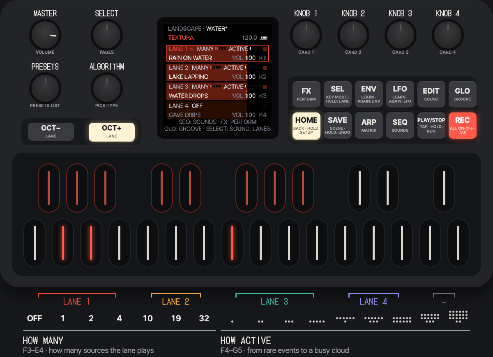

# Textura

**A texture synthesizer for the M-VAVE FM-1: rain, streams, fire, sand and stones, ice, wood, wind, storms, insects
and birds, computed live.**

No samples. Every drop, crackle, grain and chirp is calculated as it sounds, from how the real source works: a drop
hits water and rings a bubble, a log splits and spits, a pebble knocks and rolls. Each sound plays as a cloud of
these small events from the FM-1's keys: say how many and how busy, and the cloud never repeats itself.

Textura is free. If you enjoy it, you can [buy me a coffee](https://ko-fi.com/leomirabal).

<p align="center">
  
</p>

<table align="center">
  <tr>
    <td align="center" width="50%"><br><b>On the M-VAVE FM-1</b>: colour screen, four knobs, four lanes</td>
    <td align="center" width="50%"><br><b>On your computer</b>: a plugin with its own window, up to 16 lanes</td>
  </tr>
</table>

**The keys, in three steps:**

1. **Pick a lane**: tap a black key. Each group is one lane: 3 keys for lane 1, 2 for lane 2, 3 for lane 3, 2 for
   lane 4 (F#5 has none). Hold one for 0.6 s to mute that lane, again to unmute it.
2. **How many**: the seven left white keys (F3 .. E4) set how many sources the lane plays: off, 1, 2, 4, 10, 19 or 32.
3. **How active**: the nine right white keys (F4 .. G5) set how often they sound, from rare events to a busy cloud.

Four lanes play at once. **SEL** turns the keys into a pitched keyboard for the selected lane (PLAY mode); OCT− and
OCT+ then shift the octave.

**[Try it in your browser](https://leonardomirabal.github.io/textura/)** before you install: the same firmware, with
the FM-1's screen, knobs and keys, played from your computer keyboard or a MIDI keyboard.

<table align="center">
  <tr>
    <td align="center"></td>
    <td align="center"></td>
  </tr>
  <tr>
    <td align="center"><b>LANDSCAPE</b>: four lanes play at once</td>
    <td align="center"><b>SOUNDS</b>: hear a sound before you keep it</td>
  </tr>
  <tr>
    <td align="center"></td>
    <td align="center"></td>
  </tr>
  <tr>
    <td align="center"><b>PERFORM</b>: play the effects live</td>
    <td align="center"><b>Effects</b>: one card per knob</td>
  </tr>
</table>

Textura is based on [Frodhes](https://github.com/leonardoMirabal/frodhes), an electric piano computed live for the
same keyboard by the same author: it grew from Frodhes' firmware and platform. This repository is self-contained and
needs no copy of Frodhes to build or install.

## What you get

- **10 landscapes, 103 sounds**: Water, Stones & sand, Ice & glass, Fire, Wood, Wind, Storm, Insects, Songbirds and
  Wild birds. A landscape is a place to start: its sounds load onto the lanes, ready to play.
- **4 lanes**: four sounds at once, any sound on any lane. Each lane has HOW MANY (how many sources: off, 1 .. 32),
  HOW ACTIVE (rare to busy), pan, volume and mute.
- **Effects, in the order the sound goes through them**: compressor, drive (five types), filter (a high-pass into a
  low-pass, 20 Hz .. 20 kHz, together a band), grain delay (its repeats grained, up to a slowly evolving cloud) and
  reverb (room, hall, plate and infinite spaces). Last in the chain, after the reverb, comes **M/S**: MID and SIDE
  levels, WIDTH and MONO. The pages follow the same order, left to right.
- **PERFORM**: one page for playing the effects live: HIGH PASS, LOW PASS, DELAY MIX and REVERB MIX.
- **Movement**: 8 LFOs, 2 envelopes, 2 envelope followers and a 16-slot mod matrix. A groove makes the small events lean
  toward a shared, slowly drifting pulse, felt rather than heard, never a beat.
- **For playing**: PLAY mode turns the keys into a pitched keyboard for the selected lane, with scales; tap tempo or
  MIDI clock.
- **Connections**: MIDI over USB and the TRS input (each lane on its own channel), and audio over USB as well as
  the headphone jack.
- **Presets**: 110 factory presets in families, 16 slots for your own, and the 10 landscapes.
- **On your computer too**: the same engines as a plugin, [below](#on-your-computer-the-desktop-plugin).

## On your computer: the desktop plugin

Textura also runs in your music software as an instrument plugin: CLAP and VST3 on macOS, Windows and Linux, and an
Audio Unit on macOS.

- The same 103 engines, presets, landscapes and effects as the FM-1, computed by the same code. A computer has room to
  spare, so nothing is thinned: every lane plays all its events.
- **16 lanes** instead of 4, each on its own MIDI channel.
- Its own window: the **MAP** and **SPACE** views to place sources, the lanes with a drawer for the selected one, and
  an effects strip in signal order, ending with the M/S section (MID, SIDE, WIDTH, MONO).
- **Movement**: LFOs, envelopes, followers and the mod matrix, drawn in the window.
- **Engine browser** with preview: hear a sound before you keep it.
- macOS 11 or newer (universal: Apple silicon and Intel), Windows x64, Linux x86_64 and aarch64.
- **Install**: the plugin files come with each release on the [Releases](https://github.com/leonardoMirabal/textura/releases)
  page. There is no installer: copy the bundles you need into your plug-in folders and rescan in your music software.
  Each system's steps are in [the plugin manual](docs/PLUGIN-MANUAL.md#2-install).

<table align="center">
  <tr>
    <td align="center"></td>
    <td align="center"></td>
  </tr>
  <tr>
    <td align="center"><b>The window</b>: place, lanes and effects</td>
    <td align="center"><b>Engine browser</b>: hear before you keep</td>
  </tr>
</table>

Every control in full: [the plugin manual](docs/PLUGIN-MANUAL.md).

## Install on the FM-1

Installing Textura **replaces the firmware now on your FM-1** (Frodhes, for example). Your FM-1 can go back to it
at any time: see below.

1. Download the newest `.fwsc` file from the [release page](https://github.com/leonardoMirabal/textura/releases).
2. Connect the FM-1 with USB and install it in one of these ways:
   - **In the browser** (Chrome or Edge): the [emulator page](https://leonardomirabal.github.io/textura/#install)'s
     **Install on your FM-1** finds the FM-1 and installs the newest release.
   - **[The Firmware Hub](https://thefirmwarehub.com/firmware/textura/)**: install and update from the FM-1's firmware
     catalogue in the browser.
   - **FM-1 Loader**: put the `.fwsc` file in the folder it watches, and install it from there.
   - **From a terminal**, in a copy of this repository:
     ```sh
     pip install mido python-rtmidi
     python3 tools/tx_install.py textura-app-X.Y.Z.fwsc
     ```
3. If something goes wrong, switch the FM-1 off, hold **OCT−** and switch it on. This starts the USB rescue, and you
   can install again from there.

**Going back.** Install the other firmware (Frodhes, or M-VAVE's own) the same way: from The Firmware Hub, FM-1
Loader, or Frodhes' own installer. The USB rescue (OCT− held at power-on) works whatever is installed.

## Where to find Textura

| Where | What it is |
|---|---|
| [Releases](https://github.com/leonardoMirabal/textura/releases) | Every version's `.fwsc` package and its release notes |
| [The Firmware Hub](https://thefirmwarehub.com/firmware/textura/) | The FM-1's firmware catalogue: install and update from one place |
| [mutant.cloud](https://mutant.cloud/#/p/textura) | Install over USB-MIDI in the browser, no account needed |
| [fm1-editor.com](https://fm1-editor.com/firmware/#textura) | The community's firmware list with pictures |
| [altstrument](https://altstrument.org/firmware/m-vave-fm-1/textura) | The community catalogue of alternative firmware, with every Textura version |
| [Web emulator](https://leonardomirabal.github.io/textura/) | Play Textura in the browser before you install it |

Questions, bugs or ideas: [issues](https://github.com/leonardoMirabal/textura/issues). The community's own place is
[r/MVaveFM1](https://www.reddit.com/r/MVaveFM1/).

## Status

**Beta.** Pages and presets can still change between versions. The USB ID is
interim until Textura's own pid.codes ID is granted.

## Controls

The screen shows one page at a time, one card per knob (K1 .. K4); each page's footer says what ALGORITHM and the
buttons do there. Press a button again on its page for its second job. Every control in full:
[the manual](docs/MANUAL.md).

| Control | What it does |
| --- | --- |
| Black keys (groups 3, 2, 3, 2) | Select lanes 1 .. 4. Held: mute or unmute that lane |
| F3 .. E4 | HOW MANY on the selected lane: off, 1, 2, 4, 10, 19, 32 |
| F4 .. G5 | HOW ACTIVE: rare .. busy |
| K1 .. K4 | On LANDSCAPE: the four lanes' volumes. On other pages: the cards |
| ALGORITHM | On LANDSCAPE: pick a landscape (EDIT loads it). Elsewhere: named in the footer |
| HOME | LANDSCAPE. Again: back to the last page. Twice quickly: PERFORM. Held: setup |
| EDIT | The selected lane's sound and its pages |
| SEQ | The sound browser: every family's sounds, heard before you keep one |
| SELECT | The pages, in the order of the sound: the lane's sound, the mixer |
| FX | PERFORM, then the effects' pages in signal order. Held: PERFORM from anywhere |
| GLO | GROOVE, TEMPO, SCALE, MIDI, DISPLAY |
| LFO / ENV / ARP | The LFOs, the envelopes and followers, the mod matrix. LFO held + turn a card: learn |
| OCT− / OCT+ | Previous / next lane (in PLAY mode: octave) |
| SEL | Keys: LANDSCAPE or PLAY |
| REC | All lanes stop / start |
| PLAY | Tap tempo. Held: start / stop |
| PRESETS | The preset list: factory, your own, landscapes |
| SAVE | Save a preset. Held: undo the last load |

## Try it on your computer

The firmware also builds for a computer, unchanged:

- **The web panel**: the FM-1's screen, knobs and keys in the browser, playable from the computer keyboard or a MIDI
  keyboard. `make fw-web` builds it (it needs Emscripten), `make fw-web-serve` serves it at `http://localhost:8001`.
- **A fake FM-1 in the terminal**: `make fw-host` builds `build/fw/textura-host`, which plays a script of key and
  button presses and writes the sound (WAV) and screenshots.

## For developers

The sounds are written in integer C in `engines/` and auditioned on a computer before they reach the device:

| Folder | What |
| --- | --- |
| `engines/` | The sound engines, their shared cores and the effects: the same code the FM-1 runs |
| `firmware/` | The FM-1 app: lanes, pages, presets, landscapes, MIDI |
| `bench/` | Host tools: renders to WAV, checks, the CPU budget |
| `audition/` | A browser player for trying the engines |
| `web/` | The web panel |
| `tests/` | The firmware's checks and host scripts |
| `tools/` | Install, build and generator scripts |

`make setup` fetches the tools into `.local/` from their own public sources (a Python environment, JieLi's toolchain
and three files of its SDK, Emscripten, a headless Chromium, the fonts); building for the FM-1 also needs Docker.
`make fm1-app` builds the firmware (`build/fm1/textura-app.fwsc`), `make tx-test` and `make fw-test` run the checks;
the top of the `Makefile` lists every target.

## Credits

Textura is based on [Frodhes](https://github.com/leonardoMirabal/frodhes), by the same author: its firmware, platform
and tools were the starting point. That platform comes from [Dinghy](https://github.com/zvenson/dinghy) by zvenson,
which uses the platform of [Felucca](https://github.com/hugelton/Felucca) by Leo Kuroshita (Hügelton Instruments) as
[SLOOP](https://github.com/isod89/sloop-fm1) by isod89 carries it: updates, the USB rescue, USB MIDI and audio, the
panel, the screen and the settings.

Fonts, all under the SIL Open Font License 1.1: Inter Tight (the screen's text and the web page), Terminus (the
screen's small text) and DotGothic16 (the web page's labels).

## Support

Questions, bugs or ideas: [GitHub issues](https://github.com/leonardoMirabal/textura/issues).

Textura is free. If you enjoy it, you can [buy me a coffee](https://ko-fi.com/leomirabal).

## License and disclaimer

GPL-3.0 ([LICENSE](LICENSE)).

Textura is an independent open-source project, not affiliated with or endorsed by M-VAVE. It comes with no warranty:
install it at your own risk.
