<!-- SPDX-License-Identifier: GPL-3.0-only -->
# Textura: user manual

**A texture synthesizer for the M-VAVE FM-1: rain, streams, fire, sand and stones, ice, wood, wind, storms, insects
and birds, computed live.**

Textura is free firmware that turns the M-VAVE FM-1 into a synthesizer for the sounds of nature. Nothing is played
back from recordings: every drop, crackle, grain and chirp is calculated as it sounds, from how the real source
works. A drop hits water and rings a bubble. A log splits and spits. A pebble knocks and rolls.

Each sound plays as a cloud of these small events. You say how many sources there are and how busy they are, and the
cloud never repeats itself: no two drops, knocks or calls are ever quite the same. Four sounds play at once, one on
each of four lanes, and together they make a place: a beach at dusk, a forest after rain, a campfire on a cold night.
Around the lanes is an effects chain (compressor, drive, filter, grain delay, reverb), and for movement there are LFOs,
envelopes, envelope followers, a modulation matrix and a gentle groove.

Textura is an independent open-source project, not affiliated with or endorsed by M-VAVE. It comes with no warranty:
install it at your own risk. The firmware you had before can always be put back
([how](#going-back-to-another-firmware)). Textura is based on [Frodhes](https://github.com/leonardoMirabal/frodhes),
an electric piano for the same keyboard by the same author.

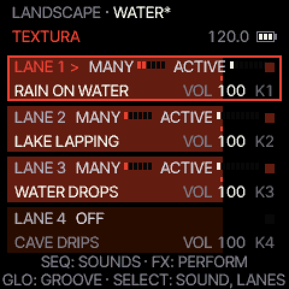

## Contents

- [What Textura can do](#what-textura-can-do)

1. [Getting started](#1-getting-started): [install](#install), [your first sound](#your-first-sound),
   [pages and knobs](#pages-and-knobs), [presets](#presets), [saving a sound](#saving-a-sound),
   [how do I ...](#how-do-i-), [updating](#updating), [going back to another firmware](#going-back-to-another-firmware)
2. [The idea: landscapes, lanes and clouds](#2-the-idea-landscapes-lanes-and-clouds)
3. [Buttons, knobs and keys](#3-buttons-knobs-and-keys)
4. [The pages](#4-the-pages): [TEXTURA](#textura-the-home-page), [SOUND](#sound), [the lane pages](#the-lane-pages-how-many-how-active-pan-on--mute),
   [PERFORM](#perform), [COMPRESSOR](#compressor), [DRIVE](#drive), [FILTER](#filter), [the grain delay](#the-grain-delay-delay-delay-motion-grains-grain-tone),
   [REVERB](#reverb-reverb-space-shimmer), [M/S](#ms), [LFO](#lfo-lfo-phase-lfo-level), [ENV and FOLLOW](#env-env-shape-and-follow),
   [MOD MATRIX](#mod-matrix), [GROOVE](#groove-and-groove-lanes), [TEMPO](#tempo), [SCALE](#scale),
   [MIDI CLOCK](#midi-clock), [MIDI IN](#midi-in), [BINAURAL](#binaural) (the OUTPUT page), [DISPLAY](#display), [the sound browser](#the-sound-browser-sounds),
   [the presets list](#the-presets-list-presets), [the save mode](#the-save-mode)
5. [The sounds](#5-the-sounds): [all 103 at a glance](#all-103-sounds-at-a-glance), then each family and its engines
6. [Presets, landscapes and scenes](#6-presets-landscapes-and-scenes): [RANDOM](#random)
7. [The effects](#7-the-effects)
8. [Movement: LFOs, envelopes, followers and the matrix](#8-movement-lfos-envelopes-followers-and-the-matrix)
9. [Groove, tempo and sync](#9-groove-tempo-and-sync)
10. [PLAY mode and scales](#10-play-mode-and-scales)
11. [Sound and volume tips](#11-sound-and-volume-tips)
12. [MIDI](#12-midi)
13. [If something goes wrong](#13-if-something-goes-wrong)
14. [Specifications](#14-specifications)

## What Textura can do

Every feature in a line or two. Each one links to its full description.

| | |
| --- | --- |
| **Landscapes** | Ten places to start from: Water, Stones & sand, Ice & glass, Fire, Wood, Wind, Storm, Insects, Songbirds and Wild birds. Pick one and its sounds come onto the lanes, ready to play. [More](#6-presets-landscapes-and-scenes) |
| **Four lanes** | Four sounds at once, any sound on any lane (the same one on two lanes too). Each lane has HOW MANY, HOW ACTIVE, a volume, a pan and a mute. [More](#2-the-idea-landscapes-lanes-and-clouds) |
| **103 sounds in 10 families** | Rain, brooks, waves, drips, stones, gravel, sand, minerals, ice, glass, fire, sparks, wood, wind, chimes, thunder, insects and twenty birds. Every one computed live, each with its own controls. [More](#5-the-sounds) |
| **HOW MANY and HOW ACTIVE** | Two rows of white keys: how many sources play (off, 1, 2, 4, 10, 19 or 32) and how often they sound (rare to busy). [More](#your-first-sound) |
| **Mute** | Hold a lane's black key: the lane goes silent but keeps playing, so it comes back at once. [More](#the-keys) |
| **The sound browser** | SEQ lists every sound by family. Turn to one and you hear it on the lane before you keep it. [More](#the-sound-browser-sounds) |
| **Presets, scenes and undo** | 110 factory presets in eleven families, 16 slots of your own, the ten landscapes as starting points. Hold SAVE to undo a load. [More](#6-presets-landscapes-and-scenes) |
| **The effects chain** | Compressor, drive (five types), filter (a high-pass into a low-pass), grain delay (from a plain echo to an evolving cloud) and reverb (eight spaces, shimmer). [More](#7-the-effects) |
| **PERFORM** | One page to play the effects live: HIGH PASS, LOW PASS, DELAY MIX and REVERB MIX. [More](#perform) |
| **8 LFOs** | Twelve shapes, from a sine to gusts and chaos, free or synced to the tempo. [More](#lfo-lfo-phase-lfo-level) |
| **2 envelopes** | Started by a key, a lane's events, an LFO or the transport; they can loop on their own. [More](#env-env-shape-and-follow) |
| **2 envelope followers** | Follow a lane's level, its event rate, the whole mix or the grain delay's grains. [More](#env-env-shape-and-follow) |
| **The mod matrix** | 16 routes from any source to any target, each with a depth and a spread over the lanes. [More](#mod-matrix) |
| **Learn** | Hold LFO or ENV and turn a card: that card is modulated. [More](#learn) |
| **The groove** | The small events lean toward one shared, slowly drifting pulse: felt rather than heard, never a beat. [More](#9-groove-tempo-and-sync) |
| **Tempo, tap and MIDI clock** | 40 to 240 BPM, tap tempo on PLAY or REC, MIDI clock in over USB or TRS, clock out over USB. [More](#9-groove-tempo-and-sync) |
| **PLAY mode and scales** | SEL turns the keys into a pitched keyboard for the selected lane, with 11 scales. [More](#10-play-mode-and-scales) |
| **MIDI per lane** | Each lane on its own channel: notes, CCs, NRPNs for every parameter, program changes for the presets. [More](#12-midi) |
| **USB audio and the headphone jack** | The FM-1 is a USB audio input for your computer as well as playing on its headphone jack. [More](#14-specifications) |
| **The emulator** | The same firmware runs in your web browser, with the FM-1's screen, knobs and keys. [More](#in-the-browser) |
| **The browser installer** | Install Textura from the emulator's page with Chrome or Edge. [More](#install) |

## 1. Getting started

### Install

You need the FM-1, a USB cable and a computer. Installing Textura **replaces the firmware now on your FM-1**
(Frodhes, for example, or M-VAVE's own). You can go back at any time ([how](#going-back-to-another-firmware)).

1. Download the newest `.fwsc` file from the [release page](https://github.com/leonardoMirabal/textura/releases).
2. Connect the FM-1 with USB.
3. Install it in one of these ways:
   - **In the browser** (Chrome or Edge): open [the emulator page](https://leonardomirabal.github.io/textura/#install)
     and use **Install on your FM-1**. It finds the FM-1 and installs the newest release. (The page goes live with
     Textura's first public release.)
   - **The Firmware Hub**, the FM-1's firmware catalogue in the browser, once Textura is listed there.
   - **FM-1 Loader**: put the `.fwsc` file in the folder it watches, and install it from there.
   - **From a terminal**, in a copy of this repository:
     ```sh
     pip install mido python-rtmidi
     python3 tools/tx_install.py textura-app-X.Y.Z.fwsc
     ```
4. Keep the FM-1 connected until the install says it is done. The FM-1 restarts into Textura.

If an install is cut off, or the FM-1 does not start, switch it off, hold **OCT−** and switch it on. That starts the
USB rescue, and you can install again from there. Your FM-1 can always be recovered this way.

On the computer, the FM-1 running Textura is called **Textura FM-1**: its MIDI port, its audio input and the USB
device list all carry that name.

### Your first sound


Textura starts with its own screen: the mark, the name and the version installed. After a moment, or as soon as you
touch a button or a knob, it opens the **TEXTURA** page, the home page. The first time, the **Water** landscape is
ready on the lanes: rain on water, lake lapping, water drops and cave drips.

1. **Press REC.** All lanes start. Press REC again to stop them all.
2. **Pick a lane**: tap a black key. The black keys come in groups of 3, 2, 3 and 2: each group is one lane.
3. **How many**: the seven left white keys (F3 to E4) set how many sources the lane plays: off, 1, 2, 4, 10, 19 or 32.
4. **How active**: the nine right white keys (F4 to G5) set how often they sound, from rare events to a busy cloud (1 to 9).
5. **MASTER** sets the volume of the headphone jack and of the USB audio.

That is all you need to play. Turn **K1 to K4** on the home page for the four lanes' volumes.
<br clear="right">

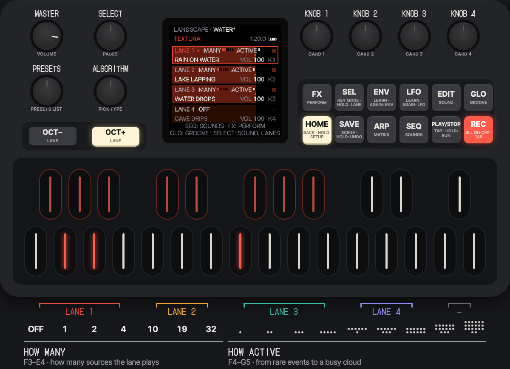

### Pages and knobs

The screen shows one page at a time, with four cards, one for each of the knobs **K1 to K4**, from top to bottom.

- Turn **SELECT** to go to the next or previous page. The page's name is at the top left; the dots at the top right
  show which of its button's pages you are on.
- The buttons jump straight to their pages: **EDIT** to the lane's sound, **FX** to the effects, **LFO**, **ENV**,
  **ARP** to the mod matrix, **GLO** to the groove, tempo and setup. Press a button again on its page for its next page.
- **HOME** always takes you back to the home page. Press it there to return to the page you came from.
- The bottom line (the footer) says what **ALGORITHM** does on this page, and where the page's button goes next.
- Turn a knob quickly to move in bigger steps; turn it slowly for fine steps.

### Presets

Turn **PRESETS**: the presets list opens. **F001 to F110** are the factory presets, in eleven families (RAIN, STORM,
COAST, RIVER & LAKE, FOREST, MEADOW, NIGHT, FIRE, STONE & SAND, ICE & WINTER, DREAMS). **U01 to U16** are your own.
**L01 to L10** are the ten landscapes. Turning only moves the cursor; press **EDIT** to load the preset under it.
**HOME** closes the list.

Loaded one by mistake? Hold **SAVE** for a moment to go back to what you had. Hold it again to return.

### Saving a sound

Your changes are not kept when you switch off. To keep a sound, save it as a user preset:

1. Press **SAVE**.
2. Turn **PRESETS** or **K1** to choose a slot, U01 to U16. **K2** picks a letter of the name, **K3** changes it.
3. Press **SAVE** again. Press **HOME** to cancel.

Settings such as the tempo, the MIDI channels and the screen colour are kept by themselves, two seconds after you
change them: let the FM-1 rest for two seconds before you switch it off.

### How do I ...

- Change the whole place: turn **ALGORITHM** on the home page and press **EDIT** ([landscapes](#landscapes)).
- Put another sound on a lane: **SEQ**, turn **ALGORITHM**, press **EDIT** ([the sound browser](#the-sound-browser-sounds)).
- Try something new: press **OCT−** and **OCT+** together; hold **SAVE** to go back ([RANDOM](#random)).
- Shape a sound: **EDIT** opens the lane's own controls ([SOUND](#sound), [the sounds](#5-the-sounds)).
- Silence one lane for a moment: hold its black key ([mute](#the-keys)).
- Make it wet or dry: **FX**, the PERFORM page ([PERFORM](#perform)).
- Make something move by itself: hold **LFO** and turn a card ([learn](#learn)).
- Play a sound in tune: **SEL** for PLAY mode, **GLO** for the scale ([section 10](#10-play-mode-and-scales)).
- Sync to a computer: MIDI clock ([section 9](#9-groove-tempo-and-sync)).
- Record into a computer: choose **Textura FM-1** as the audio input in your recording software.
- Fix a problem: [section 13](#13-if-something-goes-wrong).

### Updating

Install a new version the same way as the first one. Your settings and your user presets are kept: Textura keeps
them in a part of the flash that an update does not rewrite. The factory presets can change from one version to the
next; a user preset you saved keeps its own sound.

### Going back to another firmware

Install the other firmware (Frodhes, or M-VAVE's own) the same way: from The Firmware Hub, FM-1 Loader, or Frodhes'
own installer. The USB rescue (**OCT−** held at power-on) works whatever is installed. Textura and Frodhes keep their
data in different places, so going from one to the other and back loses nothing of either.

## 2. The idea: landscapes, lanes and clouds

**A lane is one sound.** Textura has four lanes, and they all play at once. Each lane holds one sound, and each sound
is a physical model: a little program that computes the source from how it works. The rain model drops water on a
surface; the fire model burns wood that crackles and pops; a bird model sings phrases.

**A sound is a cloud of events.** A sound is never one long tone. It is many small events: drops, knocks, cracks,
chirps, gusts. Two controls on the keys shape the cloud:

- **HOW MANY**: how many sources there are. One cricket, or a field of 32. One dripping point, or a whole cave.
- **HOW ACTIVE**: how often each source sounds, from a rare event now and then to a busy, dense cloud.

Every step on these keys sounds the same amount more: each sound has its own measured curve, so the keys feel even
on every sound.

**No two events alike.** Every drop is a little bigger or smaller, every stone strikes at another spot, every call
comes a little earlier or later. The timing is never an even beat, and the cloud never loops.

**A landscape is a place to start.** The ten landscapes are the ten families of sounds. Load one and its sounds come
onto the lanes. From there you can put any sound on any lane, from any family, and save the result as a preset.

**One page, four knobs.** The screen shows one page at a time, with four cards drawn as rows from K1 at the top to K4
at the bottom: **K1 to K4 always turn the four cards you see**. The pages, in SELECT order:

TEXTURA (home) · SOUND · HOW MANY · HOW ACTIVE · PAN · ON / MUTE · PERFORM · COMPRESSOR · COMP RELEASE · DRIVE ·
FILTER · DELAY · DELAY MOTION · GRAINS · GRAIN TONE · REVERB · REVERB SPACE · SHIMMER · M/S · LFO · LFO PHASE ·
LFO LEVEL · ENV · ENV SHAPE · MOD MATRIX · GROOVE · GROOVE LANES · TEMPO · SCALE · MIDI CLOCK · MIDI IN · OUTPUT ·
DISPLAY

The order follows the sound: first the source (the lane's SOUND), then the mixer (the lane pages), then the effects
in the order the sound goes through them, then movement, then timing and the setup.

**Reading the screen.** The top line (the header) names what plays: on the home page the preset's family and its name
(a `*` after the name means you changed something since it loaded; with no preset loaded, LANDSCAPE and the
landscape's name). On a lane's pages it shows the lane and its sound; on the LFO, ENV and MATRIX pages which one you
are editing. At the right: PLAY and the octave in PLAY mode, the tempo, and the battery (three segments; a bolt while
USB powers the FM-1).

**Reading a card.** Each card shows its knob (K1 to K4, small), the control's name and its value, large, at the
right. What is drawn behind the value tells you what kind of control it is:

- **An amount** (a time, a level, a size ...): the card fills from the left up to the value, with a bright edge.
- **A pan or a pitch**: it fills from the middle, left or right.
- **A MIX** (DRIVE, DELAY, REVERB): the fill is in two colours, split by a thin line at the middle (64). Up to the line
  the effect comes in and the dry sound stays whole; past it the dry sound fades out. The card reads **DRY** at 0,
  **50/50** at 64 and **WET** at 127, and shows only the bar in between.
- **A choice** (a type, a shape, a division): a row of short segments under the name, the chosen one lit.
- **A switch** (ON / OFF): a small square light, lit when on.
- **A modulated card** (an LFO or another source moves it): a `~` before its name, and two small ticks that move with
  its value now.

**The card you are turning** gets a thin frame and its name lights up, for about a second after you stop.

**The footer** has two lines. The first says what ALGORITHM does here and its value (or a hint for the page); the
second says where the page's button goes next, and the page's hold gesture. When you change something, the footer
shows what happened for a moment ("LANE 2 MUTED", "TEMPO 96.0"). When a preset or a landscape loads, a box names it
over the middle of the screen for a moment.

## 3. Buttons, knobs and keys


### The keys

The FM-1 has 27 keys, F3 to G5. They work in two modes: **LANDSCAPE** (the default) and **PLAY**. **SEL** switches.

In LANDSCAPE mode:

| Keys | What they do |
| --- | --- |
| **Black keys**, in groups of 3, 2, 3, 2 | Each group selects one lane, 1 to 4, and shows the home page. The last black key (F#5) does nothing. |
| A black key **held** for 0.6 s | Mutes that lane, or unmutes it. A muted lane keeps playing silently, so it comes back at once. Its card says MUTED. A preset keeps the mute. |
| **F3 to E4** (the 7 left white keys) | HOW MANY on the selected lane: off, 1, 2, 4, 10, 19, 32 |
| **F4 to G5** (the 9 right white keys) | HOW ACTIVE on the selected lane: rare to busy (1 to 9 on its card) |

The key lights tell you what plays. A lane's black keys blink with its activity while it plays (slow for rare, fast
for busy), glow steadily while it plays muted, and glow when it is selected but stopped. The white keys show the
selected lane's HOW MANY and HOW ACTIVE.

In PLAY mode the keys play the selected lane as a pitched keyboard ([section 10](#10-play-mode-and-scales)).

### Knobs

| Control | What it does |
| --- | --- |
| **K1 K2 K3 K4** | The four cards on the current page. On the home page: the four lanes' volumes. On the lane pages and GROOVE LANES: lanes 1 to 4. |
| **SELECT** | Next / previous page, from the first to the last (no wrap) |
| **ALGORITHM** | The page's own choice, named in the footer: on the home page a landscape (EDIT loads it), on SOUND the sound browser, on PERFORM and REVERB the reverb's type, on COMPRESSOR on / off, on DRIVE its type, on FILTER its slope, on the grain delay FREEZE, on LFO which LFO, on ENV which envelope or follower, on MOD MATRIX which slot, on GROOVE its type, on SCALE the scale, on MIDI IN the selected lane's channel |
| **PRESETS** | Opens the presets list and moves its cursor |
| **MASTER** | The volume of the headphone jack and the USB audio |
| **OCT− / OCT+** | Previous / next lane. On a lane's SOUND page you stay on that page for the new lane; from other pages you go to the home page. In PLAY mode: the octave down / up (two octaves each way). A press acts 60 ms late, so that both together can be told apart. **Both together**: [RANDOM](#random). |

**Fast turns.** Turn K1 to K4 quickly and the value moves in bigger steps, so one quick turn covers the whole range:
2 steps a click when the clicks come less than 40 ms apart, 4 under 20 ms, 8 under 10 ms. Turn slowly for single
steps; a turn after a rest always starts with single steps. Choices and short ranges always move one step a click.

### Buttons

| Button | Tap | Again on its page | Hold |
| --- | --- | --- | --- |
| **HOME** | The home page (TEXTURA) | Back to the page you left (the footer names it) | 0.6 s: the setup (MIDI CLOCK). Tapped twice quickly (within 0.3 s): PERFORM |
| **EDIT** | The selected lane's SOUND page | Its next SOUND page | |
| **SEQ** | The sound browser for the selected lane | Closes it | |
| **FX** | PERFORM | Each effect page in signal order: COMPRESSOR, COMP RELEASE, DRIVE, FILTER, DELAY, DELAY MOTION, GRAINS, GRAIN TONE, REVERB, REVERB SPACE, SHIMMER, M/S, then round from COMPRESSOR | 0.6 s, from any page: PERFORM at once |
| **LFO** | The LFO pages | The next LFO page | Hold LFO and turn a card: learn ([below](#learn)) |
| **ENV** | The ENV / FOLLOW pages | The next ENV page | Hold ENV and turn a card: learn |
| **ARP** | The MOD MATRIX page | | |
| **GLO** | GROOVE | GROOVE LANES, TEMPO, SCALE, MIDI CLOCK, MIDI IN, OUTPUT, DISPLAY, then round | |
| **SEL** | Keys: LANDSCAPE / PLAY mode | | The other mode while held: in PLAY mode, SEL held + a black key picks that lane |
| **SAVE** | The save mode | | 0.7 s: undo the last load, roll or sound kept (again: redo) |
| **PLAY** | Tap tempo | | 0.6 s: the transport starts / stops |
| **REC** | All lanes and the transport stop / start | Pressed again within 1.5 s: taps, the tempo from the third press | |

The lights tell you where you are: HOME, EDIT, FX, LFO, ENV, ARP and GLO light on their own pages. SEQ lights while the
sound browser is open, SAVE while the presets list is open (and blinks while a preset is saved), SEL in PLAY mode,
REC while anything plays, PLAY on the beat, and OCT− / OCT+ while there is still a lane (or an octave) to go to.

### Learn

To make a control move by itself: **hold LFO and turn any card**. The selected LFO is routed onto that card, and how
far you turn sets the depth (turn back to 0 to remove it). The footer says what was made ("LFO1 > FLT LOW PASS
-14%"), and the card shows a `~`. Hold **ENV** instead for the selected envelope or follower. Each learn fills a slot
of the [mod matrix](#mod-matrix); the footer says MATRIX FULL when all 16 are used, and NOT A MOD TARGET for a card
that cannot be modulated (a type, FREEZE, a sync ...).

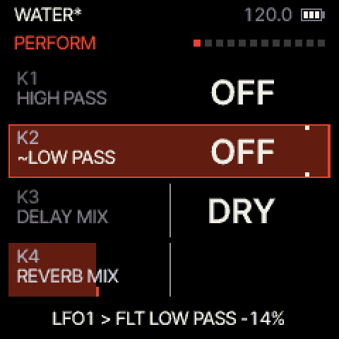

### In the browser

The [emulator](https://leonardomirabal.github.io/textura/) is the same firmware, compiled for the web browser, with
the FM-1's screen, knobs and keys. Computer keys: **A S D F G H J K L ;** play the white keys F3 to A4 and **W E R Y U O P** the black keys between, **Z** and **X** are OCT− and
OCT+, **Space** is REC, the arrows turn SELECT (left / right) and ALGORITHM (up / down). Knobs: drag or use the wheel.
A mouse cannot hold LFO while turning a knob, so there a click on LFO or ENV latches learn for 3 seconds: click, then
turn a card; click again for the LFO or ENV pages. Web MIDI works too: channel 1 plays the selected lane, channels 1 to
4 lanes 1 to 4; CC and NRPN reach the lanes on their channels and the effects on channel 5. Your presets and settings
are kept in the browser.

## 4. The pages

### TEXTURA: the home page


The home page shows the four lanes as four cards. Each card shows:

- **LANE n** (the selected lane in the accent colour, with `>` and a frame), then **MANY** (six blocks for HOW MANY)
  and **ACTIVE** (nine blocks for HOW ACTIVE), or **OFF** for a stopped lane, **MUTED** for a muted one.
- A small square at the right that blinks with the lane's activity.
- The sound's name, **VOL** and the lane's volume, and the knob that turns it (K1 to K4).
- The fill behind the card is the lane's volume (dimmer while the lane is stopped).

An empty lane says **EMPTY · SEQ: PICK A SOUND**.

| Knob | Card | What it does |
| --- | --- | --- |
| K1 to K4 | **Lane 1 to 4** | The lane's volume, 0 to 127 |
| ALGORITHM | | Picks a landscape (the footer names it). **EDIT** loads it, **HOME** keeps what plays. A pick you do not load is forgotten after 5 seconds. |

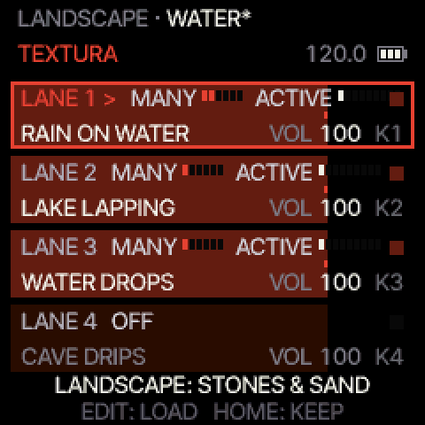

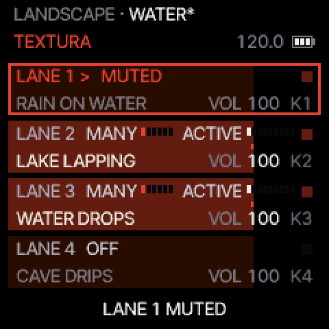

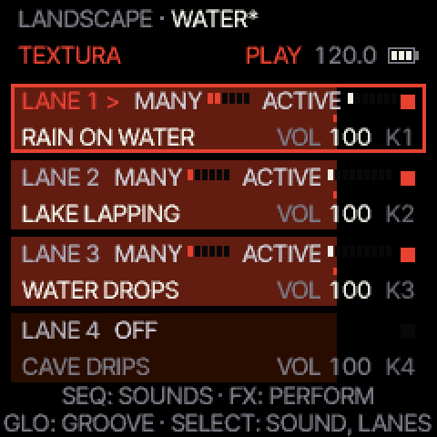

The footer explains the buttons whose printed names do not say what they do here: **SEQ: SOUNDS**, **FX: PERFORM**,
**GLO: GROOVE**, **SELECT: SOUND, LANES**; once you have been elsewhere, **HOME: BACK TO** names the page you left.

### SOUND

The selected lane's own controls: the cards of its sound, four to a page, up to eight on two pages. **EDIT** opens
the first page; press it again for the next. Every sound has its own cards ([section 5](#5-the-sounds) lists them
all). **ALGORITHM** opens the sound browser; **OCT− / OCT+** show another lane's SOUND page.


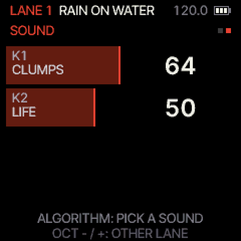

### The lane pages: HOW MANY, HOW ACTIVE, PAN, ON / MUTE

The mixer: four pages after SOUND, each with the four lanes as rows, **K1 to K4 for lanes 1 to 4**. Each row names
the lane and its sound. SELECT walks through them.

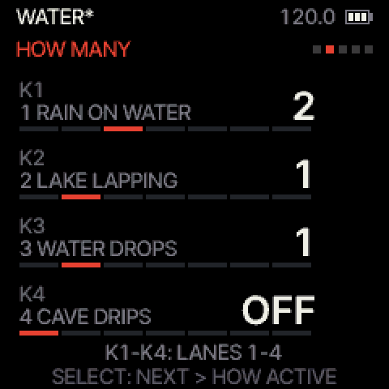

| Page | Range | What it does |
| --- | --- | --- |
| **HOW MANY** | OFF, 1, 2, 4, 10, 19, 32 | How many sources the lane plays (the left white keys) |
| **HOW ACTIVE** | OFF, 1 .. 9 | How often they sound, 1 rare to 9 busy: the step the right white keys give (F4 is 1, G5 is 9) |
| **PAN** | L64 .. C .. R63 | Where the lane sits, left to right |
| **ON / MUTE** | ON / MUTED | Turn up: on. Turn down: muted (as holding the lane's black key) |

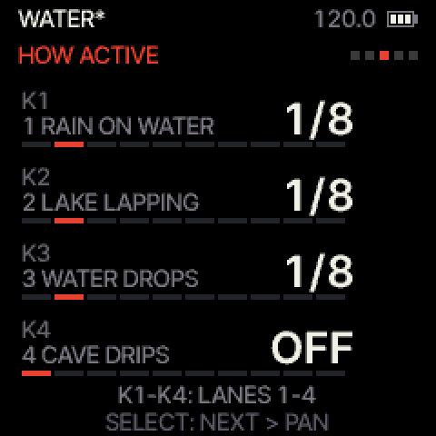

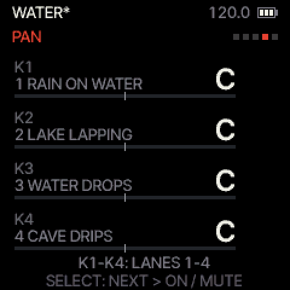

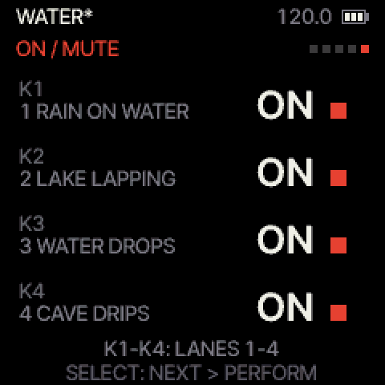

### PERFORM

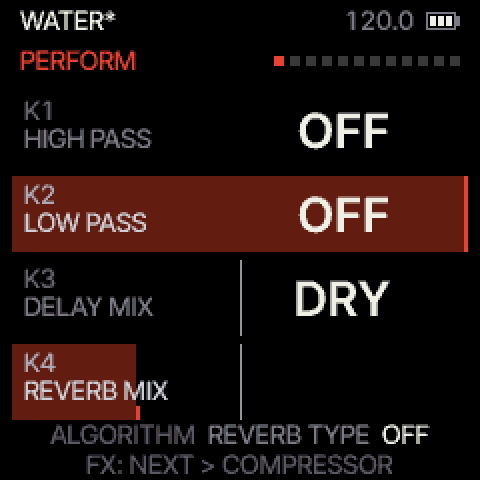

The front page for playing the effects live, in the order the sound goes through them: the filter's two edges, then
the delay's and the reverb's MIX. **FX** opens it, and so do FX held from any page and HOME tapped twice.

| Knob | Card | What it does |
| --- | --- | --- |
| K1 | **HIGH PASS** | The filter's low edge: OFF, then 20 Hz to 20 kHz. Turn up to thin the sound out. |
| K2 | **LOW PASS** | The filter's high edge: 20 Hz to 20 kHz, OFF at the top. Turn down to darken the sound. |
| K3 | **DELAY MIX** | How much grain delay: DRY (off) .. 50/50 .. WET |
| K4 | **REVERB MIX** | How much reverb: DRY .. 50/50 .. WET |
| ALGORITHM | | The reverb's TYPE |

### COMPRESSOR

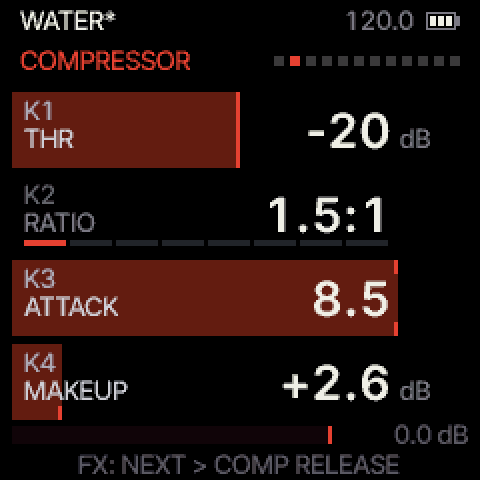

The first effect on the mix of the four lanes. It is on from the start.

| Knob | Card | What it does |
| --- | --- | --- |
| K1 | **THR** | Where it starts: 0 to −40 dB (−20 dB at first). Lower: more compression. |
| K2 | **RATIO** | How strongly it compresses: 1.5:1, 2:1, 3:1, 4:1, 6:1, 8:1, 10:1, 20:1 |
| K3 | **ATTACK** | How fast it grabs: 0.0 (0.1 ms) to 10.0 (50 ms) |
| K4 | **MAKEUP** | Gain after it: 0 to +24 dB (+2.6 dB at first) |
| ALGORITHM | | COMP: turn up for on, down for off |

While the compressor is on, the footer is a gain-reduction meter, as on a hardware compressor: its bar fills from
the right from 1 to 30 dB of reduction, a bright mark holds the peak for a second, and the number is the reduction now.

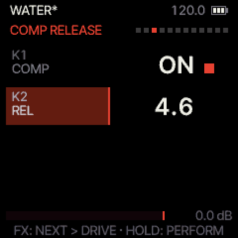

| Knob | Card | What it does |
| --- | --- | --- |
| K1 | **COMP** | On / off |
| K2 | **REL** | How fast it lets go: 0.0 (20 ms) to 10.0 (1.5 s). A dense sound holds its gain longer, so it never pumps. |

### DRIVE

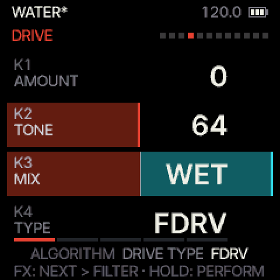

| Knob | Card | What it does |
| --- | --- | --- |
| K1 | **AMOUNT** | How much drive: 0 (off) to 127. It adds tone, not volume. |
| K2 | **TONE** | After the drive: 0 takes the highs away, 64 is flat, 127 adds up to 6 dB above about 1.8 kHz |
| K3 | **MIX** | DRY .. 50/50 .. WET (WET at first) |
| K4 | **TYPE** | **FDRV** (the classic Textura drive), **KHLON** (a clean-blend overdrive: AMOUNT its gain, TONE its treble), **TSH8** (a mid-hump overdrive), **OHCD** (a MOSFET overdrive), **BHLUE** (a two-stage soft overdrive) |
| ALGORITHM | | The TYPE |

### FILTER

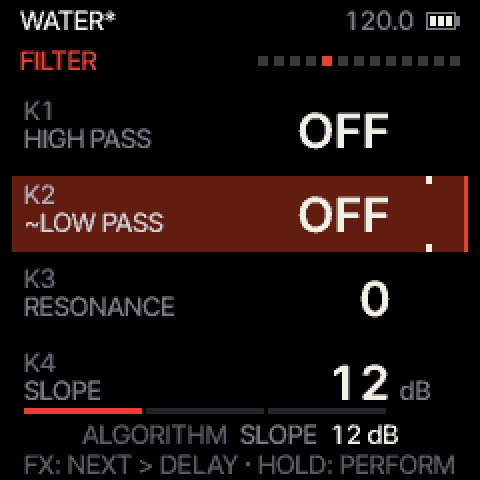

A high-pass into a low-pass, right after the drive. Each one is a real filter over its whole knob, and the card
shows its cutoff in Hz.

| Knob | Card | What it does |
| --- | --- | --- |
| K1 | **HIGH PASS** | OFF (0), then 20 Hz to 20 kHz |
| K2 | **LOW PASS** | 20 Hz to 20 kHz, then OFF (127) |
| K3 | **RESONANCE** | A peak at both edges, gentle: 0 to 127 |
| K4 | **SLOPE** | How steep the edges are: 12, 18 or 24 dB per octave |
| ALGORITHM | | The SLOPE |

Bring HIGH PASS and LOW PASS together for a band (with RESONANCE up, a peaky bell); cross them and the sound closes.

### The grain delay: DELAY, DELAY MOTION, GRAINS, GRAIN TONE

The delay comes after the filter, and its echoes can be cut into grains: from a plain echo to a slowly evolving
cloud. Four pages. **ALGORITHM** on all four is **FREEZE**: up holds the last 2.55 seconds going round, while the
grains keep playing them; down lets go.

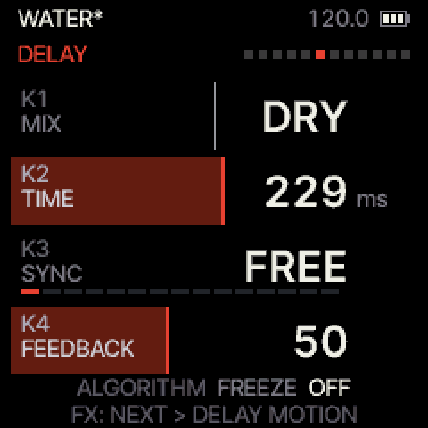

| Knob | Card | What it does |
| --- | --- | --- |
| K1 | **MIX** | DRY (the delay off) .. 50/50 .. WET |
| K2 | **TIME** | The echo's time: 20 ms to 2.00 s |
| K3 | **SYNC** | FREE, or a division of the beat: 1/32, 1/16T, 1/16, 1/8T, 1/16D, 1/8, 1/4T, 1/8D, 1/4, 1/4D, 1/2, 1 BAR, 2 BAR, 4 BAR. A division longer than 2 s is halved until it fits (TIME then shows `~`). |
| K4 | **FEEDBACK** | How long the repeats go on, each grained again: none .. endless (110) .. a held wall |

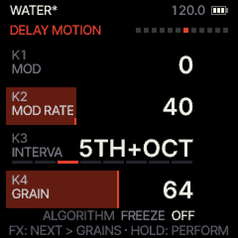

| Knob | Card | What it does |
| --- | --- | --- |
| K1 | **MOD** | The motion: 0 is the plain delay; turned up, the time drifts in a slow wow, each grain gets its own size, start, direction and place, and more grains leave unison for INTERVALS |
| K2 | **MOD RATE** | How fast the motion moves, always at random: about 8 s to 0.1 s between its turns |
| K3 | **INTERVALS** | The pitches MOD gives the grains: NONE, OCTAVES, 5TH+OCT, 4TH+5TH, MAJOR, MINOR, ALL, UP (repeats that climb) |
| K4 | **GRAIN** | The clean echo (0) .. the grains (127) |

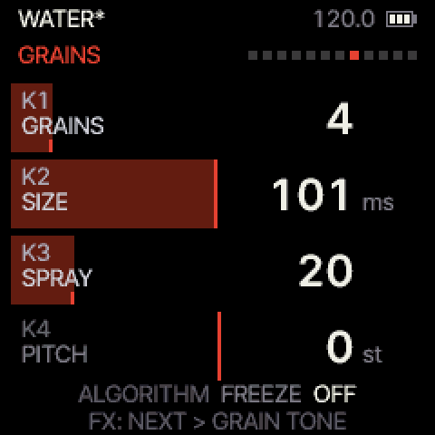

| Knob | Card | What it does |
| --- | --- | --- |
| K1 | **GRAINS** | Grain voices on the repeats: 1 to 30 (fewer when the processor is busy) |
| K2 | **SIZE** | Each grain's length: 20 to 500 ms |
| K3 | **SPRAY** | Where each grain starts: at TIME .. up to 0.5 s later, at random |
| K4 | **PITCH** | The grains' pitch: −12 to +12 semitones |

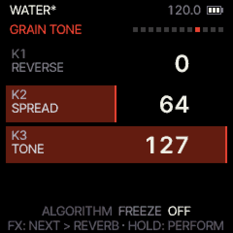

| Knob | Card | What it does |
| --- | --- | --- |
| K1 | **REVERSE** | The chance a grain plays backwards: never .. always |
| K2 | **SPREAD** | Each grain's place: all in the middle .. anywhere left to right |
| K3 | **TONE** | The repeats' top: dark (400 Hz) .. 16 kHz .. open (127) |

### REVERB, REVERB SPACE, SHIMMER

It reverberates what the grain delay gives it, so the echoes ring in the space too.

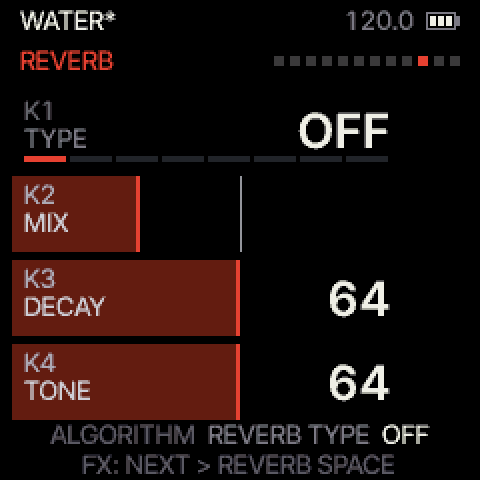

| Knob | Card | What it does |
| --- | --- | --- |
| K1 | **TYPE** | **OFF** (the tail rings out), **ROOM** (a small body and a short tail), **HALL**, **INFINITE** (DECAY 120 to 126 sustains, 127 freezes), **DARK** (the infinite space, darker and still: a deep frozen bed), **DRIFT** (the infinite space, slowly bending in pitch), **SWELL** (the infinite space, held down while the sound plays, swelling in after), **PLATE** (bright and dense) |
| K2 | **MIX** | DRY .. 50/50 .. WET |
| K3 | **DECAY** | HALL: half to twice the time; the infinite types: 4 to 60 s, then sustain and freeze; PLATE: 0.8 to 6 s; ROOM: the walls (127: hard and long) |
| K4 | **TONE** | The tail's top: dark .. as designed (64) .. bright. ROOM: the body's resonance. |
| ALGORITHM | | The TYPE |

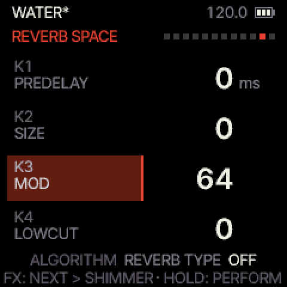

| Knob | Card | What it does |
| --- | --- | --- |
| K1 | **PREDELAY** | Before the reverb: 0 to 80 ms |
| K2 | **SIZE** | 0 = automatic (HALL and PLATE from MIX); 1 to 127 the size (ROOM: 0.2 to 3 m) |
| K3 | **MOD** | The tail's slow wander: none .. twice the normal (64) |
| K4 | **LOWCUT** | A high-pass on what goes into the reverb: OFF, 20 to 800 Hz |

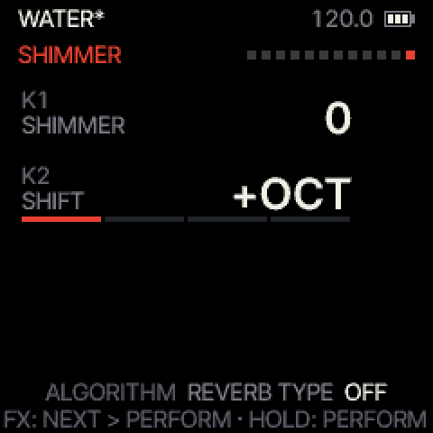

| Knob | Card | What it does |
| --- | --- | --- |
| K1 | **SHIMMER** | The tail shifted up, heard beside the tail and fed back into it: none .. a clear, rising halo at the top, growing evenly all the way |
| K2 | **SHIFT** | The shimmer's interval: +OCT, +5TH, +OCT+5, −OCT |

### M/S

The last effect, after the reverb: the mix split into its middle (what both sides share) and its sides (what differs
left to right), each with its own level, and WIDTH on the sides after that. At 0 dB, 100 % and MONO off it leaves the
sound exactly as it is. MID, SIDE and WIDTH are three separate controls: turning one never moves another. Every change
glides, so nothing clicks. The limiter comes after it, so a boost never clips.

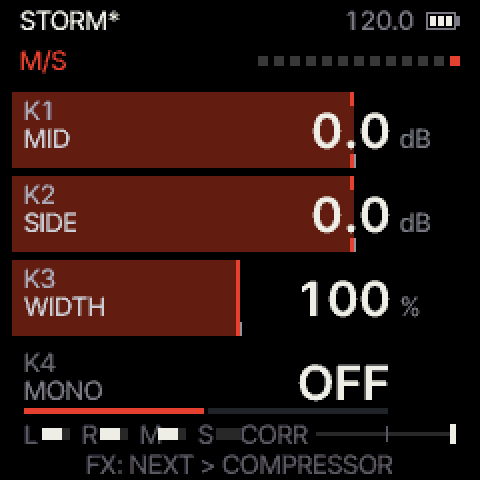

| Knob | Card | What it does |
| --- | --- | --- |
| K1 | **MID** | The middle's level: −INF, −57 to +6 dB in 0.5 dB steps; 0 dB (the mark on the card) leaves it as it is |
| K2 | **SIDE** | The sides' level, the same range: lower for a narrower mix, higher for a wider one. Turning it puts MONO off |
| K3 | **WIDTH** | 0 to 200 % in 2 % steps, on the sides after SIDE: 0 is mono, 100 % (the mark) as it is, 200 % the sides twice as loud (+6 dB). Turning it puts MONO off. A preset or scene saved before WIDTH was its own loads at 100 % |
| K4 | **MONO** | OFF / ON: the sides off, to hear the mix in mono. SIDE keeps its value; the cards read −INF and 0 while it is on |

The bottom line shows four meters, **L**, **R**, **M** and **S** (their peaks), and **CORR**, the correlation: the
mark at the right end (+1) is mono, in the middle (0) the sides as loud as the middle, and in the accent colour left
of the middle the sides louder than the middle (out of phase: it thins out in mono).

### LFO, LFO PHASE, LFO LEVEL

Eight LFOs, three pages each. **ALGORITHM** picks which LFO (1 to 8); the header shows it and its shape ("LFO 1
SMOOTH"). The LFOs do nothing until a route uses them: hold LFO and turn a card ([learn](#learn)), or set a route on
the [MOD MATRIX](#mod-matrix).

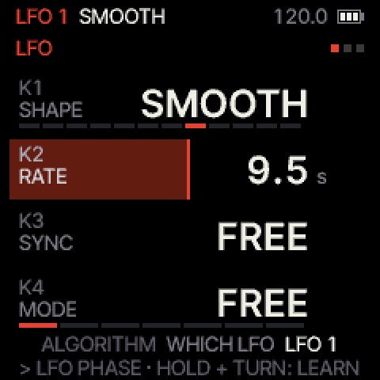

| Knob | Card | What it does |
| --- | --- | --- |
| K1 | **SHAPE** | SINE, TRI, SAW UP, SAW DN, SQUARE, PULSE, S&H (steps at random), SMOOTH (random, eased), DRIFT (a random walk), GUSTS (random swells), CHAOS, STEPS |
| K2 | **RATE** | Free: from 0.0005 Hz (one cycle in 33 minutes) to 20 Hz, shown as the time of one cycle |
| K3 | **SYNC** | FREE, or a division of the beat: 1/32T to 64 BAR |
| K4 | **MODE** | FREE (runs on its own), KEY (a note restarts it), LANE 1 to 4 (that lane's start or notes restart it), ONE-SHOT (one cycle, then it waits) |

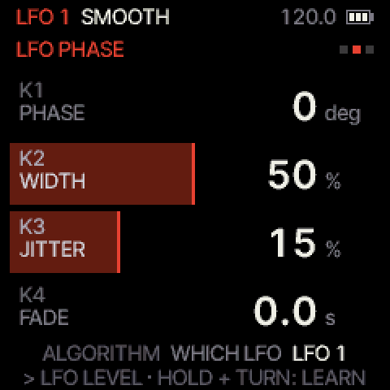

| Knob | Card | What it does |
| --- | --- | --- |
| K1 | **PHASE** | Where a restart begins: 0 to 360 degrees |
| K2 | **WIDTH** | The shape's skew: the pulse's width, the triangle's lean, how SMOOTH eases, how GUSTS rise, how often STEPS step |
| K3 | **JITTER** | Free LFOs: each cycle's length varies at random, up to ±50 % (15 % at first) |
| K4 | **FADE** | After a restart, the depth rises over 0 to 10 s |

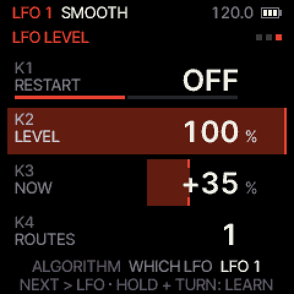

| Knob | Card | What it does |
| --- | --- | --- |
| K1 | **RESTART** | OFF, or START: the transport's start restarts it |
| K2 | **LEVEL** | The LFO's depth, scaling all its routes: 0 to 100 % |
| K3 | **NOW** | Its value now (read only) |
| K4 | **ROUTES** | How many matrix slots use it (read only) |

### ENV, ENV SHAPE and FOLLOW

Two envelopes and two envelope followers. **ALGORITHM** picks which: ENV 1, ENV 2, FOLLOW 1, FOLLOW 2. An envelope has
two pages, a follower one. A bar in the footer shows its value now.

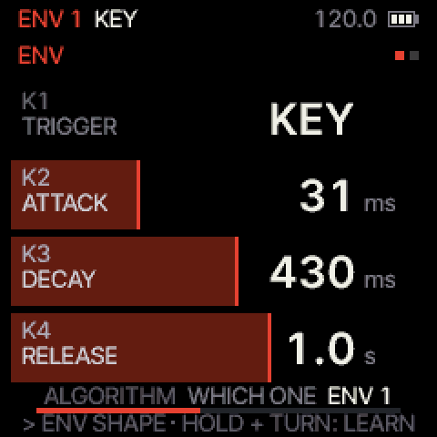

| Knob | Card | What it does |
| --- | --- | --- |
| K1 | **TRIGGER** | What starts it: KEY (a note on any lane), LANE 1 to 4 (that lane's notes), EVENTS 1 to 4 (that lane's events), RANDOM, LFO 1 to 8 (rising through the middle), START (the transport) |
| K2 | **ATTACK** | 1 ms to 60 s |
| K3 | **DECAY** | 1 ms to 60 s |
| K4 | **RELEASE** | 1 ms to 60 s |

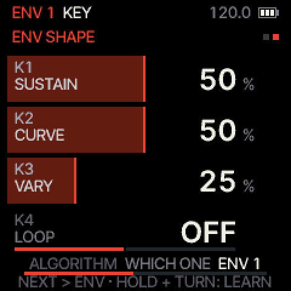

| Knob | Card | What it does |
| --- | --- | --- |
| K1 | **SUSTAIN** | The level held while the notes are held (KEY and LANE triggers) |
| K2 | **CURVE** | Linear .. eased (a fast start) |
| K3 | **VARY** | Each start: its times ±50 % and its peak down to half at most, at random |
| K4 | **LOOP** | OFF, or ON: it starts again by itself after a random rest |

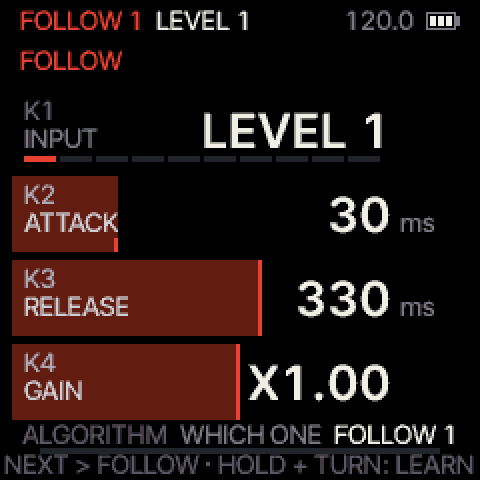

| Knob | Card | What it does |
| --- | --- | --- |
| K1 | **INPUT** | What it follows: LEVEL 1 to 4 (a lane's level), RATE 1 to 4 (a lane's event rate), MIX (the whole mix's level), GRAIN (the grain delay's grains sounding) |
| K2 | **ATTACK** | How fast it rises: 5 ms to 10 s |
| K3 | **RELEASE** | How fast it falls: 5 ms to 10 s |
| K4 | **GAIN** | x0 to x2 (x1.00 at the middle) |

### MOD MATRIX

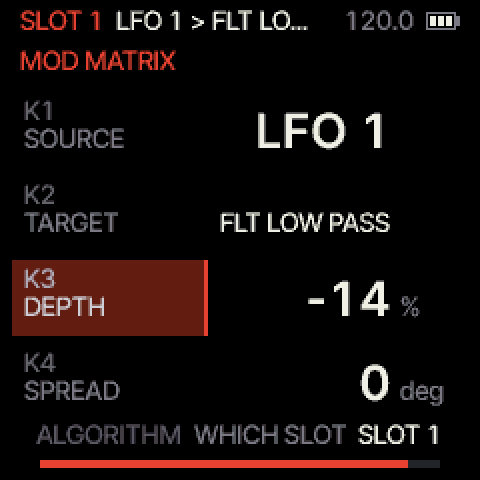

Sixteen routes ("slots"), each from a source to a target. **ARP** opens the page; **ALGORITHM** picks the slot. The
header shows the slot and its route ("SLOT 1 LFO 1 > FLT LOW ..."); a bar in the footer shows the target's value now.

| Knob | Card | What it does |
| --- | --- | --- |
| K1 | **SOURCE** | NONE, LFO 1 to 8, VELOCITY (the last note's), MOD WHEEL (CC 1), AFTERTCH (aftertouch), CC (the MOD CC, CC 2 at first), ACTIVE (the lane's HOW ACTIVE), RANDOM (a new value at each note), CONSTANT, ENV 1 and 2, FOLLOW 1 and 2 |
| K2 | **TARGET** | A lane's (1 to 4, or ALL LANES) LEVEL, PAN, HOW MANY, HOW ACTIVE or one of its sound's cards; the grain delay's and the reverb's amounts; an LFO's RATE or LEVEL; the DRIVE's AMOUNT, TONE or MIX; the FILTER's HIGH PASS or LOW PASS; the delay's MOD; the GROOVE's AMOUNT; the M/S's MID or SIDE |
| K3 | **DEPTH** | −100 to +100 % |
| K4 | **SPREAD** | With ALL LANES: each lane reads the source a little later than the one before, up to 90 degrees of its cycle |

Types, FREEZE, SYNC, SHIFT and the like cannot be targets.

**Learning the MOD CC.** The CC source follows one controller, the MOD CC (CC 2 at first). To pick another, show a
slot whose SOURCE is CC on this page (turn K1 to CC, or pick such a slot with ALGORITHM): the footer says
**SEND A CC: MOD CC**. Move the knob or fader on your controller: the first CC that Textura does not already use on that channel
(see the MIDI chapter's tables; CC 1 is the MOD WHEEL, and CC 120 and above are never learned) becomes the MOD CC. The screen says "MOD CC 11", the
SOURCE card shows "CC 11", and every slot with the CC source follows it. The learn then stops; to learn again, pick
another slot and come back, or turn SOURCE away from CC and back. A preset keeps its MOD CC.

### GROOVE and GROOVE LANES

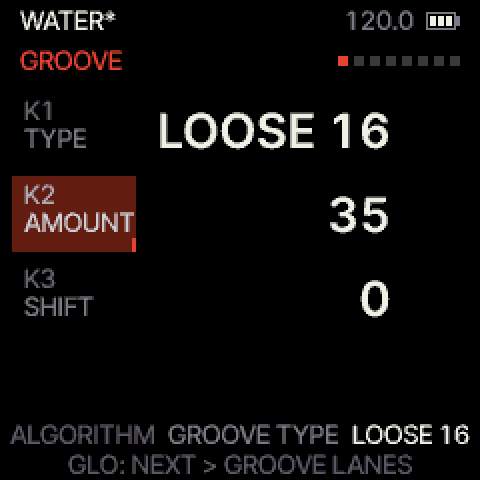

The groove makes the landscape's small events lean toward one shared, slowly drifting pulse: felt rather than heard,
never a beat ([section 9](#9-groove-tempo-and-sync)). **GLO** opens it.

| Knob | Card | What it does |
| --- | --- | --- |
| K1 | **TYPE** | The pulse: polyrhythms first (3:4, 3:4:5 ...), then swings, claves and other rhythms, then even spreads E(k,n): 244 in all |
| K2 | **AMOUNT** | How much the events lean: 0 (off) to 127 (35 at first: light) |
| K3 | **SHIFT** | Moves the pulse in time: 0 to 31 |
| ALGORITHM | | The TYPE |

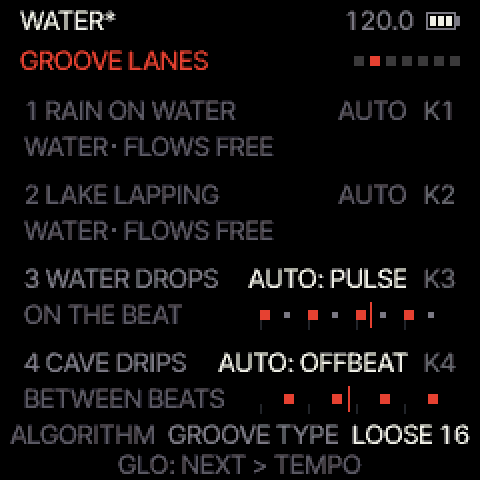

GROOVE LANES (GLO again) shows each lane's role, **K1 to K4 for lanes 1 to 4**: **FREE** (no pulse), **AUTO** (chosen
by its sound: "AUTO: PULSE"), **PULSE** (on the beat), **OFFBEAT** (between beats), **FILL** (in the gaps), or its own
cycle of 2 to 9 pulses over the span ("5 PER 4 BEATS": a polyrhythm). Under each lane, what the role means and its
pulse, drawn as dots (the strong ones larger) with a line that sweeps along with the beat. A sound the groove leaves
alone (water, wind and the other flows) says **FLOWS FREE**.

### TEMPO

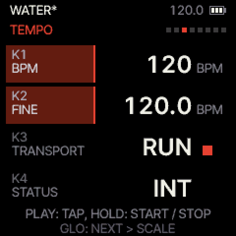

| Knob | Card | What it does |
| --- | --- | --- |
| K1 | **BPM** | 40 to 240 BPM |
| K2 | **FINE** | The tempo in tenths: 40.0 to 240.0 BPM |
| K3 | **TRANSPORT** | RUN / STOP |
| K4 | **STATUS** | What leads the tempo (read only): INT, MASTER, WAITING (FOLLOW with no clock), or USB / TRS and the clock's tempo |

The footer reminds you: **PLAY** taps the tempo, held it starts / stops the transport.

### SCALE

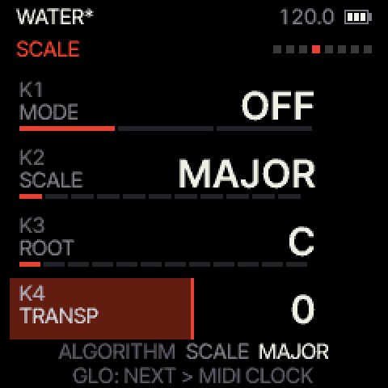

The notes of the keys in PLAY mode ([section 10](#10-play-mode-and-scales)).

| Knob | Card | What it does |
| --- | --- | --- |
| K1 | **MODE** | **OFF** (the keys as played), **SNAP** (a key out of the scale plays the scale's nearest note), **DEGREE** (the white keys walk the scale from C4, the black keys are silent) |
| K2 | **SCALE** | MAJOR, MINOR, DORIAN, MIXO, LYDIAN, PHRYG, HARMON, MELODIC, PENTA, MPENTA, BLUES |
| K3 | **ROOT** | C to B |
| K4 | **TRANSP** | −24 to +24 semitones |
| ALGORITHM | | The SCALE |

### MIDI CLOCK

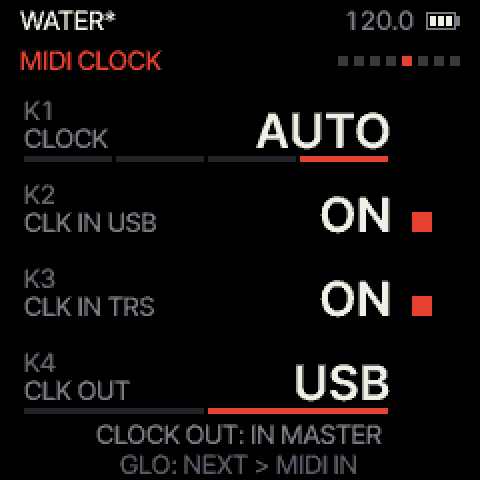

The setup page: **HOME held** opens it, and GLO steps to it.

| Knob | Card | What it does |
| --- | --- | --- |
| K1 | **CLOCK** | **INT** (the BPM and the taps; a clock coming in is ignored), **MASTER** (as INT, and the clock goes out over USB when CLK OUT is USB), **FOLLOW** (the incoming clock only; without one the transport stops), **AUTO** (the incoming clock while one comes, else the BPM: the default) |
| K2 | **CLK IN USB** | Listen to a clock on USB: ON / OFF |
| K3 | **CLK IN TRS** | Listen to a clock on the TRS MIDI input: ON / OFF |
| K4 | **CLK OUT** | OFF / USB: in MASTER, the clock goes out over USB |

### MIDI IN

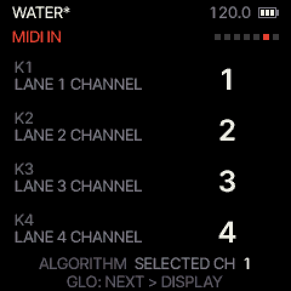

| Knob | Card | What it does |
| --- | --- | --- |
| K1 to K4 | **LANE 1 to 4 CHANNEL** | The channel each lane listens on, for its notes and its CCs: OFF, 1 to 16 (lane n on channel n at first; two lanes on one channel both listen) |
| ALGORITHM | **SELECTED CH** | The channel whose notes play the selected lane, whichever it is: OFF, 1 to 16 (1 at first) |

### BINAURAL

The **OUTPUT** page (GLO, after MIDI IN): how you listen. On headphones Textura places each sound binaurally, as your
ears place a real one: a lane panned to one side reaches the far ear a little later and a little darker, the head's
shadow, so the lanes stand apart around your head instead of inside it. It changes only how the lanes are placed, never
the sounds. The three settings are kept by themselves: a preset, a scene or a roll of the dice never changes them,
whatever EFFECTS ON LOAD says.

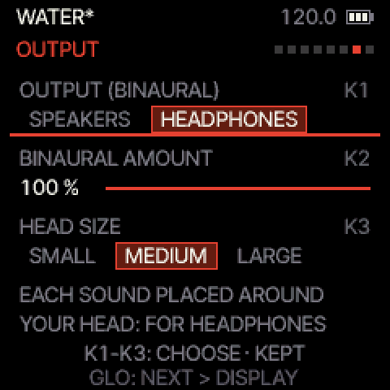

| Knob | Card | What it does |
| --- | --- | --- |
| K1 | **OUTPUT (BINAURAL)** | **SPEAKERS** (the default on the FM-1): each lane placed by its level in the left and right channels alone, for speakers and mixers. **HEADPHONES**: each lane placed binaurally, for headphones. At the centre both are the same. |
| K2 | **BINAURAL AMOUNT** | How much of the binaural placing: 0 to 100 % (100 % at first). Less brings the far ear's delay, its shadow and the level difference back toward plain level panning; at 0 % HEADPHONES sounds exactly as SPEAKERS. |
| K3 | **HEAD SIZE** | **SMALL**, **MEDIUM** (at first) or **LARGE**: the size of the head the placing is worked out for. A larger head delays the far ear more (up to 0.57, 0.66 or 0.75 ms at a hard pan) and shadows it from lower notes. Pick the one that sounds most natural to you. |

On SPEAKERS, K2 and K3 are dim: they act only on HEADPHONES, but you can still set them, ready for the next switch.
The line under the cards says what the output does.

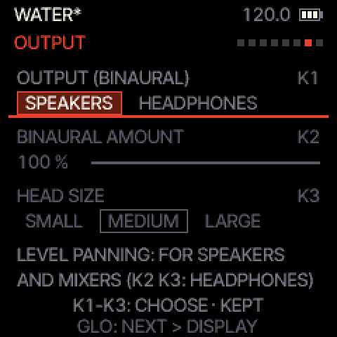

HEADPHONES takes a little of the sources' CPU (about 45 µs a block for each lane playing; AMOUNT 0 % none): with four
busy lanes the CPU governor may thin a crowded cloud slightly sooner.

### DISPLAY

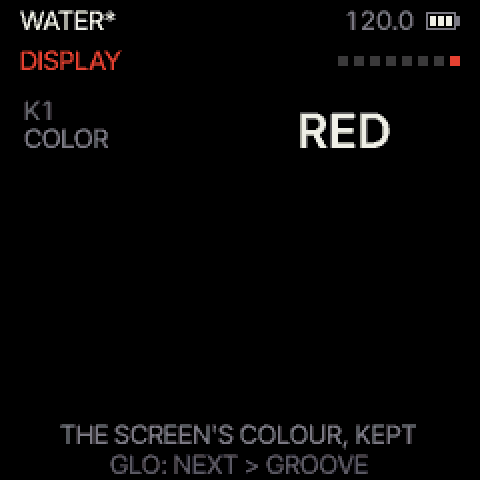

| Knob | Card | What it does |
| --- | --- | --- |
| K1 | **COLOR** | The screen's accent colour: RED (the default), AMBER, then 25 pastel colours around the colour wheel, from PEACH through PINK, VIOLET, BLUE, CYAN and GREEN to MANGO. Kept by itself. |

### The sound browser (SOUNDS)

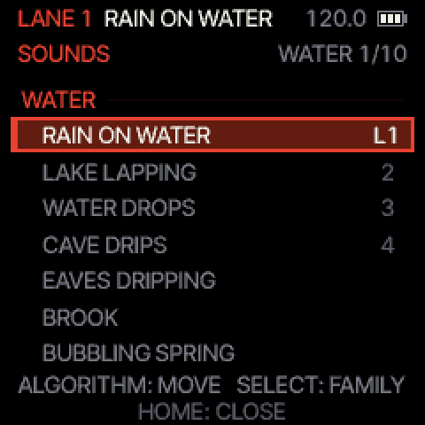

**SEQ** (or ALGORITHM on a SOUND page) opens the sound browser for the selected lane, over the page you are on. It is
one list: each family's name, then its sounds. The lane's sound is drawn solid with its lane at the right (`L1`);
other lanes playing a sound show their numbers beside it.

- **ALGORITHM** or **K1** moves the cursor; past a family's last sound comes the next family's first.
- **SELECT** jumps to the next or previous family.
- While the lane plays, the sound under the cursor is heard on the lane 0.4 s after you stop turning: the footer says
  **HEARING** and the title **SOUNDS: BROWSING**. The kept sound stays marked.
- **EDIT** keeps the sound under the cursor; the list stays open.
- **HOME**, **SEQ** or any other button closes the list, with the kept sound back on the lane.
- **OCT− / OCT+** or a black key: another lane.
- Hold **SAVE** to undo the last sound kept.

Any sound can go on any lane, from any family, and the same sound on two lanes too.

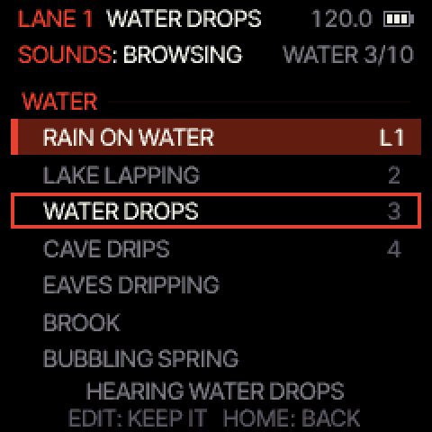

### The presets list (PRESETS)

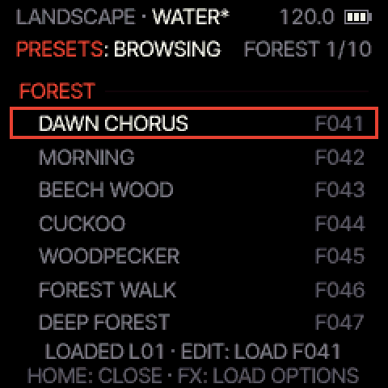

**PRESETS** opens the list, on the preset that plays. It is one list: the eleven factory families (F001 to F110), then
USER (your presets, once you have saved one), then LANDSCAPES (L01 to L10).

- **PRESETS**, **ALGORITHM** or **K1** moves the cursor. Nothing loads while you turn.
- **SELECT** jumps a family.
- **EDIT** loads the preset under the cursor; the list stays open. The loaded one is drawn solid, the cursor as an
  outline; the title says **PRESETS: BROWSING** while the cursor is away from it.
- **FX** shows the LOAD OPTIONS (FX again: back to the list).
- **HOME** or any other button closes the list; what plays stays. **SEQ** opens the sound browser instead.

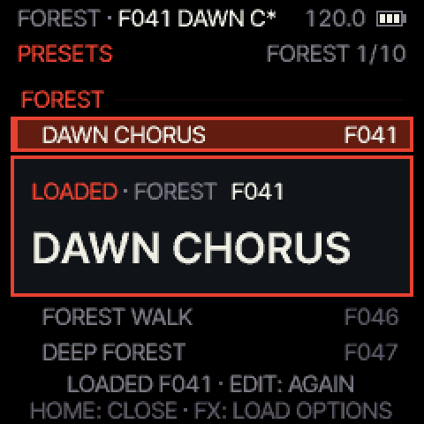

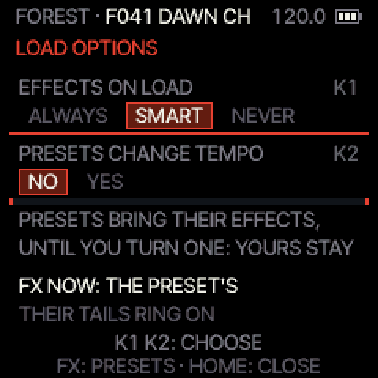

| Knob | Card | What it does |
| --- | --- | --- |
| K1 | **EFFECTS ON LOAD** | **NEVER** (the default, for playing live): your effects stay, whatever you load. **SMART**: a preset brings its effects, until you turn one; then yours stay ("FX: YOURS" on the home page). **ALWAYS**: every preset brings its own effects. A unit updated from 0.3.0 or before that was on SMART moves to NEVER once. |
| K2 | **PRESETS CHANGE TEMPO** | **NO** (the default): the tempo stays. **YES**: a preset brings the tempo it was saved with. |

Effects that change on a load glide to their new values, and the delay's and the reverb's tails ring on.

### The save mode

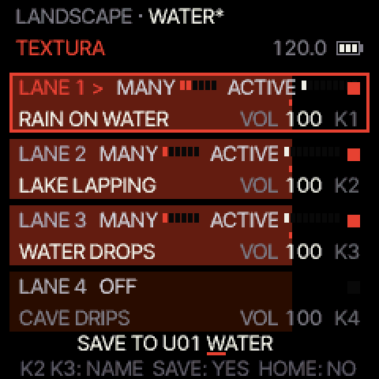

**SAVE** opens it on the first free slot, with a new name of two words, such as **SALT FIELD** or **MOSSY DUSK**.
The footer says **SAVE TO U01** and the name. A new name is never the name of one of your presets, so a save makes a
new preset and leaves the others as they are.

| Control | What it does |
| --- | --- |
| **PRESETS** or **K1** | The slot: U01 to U16 |
| **K2** | Which letter of the name (it is underlined) |
| **K3** | The letter |
| **K4** | Another name: each turn makes a new one |
| **SAVE** | Saves |
| **HOME** | Cancels |

To replace a preset, move to its slot. The name changes to that preset's name, and the footer says
**REPLACES U03** and its name, in the screen's accent colour (red by default). **SAVE** then writes over it. Move on
to a free slot and a new name comes back. Letters you set with K2 and K3 stay when you move.

When all 16 slots are used, SAVE opens on the preset you loaded (or U01 if you loaded a factory preset), and the
footer says **ALL 16 USED: REPLACES U01**. The factory presets are never written over.

## 5. The sounds

Textura has **103 sounds** in **10 families**. Each family is also a landscape. Any sound can go on any lane ([the sound browser](#the-sound-browser-sounds)), and every sound has its own cards on its [SOUND](#sound) pages: up to eight, four on a page. The cards are the source's own physical controls: a drop's size, a fire's moisture, a bird's excitement.

Behind the sounds are **engines**: one engine can make several sounds, each with its own setting (a campfire and a bonfire are the same fire engine, at a different size). Sounds that share an engine share their cards, so this chapter describes each engine once, with a picture of its SOUND page.

**Cards that most sounds share:**

| Card | What it does |
| --- | --- |
| **DIST** | How far away: close (low) .. far (high). Far is quieter and darker. |
| **CLUMPS** | The timing: in bursts and quiet spells (low) .. spread out at random (high) |
| **LIFE** | How much the sound changes by itself over time: still .. alive (swells and lulls) |
| **DEPTH** | How spread out in distance they are: all at DIST .. near and far at once |
| **SPREAD** | How different their sizes are: all alike .. very mixed |

Each card shows 0 to 127. At 64 most cards give the sound's own setting, and DIST at 63 its own distance (about 3 m). HOW MANY and HOW ACTIVE are on the keys, so no card takes them.

In PLAY mode a key sets the size or pitch of the events, so a sound keeps its character: lower keys play bigger drops, stones or birds ([section 10](#10-play-mode-and-scales)).

### All 103 sounds at a glance

| Family | Sounds | Engines |
| --- | --- | --- |
| **[Water](#51-water)** (10) | rain on water, lake lapping, water drops, cave drips, eaves dripping, brook, bubbling spring, waterfall, waves on sand, waves on shingle | Rain on water, Waves, Water drops, Drips, Streams |
| **[Stones & sand](#52-stones--sand)** (10) | stones, rockfall, ringing rocks, gravel, marbles, sand, singing dune, minerals, stone friction, stone clinks | Stones, Rockfall, Ringing rocks, Gravel, Marbles, Sand, Singing dune, Minerals, Stone friction, Stone clinks |
| **[Ice & glass](#53-ice--glass)** (10) | icicles, ice in a glass, frost tinkling, snow underfoot, lake ice, frozen lake booming, thin ice underfoot, glass pane, bottles, shards settling | Ice, Lake ice, Glass |
| **[Fire](#54-fire)** (10) | campfire, bonfire, fireplace, embers, kindling, pine fire, leaves, paper, torch, flame, sparks | Fire, Flame, Sparks |
| **[Wood](#55-wood)** (9) | spruce, pine, maple, oak, green branch, tree trunk, twigs underfoot, rain stick, crumpled paper | Wood, Rain stick, Crumpled paper |
| **[Wind](#56-wind)** (11) | wind, breeze in grass, wind in pines, leafy trees, open moor, sea wind, ridge gale, gusty autumn, winter storm, desert wind, wind chimes | Wind, Wind chimes |
| **[Storm](#57-storm)** (12) | rain on water, rain on a roof, storm, thunder, ridge gale, winter storm, hail on a roof, hail on a car, hail in leaves, sleet on a window, thunder sheet, spring echo | Rain on water, Rain and hail on surfaces, Storm, Thunder, Wind, Thunder sheet, Spring echo |
| **[Insects](#58-insects)** (11) | field cricket, tree cricket, mole cricket, cicada, small cicada, cicada chorus, katydid, grasshopper, honeybee, bumblebee, cicada up close | Crickets, Cicadas, Katydids and grasshoppers, Bees, Cicada up close |
| **[Songbirds](#59-songbirds)** (10) | songbird, blackbird, song thrush, nightingale, robin, wren, hermit thrush, skylark, wood thrush, reed warbler | Songbirds |
| **[Wild birds](#510-wild-birds)** (10) | chirper, crow, gull, curlew, oystercatcher, cuckoo, woodpecker, wood pigeon, nightjar, bittern | Wild birds |

### 5.1 Water

Rain falling on water, drops, drips, brooks, springs, a waterfall, waves and a lake's lapping. Every drop rings a small air bubble under the surface: that ringing is what makes water sound like water.

| Sound | Engine |
| --- | --- |
| rain on water | Rain on water |
| lake lapping | Waves |
| water drops | Water drops |
| cave drips | Drips |
| eaves dripping | Drips |
| brook | Streams |
| bubbling spring | Streams |
| waterfall | Streams |
| waves on sand | Waves |
| waves on shingle | Waves |

#### Rain on water

Raindrops falling on a pond or a lake. Each drop clicks as it hits and can leave a ringing bubble under the surface. The rain comes in showers and lulls.

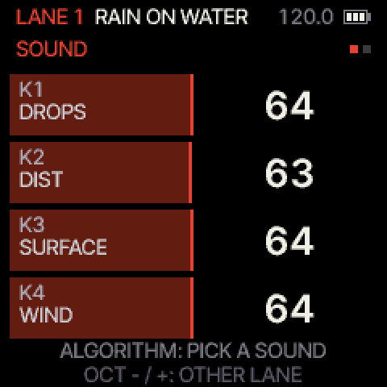

| Card | What it does |
| --- | --- |
| **DROPS** | The drops' size: small drops .. big drops |
| **DIST** | How far away: close (low) .. far (high). Far is quieter and darker. |
| **SURFACE** | How deep the bubbles under the surface ring |
| **WIND** | The clicks of the drops hitting the surface; above the middle the rain blows in the wind |
| **CLUMPS** | The timing: in bursts and quiet spells (low) .. spread out at random (high) |
| **LIFE** | How much the sound changes by itself over time: still .. alive (swells and lulls) |

#### Waves

Waves breaking on a beach: the crash, the long wash up the shore and the backwash draining through sand or shingle. On a lake, short waves lap against the shore or a hull.

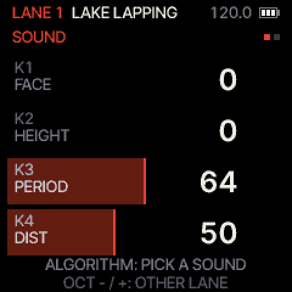

Sounds: lake lapping, waves on sand, waves on shingle.

| Card | What it does |
| --- | --- |
| **FACE** | What the lake's waves meet: a sloping shore (soft washes) .. a hull or a jetty (short slaps) (lake lapping) |
| **HEIGHT** | The waves' height: bigger is louder, longer and deeper |
| **PERIOD** | Time between waves: the sea 6 .. 15 s; a lake's short waves, then calms |
| **DIST** | How far: on the shore .. far away (quieter, darker) |
| **CHOP** | How different the waves are: regular .. very varied |
| **BACKWSH** | The water draining back after each wave: none .. as loud as the break (waves on sand, waves on shingle) |
| **FLOOR** | The far surf along the shore, under the waves: none .. louder (waves on sand, waves on shingle) |

The cards come in the order that matters most for each sound:

- lake lapping: FACE, HEIGHT, PERIOD, DIST, CHOP
- waves on sand, waves on shingle: HEIGHT, PERIOD, DIST, BACKWSH, CHOP, FLOOR

#### Water drops

Single drops falling into water. Each drop's splash rings a bubble whose pitch comes from its size.

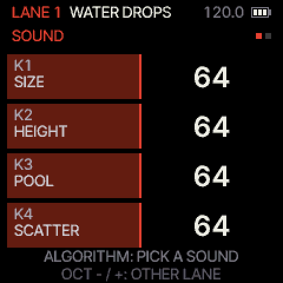

| Card | What it does |
| --- | --- |
| **SIZE** | The drops' size: bigger is lower |
| **HEIGHT** | How far the drops fall: higher is louder, with a harder splash |
| **POOL** | How the bubble rings in the pool |
| **SCATTER** | How different the drops are: all alike .. very mixed |
| **CLUMPS** | The timing: in bursts and quiet spells (low) .. spread out at random (high) |
| **LIFE** | How much the sound changes by itself over time: still .. alive (swells and lulls) |
| **DIST** | How far away: close (low) .. far (high). Far is quieter and darker. |

#### Drips

Water dripping from a height into a pool: a cave ceiling or the eaves of a roof. Each drop plinks with a bubble that glides up in pitch.

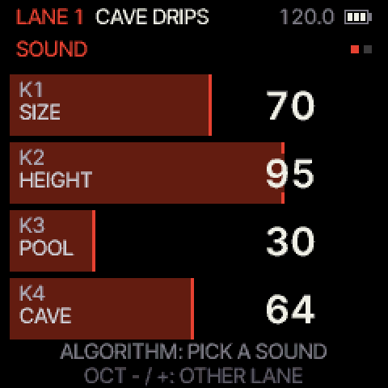

Sounds: cave drips, eaves dripping.

| Card | What it does |
| --- | --- |
| **SIZE** | The bubble's size: small (high plinks) .. big (low plonks) |
| **HEIGHT** | The fall's height, 1 cm .. 3 m: higher is louder, with a harder click |
| **POOL** | How deep the bubble forms: at the surface (rising plink) .. deep (softer, no glide) |
| **CAVE** | The space around: open air .. a cave's long tail (cave drips) |
| **SCATTER** | How different the drops are: all alike .. up to an octave apart |
| **RHYTHM** | The timing: at random .. in runs of quick drops and quiet spells |
| **DIST** | How far away: close (low) .. far (high). Far is quieter and darker. |

The cards come in the order that matters most for each sound:

- cave drips: SIZE, HEIGHT, POOL, CAVE, SCATTER, RHYTHM, DIST
- eaves dripping: SIZE, HEIGHT, RHYTHM, POOL, SCATTER, DIST

#### Streams

Running water: thousands of small bubbles bursting near the surface, from a trickle to a rushing waterfall.


Sounds: brook, bubbling spring, waterfall.

| Card | What it does |
| --- | --- |
| **SIZE** | The bubbles' size: small (bright, fizzing) .. big (low, gulping) |
| **SURFACE** | How near the surface they burst: deep (quiet, steady) .. near (loud, babbling) |
| **GURGLE** | Eddies: a steady flow .. surging and gurgling |
| **SPREAD** | The mix of sizes: many big bubbles .. mostly small ones |
| **ROAR** | The low roar of the water: none .. a big rushing stream |
| **DIST** | How far away: close (low) .. far (high). Far is quieter and darker. |

The cards come in the order that matters most for each sound:

- brook: SIZE, SURFACE, GURGLE, SPREAD, ROAR, DIST
- bubbling spring: SIZE, SURFACE, SPREAD, GURGLE, ROAR, DIST
- waterfall: ROAR, SIZE, DIST, SURFACE, SPREAD, GURGLE

### 5.2 Stones & sand

Stones knocking, a rockfall, ringing rocks, gravel, marbles rolling, sand pouring, a singing dune and the clink and scrape of minerals.

| Sound | Engine |
| --- | --- |
| stones | Stones |
| rockfall | Rockfall |
| ringing rocks | Ringing rocks |
| gravel | Gravel |
| marbles | Marbles |
| sand | Sand |
| singing dune | Singing dune |
| minerals | Minerals |
| stone friction | Stone friction |
| stone clinks | Stone clinks |

#### Stones

Stones knocking together or dropped on the ground, each its own size and ring.


| Card | What it does |
| --- | --- |
| **SIZE** | The size: bigger is lower |
| **GROUND** | What they fall on: stone on stone (bright) .. soft ground (dull knocks) |
| **RING** | How long the stones ring |
| **CLUMPS** | The timing: in bursts and quiet spells (low) .. spread out at random (high) |
| **SPREAD** | How different their sizes are: all alike .. very mixed |
| **DIST** | How far away: close (low) .. far (high). Far is quieter and darker. |

#### Rockfall

A block of rock falling from a cliff: the silence of the fall, the impact, then the fragments tumbling down the slope.


| Card | What it does |
| --- | --- |
| **VOLUME** | The rock's size: bigger is louder, with more fragments |
| **HEIGHT** | How far it falls: a longer silence, a harder impact |
| **GROUND** | What it lands on: soft ground (dull) .. hard rock (bright, loud) |
| **FRAG** | How it breaks: a few big blocks .. many small pieces, tumbling longer |
| **DIST** | How far away: close (low) .. far (high). Far is quieter and darker. |

#### Ringing rocks

Stones struck like a xylophone: slabs, bars and boulders of different stones, each ringing with its own tones.


| Card | What it does |
| --- | --- |
| **STONE** | The stone: granite, marble, sandstone, slate, limestone, ringing rock, flint, obsidian, quartz |
| **TUNE** | The pitch |
| **MALLET** | What strikes it: a stone hammer (bright) .. wood .. rubber .. felt (dark) |
| **SHAPE** | The stone's shape: a bar .. a slab .. a boulder |
| **DAMP** | A hand on the stone: rings free .. short |
| **POS** | Where it is struck: the edge .. the centre |
| **VARY** | The same stone every time .. a new stone every time |
| **DIST** | How far away: close (low) .. far (high). Far is quieter and darker. |

#### Gravel

Stones rattling against each other in a heap: footsteps on a path, a shaken box.


| Card | What it does |
| --- | --- |
| **SIZE** | The stones' size: grit .. pebbles (lower) |
| **AMOUNT** | How many stones: a few .. a heap |
| **SHAKE** | How long each step or shake lasts: a crunch .. a long rattle |
| **GROUND** | Where they rattle: open ground .. a box or a wooden floor |
| **DIST** | How far away: close (low) .. far (high). Far is quieter and darker. |

#### Marbles

A ball rolling on a surface: a marble on a table, a pebble on a stone slab. The sound comes from the small bumps of the surface under it.


| Card | What it does |
| --- | --- |
| **SIZE** | The ball's size: a small marble .. a big ball (softer, sparser) |
| **SURFACE** | What it rolls on: a wood floor, a table, a stone slab, glass, a metal tray |
| **ROUGH** | How rough the surface is: smooth .. rough (louder) |
| **SPEED** | How fast it rolls |
| **DRAG** | How far it coasts: a marble on glass .. a lumpy pebble on wood |
| **ROUND** | Its shape: a sphere .. a lumpy pebble (a swell once a turn) |
| **DIST** | How far away: close (low) .. far (high). Far is quieter and darker. |

#### Sand

Sand pouring through a narrow opening and landing on a hand, a pile, a tray, glass or a tube.


| Card | What it does |
| --- | --- |
| **GRAIN** | The grains: fine (a hiss) .. coarse (a crackle) |
| **SURFACE** | Where it lands: a hand, a sand pile, a metal tray, a glass bulb, a tube |
| **HEIGHT** | How far it falls: higher is louder |
| **PULSE** | The flow: steady .. pulsing |
| **SIZE** | The tray's, bulb's or tube's size: bigger is lower |
| **DIST** | How far away: close (low) .. far (high). Far is quieter and darker. |

#### Singing dune

A dune's sand sliding down in an avalanche until it sings: a low, humming tone from the grains moving together.


| Card | What it does |
| --- | --- |
| **GRAIN** | The grains' size: the song's pitch |
| **SORTING** | The grains: all one size (a clear tone) .. mixed (noise, no song) |
| **STEADY** | The slide: in fits .. steady |
| **DIST** | How far away: close (low) .. far (high). Far is quieter and darker. |
| **DETUNE** | Two patches singing a little apart: a slow beating |

#### Minerals

Stone specimens held in the hand and struck, knocked together or rubbed.


| Card | What it does |
| --- | --- |
| **MINERAL** | The stone: granite, marble, sandstone, slate, limestone, basalt, flint, obsidian, quartz |
| **SIZE** | The specimen's size: bigger is lower |
| **ACTION** | What you do: strike it with a tool, clink two stones, rub them |
| **HOLD** | How it is held: hung on a string (rings free) .. a firm grip (short) |
| **HUMID** | Dry .. wet (duller) |
| **VARY** | The same specimen every time .. a new one every time |
| **DIST** | How far away: close (low) .. far (high). Far is quieter and darker. |

#### Stone friction

One stone rubbed over another: a smooth rub, a scratch or a grind, and the groan when it sticks and slips.


| Card | What it does |
| --- | --- |
| **ROUGH** | The contact: a smooth rub .. a scratch .. a heavy grind |
| **STICK** | Stick and slip: none .. a strong groan or honk |
| **PRESSURE** | How hard you press: louder, more sticking |
| **SPEED** | How fast it slides: brighter, louder |
| **SIZE** | The stone's pitch |
| **DIST** | How far away: close (low) .. far (high). Far is quieter and darker. |

#### Stone clinks

Pieces of stone clinking against each other or on the ground, played freely from the keys.


| Card | What it does |
| --- | --- |
| **SIZE** | The pieces' size: bigger is lower |
| **SPREAD** | How different their sizes are |
| **MINERAL** | The stone: granite, marble, slate, flint, obsidian, quartz |
| **HARD** | What they hit: stone (bright clinks) .. wood .. soft ground (dull knocks) |
| **CLUMP** | The timing: at random .. in runs and quiet spells |
| **ROOM** | The space: dry .. a long tail |

### 5.3 Ice & glass

Icicles, ice in a glass, frost, snow underfoot, a frozen lake's cracks and booms, and glass: a pane, bottles, shards.

| Sound | Engine |
| --- | --- |
| icicles | Ice |
| ice in a glass | Ice |
| frost tinkling | Ice |
| snow underfoot | Ice |
| lake ice | Lake ice |
| frozen lake booming | Lake ice |
| thin ice underfoot | Lake ice |
| glass pane | Glass |
| bottles | Glass |
| shards settling | Glass |

#### Ice

Ice that rings, tinkles and fizzes as it melts: icicles, cubes in a glass, frost, snow underfoot.


Sounds: icicles, ice in a glass, frost tinkling, snow underfoot.

| Card | What it does |
| --- | --- |
| **SIZE** | The icicle's length, or the glass's size: bigger is lower (icicles, ice in a glass) |
| **TEMP** | The ice's temperature: deep cold (ringing) .. melting (wet, dull, more fizz) (icicles, frost tinkling, snow underfoot) |
| **AMOUNT** | How many icicles (icicles) |
| **FIZZ** | The fizz of melting: none .. strong (icicles, ice in a glass) |
| **CLUMPS** | The timing: in bursts and quiet spells (low) .. spread out at random (high) |
| **DIST** | How far away: close (low) .. far (high). Far is quieter and darker. |

The cards come in the order that matters most for each sound:

- icicles: SIZE, TEMP, AMOUNT, FIZZ, CLUMPS, DIST
- ice in a glass: SIZE, FIZZ, CLUMPS, DIST
- frost tinkling, snow underfoot: TEMP, CLUMPS, DIST

#### Lake ice

The ice of a frozen lake cracking: the crack's sound runs through the ice and arrives as a sweeping, singing "pew", then as a boom.


Sounds: lake ice, frozen lake booming, thin ice underfoot.

| Card | What it does |
| --- | --- |
| **THICK** | The ice's thickness: thin (high, fast sweeps) .. thick (low) |
| **COLD** | The temperature: near melting (dull) .. hard frost (ringing) (lake ice, frozen lake booming) |
| **FAR** | How far away the crack is in the ice: longer sweeps, a later boom (lake ice, frozen lake booming) |
| **DIST** | How far away: close (low) .. far (high). Far is quieter and darker. |

The cards come in the order that matters most for each sound:

- lake ice, frozen lake booming: THICK, COLD, FAR, DIST
- thin ice underfoot: THICK, DIST

#### Glass

Glass breaking or clinking: a pane smashing on the floor, bottles touching, shards settling.


Sounds: glass pane, bottles, shards settling.

| Card | What it does |
| --- | --- |
| **SIZE** | The pieces' size: bigger is lower |
| **RING** | How long the glass rings: on a soft floor .. crystal, hanging free |
| **ENERGY** | The blow: a crack .. a smash (more shards, louder) (glass pane, shards settling) |
| **HEIGHT** | How high the pane falls from: later first impacts (glass pane) |
| **BOUNCE** | The floor: carpet .. stone tiles (more bounces) (glass pane, shards settling) |
| **DIST** | How far away: close (low) .. far (high). Far is quieter and darker. |
| **CLUMPS** | The timing: in bursts and quiet spells (low) .. spread out at random (high) (bottles) |

The cards come in the order that matters most for each sound:

- glass pane: SIZE, RING, ENERGY, HEIGHT, BOUNCE, DIST
- bottles: SIZE, RING, CLUMPS, DIST
- shards settling: SIZE, RING, ENERGY, BOUNCE, DIST

### 5.4 Fire

Fires of every size, from a candle flame to a bonfire: the roar of the flames, the crackle and pop of the wood, and electric sparks.

| Sound | Engine |
| --- | --- |
| campfire | Fire |
| bonfire | Fire |
| fireplace | Fire |
| embers | Fire |
| kindling | Fire |
| pine fire | Fire |
| leaves, paper | Fire |
| torch | Fire |
| flame | Flame |
| sparks | Sparks |

#### Fire

A wood fire: the roar of the flames, flickering in the draught, and the crackles and pops of the wood as its moisture and resin burst.


Sounds: campfire, bonfire, fireplace, embers, kindling, pine fire, leaves, paper, torch.

| Card | What it does |
| --- | --- |
| **SIZE** | The fire's size: bigger flickers slower and roars lower |
| **MOIST** | Moisture and resin in the wood: few crackles .. many |
| **DRAUGHT** | Wind on the fire: steady .. deep flicker and gusts (campfire, bonfire, fireplace, kindling, pine fire, leaves, paper, torch) |
| **WOOD** | The wood: green wood and needles .. dry wood (brighter crackles) |
| **ROAR** | The flames' roar: none .. loud (campfire, bonfire, fireplace, kindling, pine fire, leaves, paper, torch) |
| **BURSTY** | How the crackles come: one by one .. in bursts (campfire, bonfire, fireplace, embers, kindling, pine fire, leaves, paper) |
| **DIST** | How far away: close (low) .. far (high). Far is quieter and darker. |

The cards come in the order that matters most for each sound:

- campfire, bonfire, pine fire: SIZE, MOIST, DRAUGHT, WOOD, ROAR, BURSTY, DIST
- fireplace: SIZE, MOIST, ROAR, WOOD, DRAUGHT, BURSTY, DIST
- embers: MOIST, WOOD, BURSTY, DIST, SIZE
- kindling, leaves, paper: MOIST, SIZE, DRAUGHT, WOOD, ROAR, BURSTY, DIST
- torch: ROAR, DRAUGHT, SIZE, MOIST, WOOD, DIST

#### Flame

A single flame, as a candle, a gas jet or a torch: its soft roar and flicker, and the wick's sputter.


| Card | What it does |
| --- | --- |
| **FLOW** | How strongly it burns: a quiet flame .. a loud, bright roar |
| **DRAUGHT** | The air around: still (a steady flame) .. windy (deep flicker and gusts) |
| **SPUTTER** | The wick's crackle: none .. often |
| **SLOPE** | The roar's colour: bright .. dark |
| **DIST** | How far away: close (low) .. far (high). Far is quieter and darker. |

#### Sparks

Electric sparks jumping a gap: sharp ticks and cracks, and the fizz of a corona.


| Card | What it does |
| --- | --- |
| **GAP** | The gap: small (a bright tick) .. wide (a fuller, louder crack) |
| **DIST** | How far: close .. 10 m (duller, quieter) |
| **CORONA** | The corona's fizz: none .. loud |
| **BODY** | What it jumps to: free air (a dry tick) .. a small metal object (ringing) |

### 5.5 Wood

Wood under strain: branches and trunks that creak and snap, twigs underfoot, a rain stick and crumpled paper.

| Sound | Engine |
| --- | --- |
| spruce | Wood |
| pine | Wood |
| maple | Wood |
| oak | Wood |
| green branch | Wood |
| tree trunk | Wood |
| twigs underfoot | Wood |
| rain stick | Rain stick |
| crumpled paper | Crumpled paper |

#### Wood

Wood bending under a load: it creaks, crackles and finally snaps. Each kind of wood has its own tone.


Sounds: spruce, pine, maple, oak, green branch, tree trunk, twigs underfoot.

| Card | What it does |
| --- | --- |
| **SIZE** | The piece's length: a twig .. a log (lower) |
| **CREAK** | How strongly it creaks: none .. strong (spruce, pine, maple, oak, green branch, tree trunk) |
| **PITCH** | The creak: ratchety .. singing (spruce, pine, maple, oak, green branch, tree trunk) |
| **MOIST** | Dry .. wet: duller, fewer cracks (spruce, pine, maple, oak, green branch, twigs underfoot) |
| **DIST** | How far away: close (low) .. far (high). Far is quieter and darker. |
| **WEIGHT** | The step: light (one twig) .. heavy (four twigs) (twigs underfoot) |
| **DEPTH** | The leaf litter: bare ground .. deep (softer, darker) (twigs underfoot) |

The cards come in the order that matters most for each sound:

- spruce, pine, maple, oak: SIZE, CREAK, PITCH, MOIST, DIST
- green branch: SIZE, CREAK, MOIST, PITCH, DIST
- tree trunk: CREAK, PITCH, SIZE, DIST
- twigs underfoot: SIZE, MOIST, WEIGHT, DEPTH, DIST

#### Rain stick

A tube full of seeds turned over: the seeds fall through the pins inside in a long patter.


| Card | What it does |
| --- | --- |
| **TIME** | How long the seeds take to fall: 2 .. 20 s |
| **GRAIN** | The seeds: small and hard (dry, bright) .. big beans (ringing) |
| **LENGTH** | The tube's length: longer is lower |
| **BODY** | The tube's resonance: none .. strong |
| **PULSE** | The fall: steady .. pulsing |

#### Crumpled paper

A sheet crushed in the hand: foil, paper, dry leaves or snow, each its own crackle.


| Card | What it does |
| --- | --- |
| **MATERIAL** | What you crush: foil, plastic film, paper, dry leaves, snow |
| **THICK** | The sheet's thickness: thin (fine, fast crackle) .. thick (fewer, bigger cracks) |
| **BURST** | The squeeze: steady .. in bursts |
| **CLUSTER** | How the clicks bunch: one by one .. in clusters |
| **SIZE** | The sheet's size: bigger is lower |

### 5.6 Wind

Wind in grass, pines and leafy trees, over a moor, the sea, a ridge and a desert, and wind chimes.

| Sound | Engine |
| --- | --- |
| wind | Wind |
| breeze in grass | Wind |
| wind in pines | Wind |
| leafy trees | Wind |
| open moor | Wind |
| sea wind | Wind |
| ridge gale | Wind |
| gusty autumn | Wind |
| winter storm | Wind |
| desert wind | Wind |
| wind chimes | Wind chimes |

#### Wind

Wind as it blows through things: grass, needles, leaves, around rocks and over open ground. It gusts and lulls, and sudden gusts sweep past.


Sounds: wind, breeze in grass, wind in pines, leafy trees, open moor, sea wind, ridge gale, gusty autumn, winter storm, desert wind.

| Card | What it does |
| --- | --- |
| **GUST** | Gustiness: steady .. gusts and lulls |
| **FOLIAGE** | What it blows through: open ground and grass .. leafy trees (rustle) |
| **SCALE** | The size of what it blows through: big trees (lower) .. fine grass (higher) (wind, breeze in grass, wind in pines, leafy trees, open moor, sea wind, ridge gale, gusty autumn, winter storm) |
| **EXPOSED** | Sheltered .. out in the open (the wind buffets you) |
| **WHOOSH** | Gusts sweeping past: none .. often |
| **EDGE** | Faint whistling tones in strong gusts: none .. now and then (wind, wind in pines, leafy trees, open moor, ridge gale, winter storm) |
| **DIST** | How far away: close (low) .. far (high). Far is quieter and darker. |
| **SKITTER** | Dry leaves skittering over the ground (gusty autumn) |
| **DRIFT** | Snow or sand blown along the ground (winter storm, desert wind) |

The cards come in the order that matters most for each sound:

- wind, wind in pines, leafy trees: GUST, FOLIAGE, SCALE, EXPOSED, WHOOSH, EDGE, DIST
- breeze in grass: GUST, SCALE, FOLIAGE, WHOOSH, EXPOSED, DIST
- open moor, ridge gale: GUST, EXPOSED, SCALE, WHOOSH, FOLIAGE, EDGE, DIST
- sea wind: GUST, EXPOSED, WHOOSH, SCALE, FOLIAGE, DIST
- gusty autumn: GUST, FOLIAGE, SKITTER, SCALE, EXPOSED, WHOOSH, DIST
- winter storm: GUST, EXPOSED, DRIFT, SCALE, WHOOSH, FOLIAGE, EDGE, DIST
- desert wind: DRIFT, GUST, EXPOSED, WHOOSH, FOLIAGE, DIST

#### Wind chimes

Tubes hanging in the wind, struck by a clapper as it gusts.


| Card | What it does |
| --- | --- |
| **MATERIAL** | The tubes: aluminium (a long ring) .. glass .. bamboo (short, woody) |
| **CLAPPER** | The clapper: soft (felt, wood: dark) .. hard (metal: bright) |

### 5.7 Storm

Rain on water and on roofs, a whole storm, thunder, hail, sleet, gales, and two old studio sounds: a thunder sheet and a spring echo.

| Sound | Engine |
| --- | --- |
| rain on water | Rain on water |
| rain on a roof | Rain and hail on surfaces |
| storm | Storm |
| thunder | Thunder |
| ridge gale | Wind |
| winter storm | Wind |
| hail on a roof | Rain and hail on surfaces |
| hail on a car | Rain and hail on surfaces |
| hail in leaves | Rain and hail on surfaces |
| sleet on a window | Rain and hail on surfaces |
| thunder sheet | Thunder sheet |
| spring echo | Spring echo |

**Rain on water** (rain on water): see [Rain on water](#rain-on-water).

#### Rain and hail on surfaces

Rain, hail or sleet falling on something: leaves, a tent, wood, a window or a metal roof. You hear the near drops one by one over the patter of the whole area.


Sounds: rain on a roof, hail on a roof, hail on a car, hail in leaves, sleet on a window.

| Card | What it does |
| --- | --- |
| **SURFACE** | What the rain falls on: leaves, a tent, wood, a window, a metal roof, with every shade between (rain on a roof) |
| **DROPS** | The drops' size: drizzle .. big drops (louder, darker); above the middle, drips off eaves and leaves too (rain on a roof) |
| **INSIDE** | Outside .. inside, under the roof (muffled) |
| **AREA** | How much area you hear: a few drops near you .. a whole roof |
| **DIST** | How far away: close (low) .. far (high). Far is quieter and darker. |
| **STONES** | The hailstones' size (hail on a roof, hail on a car, hail in leaves, sleet on a window) |
| **BOUNCE** | How the stones bounce: on soft ground .. bouncing again and again (hail on a roof, hail on a car, hail in leaves) |

The cards come in the order that matters most for each sound:

- rain on a roof: SURFACE, DROPS, INSIDE, AREA, DIST
- hail on a roof, hail on a car, hail in leaves: STONES, AREA, INSIDE, BOUNCE, DIST
- sleet on a window: STONES, AREA, INSIDE, DIST

#### Storm

A whole thunderstorm in one sound: rain, wind and lightning together. It can stay or pass over you.


| Card | What it does |
| --- | --- |
| **RAIN** | More or less rain than the storm brings |
| **WIND** | More or less wind |
| **FLASHES** | More or fewer lightning strikes (none at 0) |
| **DIST** | How far the thunder cell is: 0.5 .. 15 km |
| **AGE** | The storm's age: young (big drops, loud) .. the steady rain after it (fine drops) |
| **SURFACE** | Where the rain falls: water, leaves, a tent, wood, glass, a metal roof |
| **PASSING** | A steady storm, or a squall passing over you in 1 .. 10 minutes |
| **INSIDE** | Outside .. heard from indoors (muffled by walls and windows) |

#### Thunder

One thunderclap after a flash: the crack nearby, the long rolling rumble far away.


| Card | What it does |
| --- | --- |
| **JAGGED** | The lightning's path: smooth (a rolling rumble) .. jagged (cracking claps) |
| **HEIGHT** | How high the flash starts: how long it rumbles, up to about 15 s |
| **GROUND** | The land around: an open plain (no echo) .. a valley or mountains (the roll heard again off their sides) |

**Wind** (ridge gale, winter storm): see [Wind](#wind).

#### Thunder sheet

A big steel sheet shaken or struck, as theatres made thunder: it rings and builds into a roaring crash.


| Card | What it does |
| --- | --- |
| **SIZE** | The sheet's size: bigger is lower and denser |
| **THICK** | Its thickness: thin (low, dense, loud) .. thick (bell-like) |
| **MALLET** | The mallet: soft (dark) .. hard (bright) |
| **DAMP** | A hand on the sheet: rings free .. short |

#### Spring echo

The echoes of a long metal spring: each echo a descending, laser-like chirp.


| Card | What it does |
| --- | --- |
| **LENGTH** | The time between echoes: 20 .. 80 ms |
| **RADIUS** | The spring's thickness: darker .. brighter |
| **DECAY** | How long it rings: a short splash .. a long rattle |
| **CHIRP** | Each echo: a click .. a long falling chirp |

### 5.8 Insects

Crickets, cicadas, katydids, grasshoppers and bees. Each insect sings its own rhythm: HOW ACTIVE sets how much it sings, never how fast.

| Sound | Engine |
| --- | --- |
| field cricket | Crickets |
| tree cricket | Crickets |
| mole cricket | Crickets |
| cicada | Cicadas |
| small cicada | Cicadas |
| cicada chorus | Cicadas |
| katydid | Katydids and grasshoppers |
| grasshopper | Katydids and grasshoppers |
| honeybee | Bees |
| bumblebee | Bees |
| cicada up close | Cicada up close |

#### Crickets

Crickets chirping or trilling, each its own pitch and pace, faster in warm air. Nearby crickets answer each other.


Sounds: field cricket, tree cricket, mole cricket.

| Card | What it does |
| --- | --- |
| **TEMP** | The air's temperature: cool (slow chirps) .. warm (fast) |
| **CHORUS** | A distant chorus behind them: none .. loud |
| **SYNC** | Neighbours: each on its own .. taking turns .. chirping together |
| **DIST** | How far away: close (low) .. far (high). Far is quieter and darker. |
| **SIZE** | The body's size: bigger is lower (the rhythm stays) |

The cards come in the order that matters most for each sound:

- field cricket, tree cricket: TEMP, CHORUS, SYNC, DIST, SIZE
- mole cricket: TEMP, CHORUS, DIST, SYNC, SIZE

#### Cicadas

Cicadas buzzing: each cicada's tymbal clicks fast and rings, in long songs.


Sounds: cicada, small cicada, cicada chorus.

| Card | What it does |
| --- | --- |
| **SIZE** | The body's size: bigger is lower |
| **RING** | The buzz: rough .. ringing |
| **DEPTH** | The chorus: all at one distance .. near and far at once |
| **DIST** | How far away: close (low) .. far (high). Far is quieter and darker. |
| **BUZZ** | How buzzy the song is |

The cards come in the order that matters most for each sound:

- cicada, small cicada: SIZE, RING, DEPTH, DIST, BUZZ
- cicada chorus: DEPTH, SIZE, RING, DIST, BUZZ

#### Katydids and grasshoppers

Katydids rasping and grasshoppers scraping their legs on their wings.


Sounds: katydid, grasshopper.

| Card | What it does |
| --- | --- |
| **TEMP** | The temperature: cool (slow calls) .. warm (fast) |
| **RASP** | The call: a pure tone .. a rough rasp |
| **CHORUS** | Far callers behind them: none .. many |
| **DIST** | How far away: close (low) .. far (high). Far is quieter and darker. |
| **SYNC** | Neighbours: each on its own .. taking turns .. calling together |
| **SIZE** | The body's size: bigger is lower (the rhythm stays) |
| **PEGS** | The grasshopper's scrape: the pegs on its leg, lower .. higher (grasshopper) |

The cards come in the order that matters most for each sound:

- katydid: TEMP, RASP, CHORUS, DIST, SYNC, SIZE
- grasshopper: PEGS, TEMP, RASP, DIST, CHORUS, SYNC, SIZE

#### Bees

Bees and other insects hovering: the hum of their wingbeats, changing as they move.


Sounds: honeybee, bumblebee.

| Card | What it does |
| --- | --- |
| **SWARM** | Companions: one bee .. a swarm |
| **SPEED** | How fast they fly: hovering .. darting (more pitch movement) |
| **DIST** | How far away: close (low) .. far (high). Far is quieter and darker. |
| **SPREAD** | How different their wingbeats are in a swarm |

#### Cicada up close

One cicada, close, with all the parts of its song to shape, played freely from the keys.


| Card | What it does |
| --- | --- |
| **RATE** | How fast the tymbal clicks |
| **CARRIER** | The song's pitch |
| **Q** | The buzz: buzzy .. ringing |
| **COHERE** | The song: rough and buzzy .. a clean tone |
| **DIST** | How far away: close (low) .. far (high). Far is quieter and darker. |
| **PHRASE** | The song's pulses: steady .. pulsing fast |

### 5.9 Songbirds

Ten songbirds, each singing its own songs: phrases that vary, repeat and answer each other.

| Sound | Engine |
| --- | --- |
| songbird | Songbirds |
| blackbird | Songbirds |
| song thrush | Songbirds |
| nightingale | Songbirds |
| robin | Songbirds |
| wren | Songbirds |
| hermit thrush | Songbirds |
| skylark | Songbirds |
| wood thrush | Songbirds |
| reed warbler | Songbirds |

#### Songbirds

Birds that sing: each has its own repertoire of song types and varies them, as the real bird does. With more than one bird, they answer each other.


Sounds: songbird, blackbird, song thrush, nightingale, robin, wren, hermit thrush, skylark, wood thrush, reed warbler.

| Card | What it does |
| --- | --- |
| **SIZE** | The bird's size: the song's pitch (bigger is lower) |
| **DEPTH** | One bird at DIST .. birds near and far at once |
| **DIST** | How far away: close (low) .. far (high). Far is quieter and darker. |
| **VARY** | The birds alike .. each its own pitch |
| **TEMPO** | How fast they sing: long pauses .. short |
| **SONG** | Song length: short .. long songs |
| **VARIETY** | The repertoire: few song types, repeated .. many, rarely repeated |
| **EXCITE** | Excitement: calm .. excited (shorter pauses, louder, more answers) |

### 5.10 Wild birds

Ten other birds by their calls: a crow's caws, a gull, a curlew's bubbling, a cuckoo, a woodpecker's drumming, a nightjar's churr, a bittern's boom.

| Sound | Engine |
| --- | --- |
| chirper | Wild birds |
| crow | Wild birds |
| gull | Wild birds |
| curlew | Wild birds |
| oystercatcher | Wild birds |
| cuckoo | Wild birds |
| woodpecker | Wild birds |
| wood pigeon | Wild birds |
| nightjar | Wild birds |
| bittern | Wild birds |

#### Wild birds

Birds by their calls: each calls its own way, in series, bouts or drumming.


Sounds: chirper, crow, gull, curlew, oystercatcher, cuckoo, woodpecker, wood pigeon, nightjar, bittern.

| Card | What it does |
| --- | --- |
| **SIZE** | The bird's size: the call's pitch (bigger is lower) |
| **DEPTH** | One bird at DIST .. birds near and far at once |
| **DIST** | How far away: close (low) .. far (high). Far is quieter and darker. |
| **VARY** | The birds alike .. each its own pitch |
| **TEMPO** | How often it calls: long pauses .. short (chirper, crow, gull, curlew, oystercatcher, cuckoo, wood pigeon, bittern) |
| **SONG** | Song length: short .. long (chirper, curlew, oystercatcher) |
| **VARIETY** | The repertoire: few song types .. many (chirper) |
| **EXCITE** | Excitement: calm .. excited (shorter pauses, louder; a colony answers more) |
| **SERIES** | The crow: caws in a series, few .. many (crow) |
| **CALLS** | Calls in a series, few .. many (gull, cuckoo) |
| **LONGCALL** | The gull: its long call over the short ones (gull) |
| **BUBBLE** | The curlew: its bubbling song over its calls (curlew) |
| **PIPING** | The oystercatcher: its piping display over its calls (oystercatcher) |
| **INTERVAL** | The cuckoo: the interval between its two notes (cuckoo) |
| **DRUM** | The woodpecker: how fast it drums (woodpecker) |
| **ROLL** | The woodpecker: how long each roll lasts (woodpecker) |
| **PHRASES** | The pigeon: phrases in a bout, few .. many (wood pigeon) |
| **RATE** | The nightjar: how fast its churr pulses (nightjar) |
| **CHURR** | The nightjar: how long each churr lasts (nightjar) |
| **SWITCH** | The nightjar: how often its churr changes pitch (nightjar) |
| **BOOMS** | The bittern: booms in a bout, few .. many (bittern) |

The cards come in the order that matters most for each sound:

- chirper: SIZE, DEPTH, DIST, VARY, TEMPO, SONG, VARIETY, EXCITE
- crow: SIZE, DEPTH, DIST, VARY, TEMPO, SERIES, EXCITE
- gull: SIZE, DEPTH, DIST, VARY, TEMPO, CALLS, LONGCALL, EXCITE
- curlew: SIZE, DEPTH, DIST, VARY, TEMPO, SONG, BUBBLE, EXCITE
- oystercatcher: SIZE, DEPTH, DIST, VARY, TEMPO, SONG, PIPING, EXCITE
- cuckoo: SIZE, DEPTH, DIST, VARY, TEMPO, CALLS, INTERVAL, EXCITE
- woodpecker: SIZE, DEPTH, DIST, VARY, DRUM, ROLL, EXCITE
- wood pigeon: SIZE, DEPTH, DIST, VARY, TEMPO, PHRASES, EXCITE
- nightjar: SIZE, DEPTH, DIST, VARY, RATE, CHURR, SWITCH, EXCITE
- bittern: SIZE, DEPTH, DIST, VARY, TEMPO, BOOMS, EXCITE

## 6. Presets, landscapes and scenes

A preset (a scene) is everything a place is: the four lanes' sounds, their HOW MANY, HOW ACTIVE, playing or stopped,
volume, pan and mute, every sound card you set, the effects, the eight LFOs, the envelopes and followers, the matrix
and the groove. With PRESETS CHANGE TEMPO at YES, the tempo too.

### Landscapes

The ten landscapes are the ten families: **Water**, **Stones & sand**, **Ice & glass**, **Fire**, **Wood**, **Wind**,
**Storm**, **Insects**, **Songbirds** and **Wild birds**. A landscape puts its sounds on the lanes as a starting point.
Two ways to load one:

- On the home page, turn **ALGORITHM** (the footer names the landscape) and press **EDIT**. HOME keeps what plays.
- In the presets list, at the end: **LANDSCAPES**, L01 to L10.

If the lanes were playing, the new landscape plays at once.

### Factory presets

**F001 to F110**, ten in each family:

| Family | Presets |
| --- | --- |
| **RAIN** (F001–F010) | DRIZZLE, SOFT RAIN, GARDEN RAIN, FOREST RAIN, LAKE RAIN, STEADY RAIN, ROOF RAIN, ATTIC RAIN, RAIN & FIRE, AFTER RAIN |
| **STORM** (F011–F020) | FAR THUNDER, STORM NEARS, FULL STORM, STORM ROOF, HAILSTORM, HAIL ON CAR, HAIL TREES, SLEET, GALE, CLEARING |
| **COAST** (F021–F030) | CALM BEACH, SANDY SHORE, SHINGLE, ROCKY COVE, WINDY COAST, STORMY SEA, SEA CAVE, ESTUARY, SALT MARSH, PIER NIGHT |
| **RIVER & LAKE** (F031–F040) | BROOK, HILL STREAM, SPRING, WATERFALL, RAPIDS, RIVER BANK, LAKESHORE, REED BED, POND, DUSK LAKE |
| **FOREST** (F041–F050) | DAWN CHORUS, MORNING, BEECH WOOD, CUCKOO, WOODPECKER, FOREST WALK, DEEP FOREST, PINE FOREST, AUTUMN WOOD, DUSK WOOD |
| **MEADOW** (F051–F060) | SUMMER, SKYLARK, HAY FIELD, OPEN MOOR, WILDFLOWERS, ORCHARD, VILLAGE, CICADAS, OLIVE GROVE, MIDDAY HEAT |
| **NIGHT** (F061–F070) | CRICKETS, JUNE NIGHT, NIGHTINGALE, WARM NIGHT, NIGHTJAR, MARSH NIGHT, NIGHT LAKE, NIGHT WOOD, NIGHT RAIN, NIGHT FIRE |
| **FIRE** (F071–F080) | CAMPFIRE, BONFIRE, PINE FIRE, FOREST FIRE, EMBERS, KINDLING, LEAF FIRE, FIRESIDE, CABIN, TORCHLIT |
| **STONE & SAND** (F081–F090) | CAVE DRIPS, CRYSTALS, DEEP CAVE, ROCK GONGS, QUARRY, SCREE SLOPE, PEBBLES, GRAVEL PATH, DESERT WIND, DUNES |
| **ICE & WINTER** (F091–F100) | FROST, ICICLES, THAW, SNOW WALK, FROZEN LAKE, THIN ICE, BLIZZARD, HIGH RIDGE, SNOWED IN, ICE & GLASS |
| **DREAMS** (F101–F110) | SLOW TIDE, ENDLESS, ICE DREAM, GLASS CHOIR, LOST ECHOES, STARDUST, BLOOM, UNDERWORLD, AURORA, MIRAGE |

Each mixes four lanes from any families, their levels balanced, with its own effects. Most have a touch of reverb or
echo. DREAMS, and some places in the other families, go beyond the real place: a vast or endless reverb, a shimmer,
a grain cloud, the stereo image wider. Their effects:

| Effects | What they are | Presets |
| --- | --- | --- |
| **Vast** | INFINITE, a tail of about 30 s, wider | FAR THUNDER, WATERFALL, DEEP FOREST, NIGHT LAKE, NIGHT WOOD, SLOW TIDE |
| **Infinite** | INFINITE at SUSTAIN: the tail never dies away, it holds what was played (bounded) | ENDLESS |
| **Frozen** | DARK, a still, deep tail of about 50 s | FROZEN LAKE |
| **Shimmer** | INFINITE with SHIMMER an octave up | FROST, ICE DREAM |
| **Ice hall** | INFINITE, bright, SHIMMER an octave and a fifth up | ROCK GONGS, ICICLES, ICE & GLASS, GLASS CHOIR |
| **Drift echo** | DRIFT and the grain delay's long echo, bending away | PIER NIGHT, DUSK WOOD, HIGH RIDGE, LOST ECHOES |
| **Grain cloud** | the grain delay scattering the sound in octaves, a hall | STARDUST |
| **Swell** | SWELL: the tail blooms after the sounds | CLEARING, DUSK LAKE, NIGHTINGALE, BLOOM |
| **Abyss** | DARK with SHIMMER an octave down, the FILTER's top closed a little | SEA CAVE, TORCHLIT, CAVE DRIPS, DEEP CAVE, UNDERWORLD |
| **Halo** | INFINITE with SHIMMER a fifth up, grains turning back | CRYSTALS, AURORA |
| **Mirage** | DRIFT and a grain cloud climbing in fifths and octaves | DUNES, MIRAGE |

A preset brings its effects only as EFFECTS ON LOAD says (the LOAD OPTIONS): at **NEVER**, the FM-1's default, your
effects stay; set it to **SMART** or **ALWAYS** to hear each preset with its own.

### Loading

Open the presets list with **PRESETS**, move to a preset and press **EDIT** ([the presets list](#the-presets-list-presets)).
A MIDI program change on channel 1 loads one too ([section 12](#12-midi)).

A load never cuts the sound. A lane that keeps its sound plays on untouched. A lane that gets a new sound switches one
lane at a time, the old sound playing on until the new one fades in under it. Volumes, pans, HOW MANY, HOW ACTIVE and
the sound cards glide to their new values over half a second. What the load does with the effects and the tempo is
up to the LOAD OPTIONS (FX in the presets list).

### Saving

**SAVE**, then **SAVE** again: what plays goes into the first free slot, with a new name (K4 for another one; K2 and
K3 to change its letters; PRESETS or K1 for another slot) ([the save mode](#the-save-mode)).
A save never interrupts the sound. Your presets are kept in two copies, written in turn, so a power cut while saving
never loses them.

### RANDOM

Two actions, no settings: press **OCT−** and **OCT+** together (the second within 60 ms of the first) to roll the dice.

- **Anywhere** (but the sound browser): everything is rolled, on every lane in use: a new engine on each lane
  (each a different one where it can be; an empty lane gets one too and starts playing, sparse; a stopped lane stays
  stopped), each engine's cards, the effects (COMPRESSOR to M/S: types and amounts; a
  long, unreal reverb can come up) and the movement (the LFOs, the envelopes, the followers and 2 to 6 routes: what
  they move, how far). The toast: **RANDOM · ROLLED**, then **EVERYTHING**. The preset name reads **RANDOM**, marked
  as changed.
- **With the sound browser open** (**SEQ**): the browser's lane alone gets a new engine, from any family; the browser
  moves to it. The toast: **LANE 2 · RANDOM**, then the engine's name.

Hold **SAVE** to undo a roll in one step (hold it again to redo); **SAVE** keeps one you like.

- A roll **keeps** LANES and each lane's LEVEL, PAN, HOW MANY, HOW ACTIVE, mute and MIDI channel, and the tempo, the
  clock, the keys and GROOVE. Levels stay even, the limiter stays on, DRIVE, COMP's make-up and the movement's depths
  stay moderate: a roll never silences the mix or jumps in level.
- New engines come in as a preset's do (one lane at a time, the old one ringing out); rolled effects glide.
- Each roll is a new one.

### Undo

Hold **SAVE** for 0.7 s: the last load (a preset, a landscape, a program change), the last roll of the dice
([RANDOM](#random)) or the last sound you kept in the sound browser is undone. Hold it again to redo.

### At power-on

Textura comes back with the last preset you loaded, and with your settings: the tempo, the clock, the MIDI channels,
the scale and the screen colour.

## 7. The effects

One chain on the mix of the four lanes, in the order the sound goes through it, and in that order on the pages:

**COMPRESSOR → DRIVE → FILTER → GRAIN DELAY → REVERB → M/S → limiter**

- **FX** steps through every effect page in this order; **PERFORM** has the four controls you want while playing.
- The reverb comes after the delay, so the echoes ring in the space too.
- The M/S comes last, so its width works on the whole mix, the reverb's tail too.
- A limiter at the very end keeps the output from clipping.

**The MIX convention.** DRIVE, DELAY and REVERB each have a MIX card that works the same way: at **0 (DRY)** you hear
the sound alone; up to **64** the effect comes in while the sound stays whole; at **64 (50/50)** both are whole; above
64 the sound fades out; at **127 (WET)** you hear the effect alone. On the card the part up to 64 is in the accent
colour and the part past it in the opposite colour.

**Switching on.** The compressor is on from the start and switches with ALGORITHM on its page. The drive is off with
AMOUNT at 0, the filter is open with HIGH PASS and LOW PASS at OFF, the delay is off with its MIX at DRY, the
reverb is off with TYPE at OFF, and the M/S leaves the sound as it is (0 dB, 100 %). Turn one up and it comes in
smoothly; nothing clicks.

**The effects and presets.** Every preset brings its effects with it, unless you choose otherwise in LOAD OPTIONS
([section 6](#6-presets-landscapes-and-scenes)).

## 8. Movement: LFOs, envelopes, followers and the matrix

Anything that moves by itself comes from a **source** routed through the **mod matrix** onto a **target**.

- **8 LFOs** ([LFO pages](#lfo-lfo-phase-lfo-level)): slow or fast cycles, from a plain sine to random walks, gusts
  and chaos. The slowest takes 33 minutes for one cycle; a little JITTER keeps a free LFO from ever repeating exactly.
- **2 envelopes** ([ENV pages](#env-env-shape-and-follow)): a rise and fall started by a key, a lane's notes, a lane's
  events, an LFO or the transport. With LOOP on, an envelope starts again by itself after a random rest: swells that
  come and go.
- **2 envelope followers** ([FOLLOW](#env-env-shape-and-follow)): a value that follows a lane's level, its event rate,
  the whole mix or the grain delay's grains. Let a thunder lane open the filter, or busy birds raise the reverb.
- **Other sources**: VELOCITY, the MOD WHEEL, AFTERTOUCH, a MIDI CC, a lane's HOW ACTIVE, RANDOM (a new value at each
  note) and CONSTANT.
- **The matrix** ([MOD MATRIX](#mod-matrix)): 16 slots, each a source, a target, a depth and a spread.

**The quickest way: learn.** Hold **LFO** (or **ENV**) and turn any card: the selected LFO (or envelope, or follower)
is routed onto it, the turn sets the depth. Turn back to 0 to remove the route. See [learn](#learn).

A modulated card shows `~` before its name and two ticks that move with its value now. On the LFO LEVEL page, ROUTES
counts the slots that use the LFO. ALL LANES as a target, with SPREAD up, lets one LFO move all four lanes a little
apart, as wind does through a forest.

## 9. Groove, tempo and sync

### The groove

Most of the landscape's events come at random. The groove makes the small, countable ones (insects, birds, crackles,
knocks, drips) lean toward one shared pulse that drifts slowly. It is felt rather than heard: never a beat and never a
loop. Water, wind and the other flows always stay free.

- **AMOUNT** (35 at first) sets how much the events lean; at 0 every lane is exactly as without the groove.
- **TYPE** chooses the pulse: polyrhythms (3:4, 3:4:5 ...), swings, claves and other rhythms, then even spreads.
- **SHIFT** moves the pulse in time.
- **GROOVE LANES** gives each lane a role: AUTO picks PULSE, OFFBEAT or FILL by the sound, or set one by hand, or give
  the lane its own cycle of 2 to 9 pulses for a polyrhythm.

A preset keeps its groove. A REC start or a transport start puts the pulse at bar 1, so the grooved lanes start
together.

### Tempo and tap

The tempo runs from 40 to 240 BPM (TEMPO page). It drives the groove, the grain delay's SYNC and the LFOs' SYNC.

- **PLAY** taps the tempo: from the third tap, the tempo follows your last taps. Hold PLAY for 0.6 s to start or stop
  the transport.
- **REC** taps too: press it again within 1.5 s, and the presses after the first are taps. A tap series never leaves
  the lanes stopped.
- While an incoming clock leads the tempo, taps do nothing; the footer says EXT CLOCK.

### MIDI clock

On the MIDI CLOCK page (HOME held):

- **AUTO** (the default) follows a MIDI clock while one comes in, over USB or the TRS input, and goes back to its own
  tempo when it stops. **FOLLOW** follows the clock only. **INT** ignores it. **MASTER** sends Textura's own clock out
  over USB (with CLK OUT at USB), with Start and Stop as the transport moves.
- A clock's Start, Continue and Stop move the transport while that clock leads.
- CLK IN USB and CLK IN TRS switch each input on or off.

## 10. PLAY mode and scales

**SEL** switches the keys between LANDSCAPE mode and **PLAY mode**. In PLAY mode the keys play the selected lane as a
pitched keyboard; the title line says PLAY and every key is lit.

- **OCT− / OCT+** shift the octave, two octaves each way (shown as PLAY +1, PLAY −2 ...).
- To play another lane: hold **SEL** and tap a black key (OCT− / OCT+ step lanes while SEL is held). The keys play the
  new lane once SEL is let go.
- Hold SEL in LANDSCAPE mode for the reverse: the keys play while it is held.
- Each sound plays its own way: a key sets the size or pitch of its events, so the sound keeps its own character. A
  drop gets bigger as you go down, a bird sings higher as you go up.

**Scales** (GLO, the SCALE page): with MODE at **SNAP** every key plays, a key out of the scale playing the scale's
nearest note; at **DEGREE** the white keys walk the scale from C4 and the black keys are silent. With a scale on, only
the scale's keys light. SCALE, ROOT and TRANSP (±24 semitones) apply to the FM-1's own keys; MIDI notes play as sent.

## 11. Sound and volume tips

- **Start quiet.** A landscape starts sparse on purpose. Build up with HOW MANY and HOW ACTIVE rather than with the
  lane volumes.
- **Every sound is equally loud at every setting.** Each sound has its own level curve, so a lane keeps its place in
  the mix as you change HOW MANY and HOW ACTIVE. Balance the lanes with K1 to K4 on the home page.
- **MASTER is digital.** For the least hiss on the headphone jack, keep MASTER high and turn your speakers or
  headphones down instead. Between sounds the output is silent.
- **Distance is in the sound.** Most sounds have a DIST card: far away is quieter, darker and more diffuse. Push one
  lane far back for depth before you reach for the reverb.
- **Space comes last.** A little reverb (REVERB MIX up to about 30, a HALL or a ROOM) places the lanes together. The
  infinite types (INFINITE, DARK, DRIFT, SWELL) make beds; keep their MIX low.
- **The compressor** holds dense moments together. Lower THR for more; it stays clean on busy clouds.
- **For recording**, use the USB audio: it records exactly what Textura plays, digitally, without the jack's hiss.

## 12. MIDI

Textura is a class-compliant USB-MIDI device and also listens to the FM-1's **TRS MIDI input** (3.5 mm).

### Channels

| Channel | What it reaches |
| --- | --- |
| **SELECTED CH** (1 at first) | Notes play the selected lane, whichever it is |
| **Lane n's channel** (n at first) | Notes, CCs and NRPNs for that lane. Two lanes on one channel both listen; OFF: none. |
| **5** | The effects, the tempo, the groove and the scale (CCs and NRPNs) |
| **1** | Program changes |

Set the channels on the [MIDI IN](#midi-in) page. MIDI notes play as sent: SCALE's MODE and TRANSP act on the FM-1's
own keys only. A note's velocity is the VELOCITY source of the matrix; CC 1 is the MOD WHEEL source; channel and
polyphonic aftertouch are the AFTERTCH source; the MOD CC (CC 2 at first; learned on the MOD MATRIX page) is the CC source.

### Program change

On channel 1: **0 to 99** load F001 to F100, **100 to 115** load U01 to U16, **116 to 125** load F101 to F110.

### Lane CCs (on the lane's channel)

| CC | Parameter | CC | Parameter |
| --- | --- | --- | --- |
| 7 | LEVEL (the lane's volume) | 10 | PAN |
| 20 | SOUND (any sound of the lane's family, as in the sound browser: one another lane plays too) | 21 | HOW MANY |
| 22 | HOW ACTIVE | 14 / 15 / 16 / 17 | The sound's cards 1 to 4 |
| 18 / 19 / 23 / 24 | The sound's cards 5 to 8 | | |

### Effect and global CCs (channel 5)

| CC | Parameter | CC | Parameter |
| --- | --- | --- | --- |
| 95 | COMP on (≥ 64) / off | 115 / 116 / 117 | COMP THR / ATTACK / REL |
| 118 / 119 | COMP RATIO / MAKEUP | | |
| 76 / 77 / 78 | DRIVE AMOUNT / TONE / MIX | 79 | DRIVE TYPE |
| 75 / 74 | FILTER HIGH PASS / LOW PASS | 71 / 70 | FILTER RESONANCE / SLOPE |
| 102 / 103 / 104 | DELAY MIX / TIME / FEEDBACK | 114 | DELAY SYNC |
| 105 / 106 / 107 / 108 | GRAINS / SIZE / SPRAY / PITCH | 109 / 110 / 111 | REVERSE / SPREAD / TONE |
| 112 / 113 | GRAIN / FREEZE (≥ 64) | 81 / 82 / 83 | MOD / MOD RATE / INTERVALS |
| 85 / 91 | REVERB TYPE / MIX | 86 / 87 | REVERB DECAY / TONE |
| 88 / 89 / 90 / 92 | REVERB PREDELAY / SIZE / MOD / LOWCUT | 93 / 94 | SHIMMER / SHIFT |
| 25 / 26 / 27 | M/S MID / SIDE / WIDTH | 28 | M/S MONO (≥ 64) |
| 3 | BPM | 9 | TAP (a value over 63 is a tap) |
| 80 | TRANSPORT (≥ 64 run) | 84 | GROOVE AMOUNT |
| 68 / 72 | SCALE MODE / SCALE | 73 / 69 | ROOT / TRANSP |

A CC value from 0 to 127 is spread over the parameter's whole range; 127 always reaches the top. When a CC changes a
card on the page you are looking at, that card lights up as if you had turned it.

### NRPN: every parameter

Every parameter is also an NRPN, on any channel that listens: **CC 99** (NRPN MSB) = the scope, **CC 98** (NRPN LSB)
= the index, then **CC 6** (data entry) = the value (0 to 127, spread over the range; CC 38 is accepted and ignored).

| Scope (CC 99) | Index (CC 98) |
| --- | --- |
| **0 to 3**: lane 1 to 4 | 0 SOUND, 1 HOW MANY, 2 HOW ACTIVE, 3 LEVEL, 4 PAN, 8 to 15 the sound's cards 1 to 8, 48 the groove PART, 49 the groove CYCLE |
| **4**: the globals | 0 to 15 the grain delay (0 MIX, 1 TIME, 2 FEEDBACK, 3 GRAINS, 4 SIZE, 5 SPRAY, 6 PITCH, 7 REVERSE, 8 SPREAD, 9 TONE, 10 GRAIN, 11 FREEZE, 12 SYNC, 13 MOD, 14 MOD RATE, 15 INTERVALS); 16 to 25 the reverb (TYPE, MIX, DECAY, TONE, PREDELAY, SIZE, MOD, LOWCUT, SHIMMER, SHIFT); 26 to 31 the compressor (COMP, THR, ATTACK, REL, RATIO, MAKEUP); 32 BPM, 33 FINE, 35 TRANSPORT, 36 TAP, 37 PRESETS CHANGE TEMPO, 38 EFFECTS ON LOAD; 40 CLOCK, 41 CLK IN USB, 42 CLK IN TRS, 43 CLK OUT; 44 COLOR; 45 OUTPUT (BINAURAL: 0 SPEAKERS, 127 HEADPHONES), 46 BINAURAL AMOUNT, 47 HEAD SIZE; 48 to 51 the drive (AMOUNT, TONE, MIX, TYPE); 52 to 55 the filter (HIGH PASS, LOW PASS, RESONANCE, SLOPE); 56 to 58 the groove (AMOUNT, TYPE, SHIFT); 59 SCALE, 60 ROOT, 61 SELECTED CH, 62 to 65 LANE 1 to 4 CHANNEL, 66 SCALE MODE, 67 TRANSP; 96 to 99 the M/S (MID, SIDE, WIDTH, MONO) |
| **5**: the LFOs | LFO n (0 to 7) × 16 + 0 SHAPE, 1 RATE, 2 SYNC, 3 MODE, 4 PHASE, 5 WIDTH, 6 JITTER, 7 FADE, 8 RESTART, 9 LEVEL |
| **6**: envelopes and followers | ENV n (0 or 1) × 16 + 0 TRIGGER, 1 ATTACK, 2 DECAY, 3 RELEASE, 4 SUSTAIN, 5 CURVE, 6 VARY, 7 LOOP; FOLLOW n: 32 + n × 16 + 0 INPUT, 1 ATTACK, 2 RELEASE, 3 GAIN |
| **7**: the matrix | slot (0 to 15) × 4 + 0 SOURCE, 1 TARGET, 2 DEPTH (64 = 0 %), 3 SPREAD; 64 the MOD CC's number |

### Clock

MIDI clock in on USB and on the TRS input, clock out on USB in MASTER ([section 9](#9-groove-tempo-and-sync)).
Song Position Pointer is followed while a clock leads.

### USB audio

The FM-1 is a class-compliant USB audio input: stereo, 16-bit, 44.1 or 48 kHz (the computer picks). It records
exactly what Textura plays, digitally. It does not play audio from the computer. It works with phones and tablets as
well as computers.

## 13. If something goes wrong

- **No sound:** check MASTER; press REC (the lanes may be stopped); look at the home page for lanes at OFF, MUTED or
  VOL 0; check the effects (a LOW PASS turned far down, a MIX at WET with the effect off).
- **A lane does not answer the keys:** the keys act on the selected lane: tap its black key first. In PLAY mode
  (PLAY in the title line) the keys play notes instead; press SEL.
- **Everything moves on its own:** an LFO, an envelope or a follower is routed somewhere. Look at the MOD MATRIX
  (ARP): set a slot's SOURCE to NONE to stop it.
- **The events fall into a rhythm:** that is the groove. Turn its AMOUNT down (GLO).
- **A preset changed my effects / did not change them:** see EFFECTS ON LOAD in the LOAD OPTIONS (FX in the presets
  list).
- **The keys play odd notes:** SCALE's MODE or TRANSP is set (GLO, SCALE).
- **A crash:** Textura shows a crash screen for half a second, restarts by itself and loads your last preset.
- **It does not start:** switch the FM-1 off, hold **OCT−** and switch it on. That is the USB rescue: install again
  ([section 1](#install)). Your FM-1 can always be recovered this way.
- **Back to another firmware:** see [Going back to another firmware](#going-back-to-another-firmware).

## 14. Specifications

| | |
| --- | --- |
| **Sound** | Physical models computed live, no samples: 103 sounds in 10 families, played as clouds of events; no two events alike |
| **Lanes** | 4 at once, any sound on any lane; HOW MANY (off, 1, 2, 4, 10, 19, 32), HOW ACTIVE (9 steps), volume, pan, mute |
| **Audio** | 44.1 kHz, integer processing, 256-frame blocks (5.8 ms), the work shared over both of the FM-1's processor cores; output limiter |
| **Effects** | COMPRESSOR → DRIVE (5 types) → FILTER (high-pass into low-pass, 12 / 18 / 24 dB) → GRAIN DELAY (20 ms to 2 s, up to 30 grains, freeze) → REVERB (8 types, shimmer) → M/S (mid, side, width, mono) → limiter |
| **Modulation** | 8 LFOs (12 shapes, free or synced), 2 envelopes, 2 envelope followers, a 16-slot matrix, learn |
| **Groove** | 244 pulse types, a role per lane |
| **Presets** | 110 factory (F001–F110), 16 user (U01–U16), 10 landscapes (L01–L10); undo / redo |
| **Tempo** | 40–240 BPM; tap tempo on PLAY and REC |
| **Keys** | 27 keys, F3–G5: LANDSCAPE mode (lanes, HOW MANY, HOW ACTIVE, mute) and PLAY mode (pitched, ±2 octaves, 11 scales, ±24 semitones) |
| **Outputs** | Stereo headphone jack (MASTER); USB audio, stereo 16-bit, 44.1 or 48 kHz |
| **MIDI in** | USB-MIDI and the TRS jack: notes per lane, CC, NRPN, program change, clock, Song Position |
| **MIDI out** | USB: the clock, in MASTER |
| **Screen** | 240 × 240, 27 accent colours |
| **USB name** | Textura FM-1 |
| **Licence** | GPL-3.0 |
