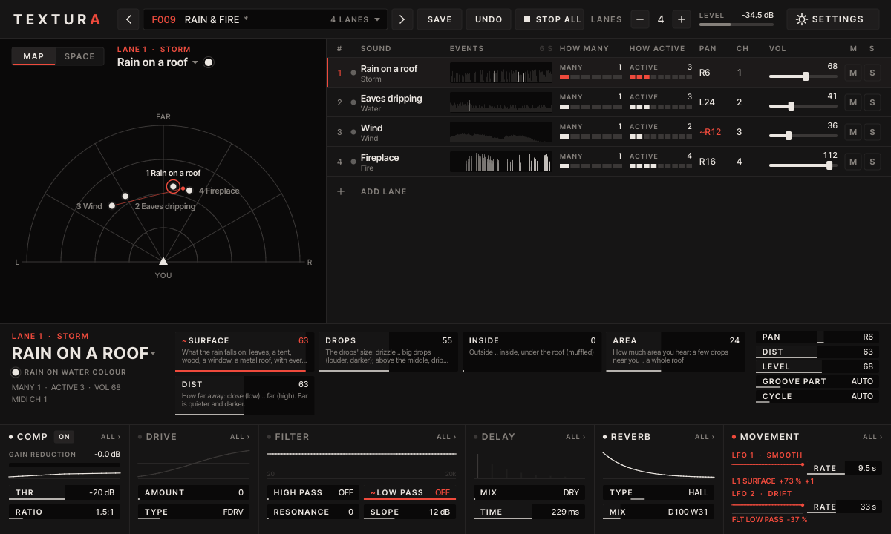
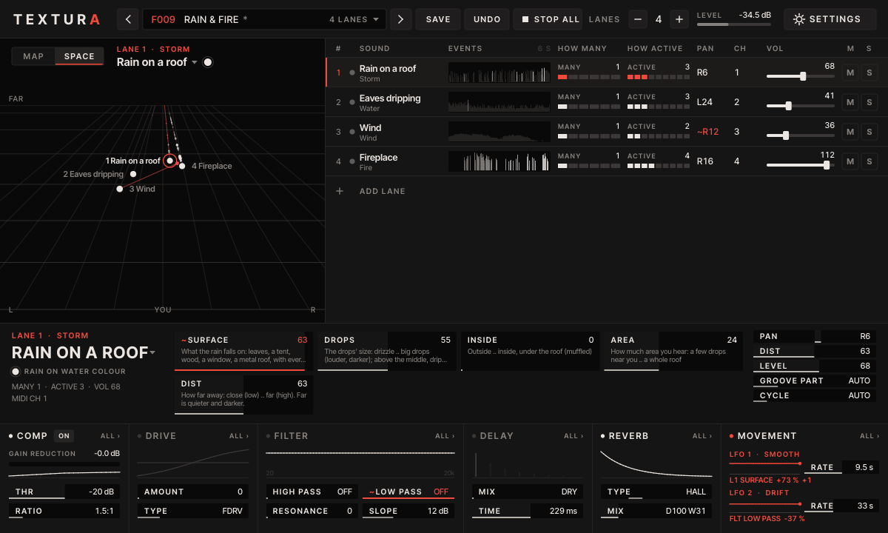
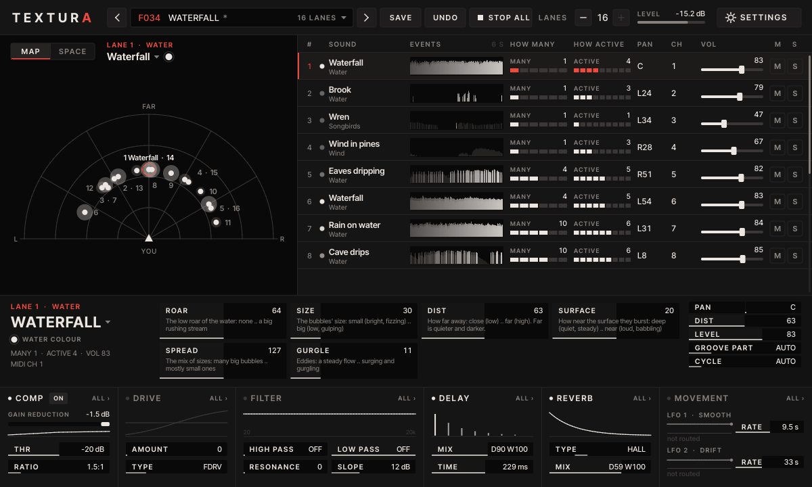
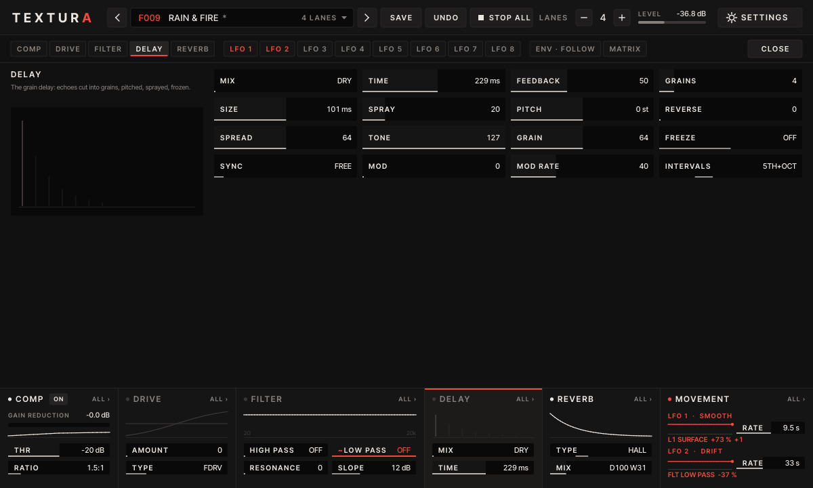
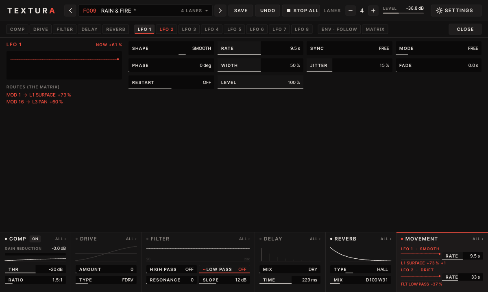
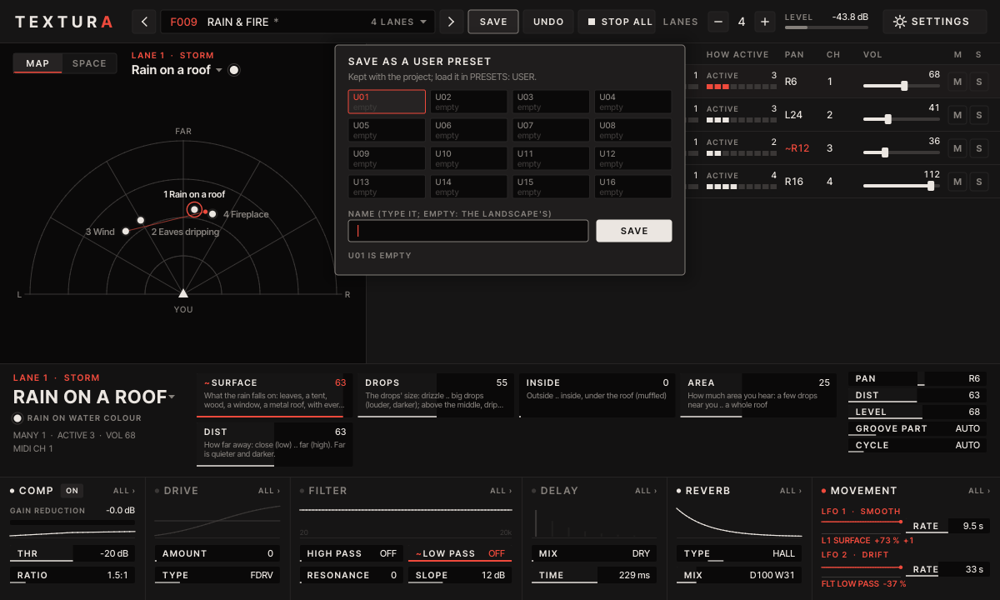
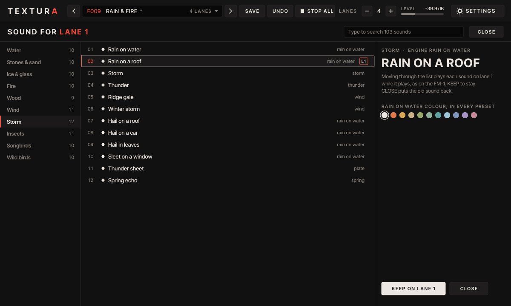
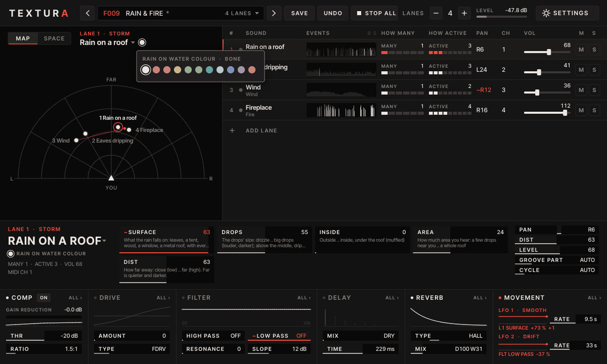

<!-- SPDX-License-Identifier: GPL-3.0-only -->
# Textura: desktop plugin manual

**Textura as an instrument in your DAW: rain, streams, fire, sand and stones, ice, wood, wind, storms, insects and
birds, computed live, on up to 16 lanes.**

The Textura plugin is the FM-1 firmware running inside your music software. It plays the same 103 sounds, the same
presets and landscapes, and the same effects and modulation as the FM-1, from MIDI tracks, with a window of its own.
It comes as CLAP, VST3 and Audio Unit for macOS, and as CLAP and VST3 for Windows and Linux.

This manual covers what is new or different in the plugin. The sounds, the effects and the modulation work as on the
FM-1: for them it links to the [FM-1 user manual](MANUAL.md).

## Contents

1. [What it is](#1-what-it-is)
2. [Install](#2-install): [macOS](#macos), [Windows](#windows), [Linux](#linux)
3. [Your first sound](#3-your-first-sound)
4. [The window](#4-the-window): [top bar](#the-top-bar), [MAP](#map), [SPACE](#space), [the lanes](#the-lanes),
   [the drawer](#the-drawer), [the strip](#the-strip), [the movement](#the-movement), [SAVE](#save),
   [the sound browser](#the-sound-browser), [the presets browser](#the-presets-browser), [SETTINGS](#settings),
   [keys: FM-1 KEYS or PLAY](#keys-fm-1-keys-or-play), [colours](#colours), [LFOs](#lfos),
   [keys and mouse](#keys-and-mouse)
5. [Everything else: host parameters](#5-everything-else-host-parameters)
6. [MIDI](#6-midi)
7. [Lanes](#7-lanes)
8. [Saving](#8-saving)
9. [Sound, CPU and latency](#9-sound-cpu-and-latency)
10. [Known limits](#10-known-limits)
11. [Differences from the FM-1](#11-differences-from-the-fm-1)
12. [If something goes wrong](#12-if-something-goes-wrong)

## 1. What it is

- **An instrument plugin.** It appears as **Textura** (vendor Textura): a note input (MIDI or CLAP notes) and a
  stereo output. It makes its own sound; it does not process audio.
- **The FM-1's sounds.** Every sound is a physical model computed live, never a recording. Each plays as a cloud of
  small events, and no two events are alike ([the idea](MANUAL.md#2-the-idea-landscapes-lanes-and-clouds)).
- **Up to 16 lanes.** The FM-1 has 4. Each lane holds one sound, and each lane has its own MIDI channel.
- **The HQ build.** A computer has room the FM-1 does not, so nothing is ever thinned: every lane plays all its
  events and the grain delay plays every grain.
- **Free and open.** GPL-3.0, like the firmware. No account, no licence key, no copy protection.

| System | Formats | Needs |
| --- | --- | --- |
| macOS | CLAP, VST3, Audio Unit (v2) | Apple silicon or Intel |
| Windows | CLAP, VST3 | Windows 10 or newer, x64 |
| Linux | CLAP, VST3 | x86_64 or aarch64, glibc 2.31 or newer, X11 or XWayland |

## 2. Install

There is no installer. You copy the plugin files into your plug-in folders and rescan in your DAW. Copy only the
formats your DAW uses. To remove the plugin, delete what you copied.

### macOS

Copy each bundle into its folder:

| File | Folder |
| --- | --- |
| `Textura.clap` | `~/Library/Audio/Plug-Ins/CLAP/` |
| `Textura.vst3` | `~/Library/Audio/Plug-Ins/VST3/` |
| `Textura.component` (Audio Unit) | `~/Library/Audio/Plug-Ins/Components/` |

`~` is your home folder (in Finder: Go, Go to Folder). The files are not signed by Apple, so clear the download flag
in Terminal, then rescan:

    xattr -dr com.apple.quarantine ~/Library/Audio/Plug-Ins/*/Textura.*

For the Audio Unit (Logic, GarageBand), `killall -9 AudioComponentRegistrar` makes macOS see it at once.

### Windows

Unzip `textura-plugin-windows-x64.zip`. Its `INSTALL.txt` says the same as this:

| File | Folder |
| --- | --- |
| `CLAP\Textura.clap` | `C:\Program Files\Common Files\CLAP\` (for you only: `%LOCALAPPDATA%\Programs\Common\CLAP\`) |
| `VST3\Textura.vst3` (the whole folder) | `C:\Program Files\Common Files\VST3\` |

The files are not code-signed. If Windows marks them as downloaded: right-click each, Properties, Unblock. The plugin
needs nothing else: no runtime to install.

### Linux

Unzip `textura-plugin-linux-x86_64.zip` (or `-aarch64`). Its `INSTALL.txt` says the same as this:

    cp Textura.clap ~/.clap/            (or /usr/lib/clap/ for everyone)
    cp -R Textura.vst3 ~/.vst3/         (or /usr/lib/vst3/ for everyone)

It needs only the system's own libraries (libc and libX11). It runs on Ubuntu 20.04, Debian 11, Fedora 32 and later.

## 3. Your first sound

1. **Add Textura** to an instrument track (a MIDI track) in your DAW, and open its window.
2. **Load a preset.** Click the preset name in the top bar. The presets browser opens. Pick a family on the left,
   then a preset, and press **LOAD**. Or use the **<** and **>** buttons beside the name to step through the
   factory presets. The preset's lanes start at once: the event lines start to move. No notes are needed. (A
   landscape starts stopped, as on the FM-1: press **PLAY ALL**.)
3. **Move a sound.** Drag a dot on the MAP: left and right is its pan, up is farther away.
4. **Change a sound.** Click a lane's sound name. The sound browser opens and plays each sound you move to on that
   lane. Press **KEEP ON LANE n** to keep it.
5. **Play it.** Notes on a lane's channel (lane n on channel n) play that lane as the FM-1's keys do in PLAY mode:
   each sound plays its own way, a note setting the size or pitch of its events.
6. **Busier or calmer.** Click a lane's **HOW MANY** and **HOW ACTIVE** blocks. Click a lane to see all its cards
   in the drawer below; drag one to change it.
7. **Shape the mix.** The strip at the bottom holds the effects; click a section's name to open all its parameters.

Your DAW saves all of it with the project ([saving](#8-saving)).

## 4. The window

One window, 1200 × 720 at 100 %. Drag its corner to any size from 840 to 2400 wide and 504 to 1800 high, at any
shape: the window scales evenly, the MAP stays round, and a taller or wider window gives the lanes more room. It is
dark and nearly monochrome on purpose. **Red marks only three things**: what is selected, what is on (a solo, a chosen
option), and what an LFO moves. Each engine can have a colour of its own ([colours](#colours)).

From top to bottom:

- **The top bar**: the preset, SAVE, UNDO, PLAY ALL, LANES, the output level, SETTINGS.
- **The place** (left) and **the lanes** (right): where each sound stands, and one row for each lane.
- **The drawer**: the selected lane's sound, all its cards, and its PAN, DIST, LEVEL and groove.
- **The strip**: the effects in signal order (COMP, DRIVE, FILTER, DELAY, REVERB) and the movement (the LFOs).
  Every section opens to all its parameters.

Every value in the window works the same way: **drag** it (up or right raises it; hold Shift for fine steps), turn
the **mouse wheel** over it, or **double-click** it for its default (a card: the sound's own value). A choice (a type,
a shape, ON / OFF) also steps on a **click** (Alt-click steps back). Each drag is one undo step in your DAW, and is
recorded when your DAW records automation.

### The top bar

| Part | What it does |
| --- | --- |
| **TEXTURA** | The name. |
| **<** and **>** | The previous / next factory preset, F001 to F100 (after F100 comes F001). |
| **The scene** | The preset's code and name (`F009 RAIN & FIRE`), a user preset (`U01 ...`) or the landscape (`L01 WATER`). A `*` after the name: you changed something since it loaded. At the right, how many lanes it uses. Click it for the [presets browser](#the-presets-browser). |
| **SAVE** | Saves what plays as a user preset, U01 to U16 ([SAVE](#save)). |
| **UNDO** | Undoes the last preset load or sound kept; click again to redo it. As the FM-1's UNDO. Dim when there is nothing to undo. |
| **PLAY ALL / STOP ALL** | Stops every lane, or starts them again, as the FM-1's REC. It turns white when every lane is stopped (a landscape's start). Space bar does the same. |
| **LANES − / +** | How many lanes are in use, 1 to 16 ([lanes](#7-lanes)). |
| **LEVEL** | The output's peak now, in dB. Red near 0 dB. |
| **SETTINGS** | Opens [SETTINGS](#settings). Click again to close. |

### MAP

The MAP is the place seen from above: a half circle, **YOU** (the triangle) at its centre at the bottom, **L** and
**R** at its sides and **FAR** at its top. Each lane is a dot with its number and its sound's name.

- **Left / right** is the lane's **PAN**.
- **Near / far** is the sound's **DIST** card, its distance, where the sound has one. A sound without a DIST card
  shows a hollow dot: then a drag moves its pan only.
- **Drag a dot** to move the sound: PAN and DIST together.
- A dot **glows** with the lane's last events. The selected lane has a red ring.
- **Lanes on one spot** fan out a little, so each dot shows and can be taken, and share one label: `1 Rain on water ·
  2 · 3 · 4`. A label that would cover another label or a dot moves to the other side, or is left out.
- With more than 8 lanes, a dot shows its number only. The selected lane and the one under the mouse show their names.

**The selected lane** is named at the top of the place: **LANE n · FAMILY**, its sound (click it for the
[sound browser](#the-sound-browser)) and its engine's colour dot (click it for the [colour](#colours) picker).

### SPACE

**SPACE** shows the same place in perspective. Switch with **MAP | SPACE** at the top left, or press **v**.

- The listener stands at the bottom edge (**YOU**). Far sounds are small, near the horizon (**FAR**).
- Each lane's events of the last 6 seconds drift away from it toward the horizon. A busy lane leaves a dense trail;
  a rare one leaves single marks.
- The lanes stand where the MAP puts them. Drag a lane on the ground to move it (pan and distance, as on the MAP).
- The MAP places a sound exactly; SPACE shows the place at a glance. Your DAW's project remembers which view was open.

### The lanes

One row for each lane in use, and **ADD LANE** under them (while there are fewer than 16). More rows than fit
scroll: turn the mouse wheel over them. A row shows, left to right:

| Column | What it shows |
| --- | --- |
| **#** | The lane's number (red when selected) and its engine's colour. |
| **SOUND** | The sound and its family. Click the name for the [sound browser](#the-sound-browser). |
| **EVENTS** | The lane's **event line**: the last 6 seconds. A bar for each moment with events, as high as their loudness, over a faint band for the lane's level. A stopped lane reads **STOPPED**. |
| **HOW MANY** | How many sources the cloud has: six blocks for **1 2 4 10 19 32**; none lit is **OFF**. Click a block for that many (the top lit block again: one less, so the first block again is OFF). Drag along the blocks, or turn the wheel. |
| **HOW ACTIVE** | How busy each source is: nine blocks, rare to busy. Click, drag and wheel as HOW MANY. |
| **PAN** | The lane's pan (`L24`, `C`, `R16`). Drag it, wheel, double-click for the centre. Red with a `~` while an LFO moves it. |
| **CH** | The MIDI channel the lane listens on, OFF or 1 to 16. A click steps it ([MIDI](#6-midi)). |
| **VOL** | The lane's **LEVEL**, 0 to 127. Drag it, turn the wheel over it, or double-click for 100. |
| **M** | Mute. The lane goes silent but keeps playing, so it comes back at once. A preset keeps it, as on the FM-1. |
| **S** | Solo. While any lane is soloed, only the soloed lanes play. Alt-, Cmd- or Ctrl-click solos one lane alone (click it again that way to clear). The project keeps it. |

Click a row to select its lane. LEVEL is the sound's, as on the FM-1: two lanes playing the same sound share it.

**A stopped lane** reads **STOPPED** across its event line, with its HOW MANY and HOW ACTIVE at OFF. A landscape
starts with all four lanes stopped, as on the FM-1: the window says **ALL LANES STOPPED** under the rows and PLAY ALL
turns white. Press **PLAY ALL**, or set a lane's HOW MANY or HOW ACTIVE: that starts it.

### The drawer

Under the place and the rows, the **drawer** shows the selected lane:

- **At the left**: **LANE n · FAMILY**, the sound in large letters (click it for the sound browser), the engine's
  colour (click it for the picker), and a line with MANY, ACTIVE, VOL and the lane's MIDI channel, STOPPED or MUTED.
- **In the middle**: **every card** of the sound, up to eight, four to a row. Each card shows its name, its value in
  its own unit, and what it does (the FM-1 manual's line for it). A card an LFO moves now is red, with `~` before
  its name.
- **At the right**: the lane's **PAN**, **DIST** (where the sound has one), **LEVEL**, and its groove **PART** and
  **CYCLE** ([the groove](MANUAL.md#the-groove)).

### The strip

The strip at the bottom shows the mix's effects in the order the sound goes through them, then the movement. Each
section has a dot (lit while it acts), a small picture and its two main values:

| Section | Picture | In the strip | All of it (click the header) |
| --- | --- | --- | --- |
| **COMP** | Its gain reduction now, and its curve | ON / OFF, THR, RATIO | COMP, THR, ATTACK, REL, RATIO, MAKEUP |
| **DRIVE** | Its curve | AMOUNT, TYPE | AMOUNT, TONE, MIX, TYPE |
| **FILTER** | Its response, HIGH PASS then LOW PASS (dashed marks; red while an LFO moves one) | HIGH PASS, LOW PASS (in Hz), RESONANCE, SLOPE | the same |
| **DELAY** | Its echoes | MIX, TIME | MIX, TIME, FEEDBACK, GRAINS, SIZE, SPRAY, PITCH, REVERSE, SPREAD, TONE, GRAIN, FREEZE, SYNC, MOD, MOD RATE, INTERVALS |
| **REVERB** | Its tail | TYPE, MIX | TYPE, MIX, DECAY, TONE, PREDELAY, SIZE, MOD, LOWCUT, SHIMMER, SHIFT |
| **MOVEMENT** | Two LFOs (the routed ones first): each one's shape, its live trace, its RATE, its route | RATE | [the movement](#the-movement) |

**Click a section's header** (or **ALL ›**) to open it over the place and the lanes: a tab for each effect, **LFO 1**
to **LFO 8**, **ENV · FOLLOW** and **MATRIX**. The strip stays under it. Click the header again, **CLOSE** or Esc to
close. What each effect parameter does: [the effects](MANUAL.md#7-the-effects) in the FM-1 manual.

### The movement

- **LFO 1** to **LFO 8**: the trace of the last seconds (red when routed), its value **NOW**, its **ROUTES** (the
  matrix slots it drives, each with its target and depth), and all ten parameters: SHAPE (SINE, TRI, SAW UP,
  SAW DN, SQUARE, PULSE, S&H, SMOOTH, DRIFT, GUSTS, CHAOS, STEPS), RATE, SYNC, MODE, PHASE, WIDTH, JITTER, FADE,
  RESTART, LEVEL. A tab is red while its LFO is routed.
- **ENV · FOLLOW**: **ENV 1** and **ENV 2** (TRIGGER, ATTACK, DECAY, RELEASE, SUSTAIN, CURVE, VARY, LOOP) and
  **FOLLOW 1** and **FOLLOW 2** (INPUT, ATTACK, RELEASE, GAIN).
- **MATRIX**: the 16 slots, **MOD 1** to **MOD 16**, each with SOURCE, TARGET, DEPTH and SPREAD (a slot in use is
  red), and **MOD CC** (the CC the matrix's CC source reads).

How the modulation works: [movement](MANUAL.md#8-movement-lfos-envelopes-followers-and-the-matrix) in the FM-1 manual.

### SAVE

**SAVE** in the top bar opens a small panel: the 16 user presets **U01** to **U16** with their names, a name field
and **SAVE**.

- It opens on the user preset loaded (with its name), else on the first empty one. Click another to choose it.
- **Type** the name: up to 11 letters, A to Z, 0 to 9, space and `- & ' .`. Backspace deletes. Left empty, the
  preset takes the landscape's name.
- **SAVE** (or Return; a double-click on a slot) saves what plays into it, as the FM-1's SAVE does. A full slot is
  replaced (the panel says so before).
- The user presets are **kept with the project**. Load them in the presets browser, **MINE: User**, or by program
  change 100 to 115.

### The sound browser

Opens from a lane's sound name (in its row, at the top of the place or in the drawer), or with **Return** for the
selected lane. The header reads **SOUND FOR LANE n**.

- **Left**: the ten families, with how many sounds each has.
- **Middle**: the family's sounds, each with its engine at the right. **L1** (L2 ...) marks the sounds lanes play now.
- **Right**: the sound under the cursor, its family and engine, and the engine's colour row.
- **Type** to search all 103 sounds by name, family or engine. Backspace deletes.
- **Up / down** move the cursor; **left / right** change the family; the wheel scrolls.

As on the FM-1, the sound under the cursor plays on the lane while the lane plays: a click at once, the arrow keys
once they rest. The header says **HEARING ON LANE n** and the sound's name while it does.

- **KEEP ON LANE n** (Return, or a double-click) keeps it. The scene shows `*`.
- **CLOSE** (Esc) puts the old sound back.

What each sound is and what its cards do: [the sounds](MANUAL.md#5-the-sounds) in the FM-1 manual.

### The presets browser

Opens from the scene name in the top bar.

- **Left**: **MINE** (your user presets, when there are any), **FACTORY**, the ten families of presets (Rain, Storm,
  Coast, River & lake, Forest, Meadow, Night, Fire, Stone & sand, Ice & winter), and **START FROM**, the ten
  **Landscapes**.
- **Middle**: the presets, each with its code and how many lanes it uses.
- **Right**: the preview. Where its lanes stand, and each lane's sound with its HOW MANY and HOW ACTIVE.
- **Type** to search; **up / down** move; **left / right** go to the next family.
- **LOAD** (Return, or a double-click) loads it. **CLOSE** (Esc) closes the browser.

A load works as on the FM-1 ([loading](MANUAL.md#loading)): it never cuts the sound, and new sounds fade in lane by
lane. A factory preset, a landscape or an FM-1 scene fills lanes 1 to 4 and sets LANES to 4. A landscape starts
stopped, as on the FM-1: press PLAY ALL, or set a lane's HOW MANY.

Under the preview are the two load options, also in SETTINGS:

- **EFFECTS ON LOAD**: **ALWAYS** (the preset brings its effects), **SMART** (it brings them until you change an
  effect yourself; then yours stay), **NEVER** (your effects stay). With SMART, loading the same preset again brings
  its effects back.
- **PRESETS CHANGE TEMPO**: **NO** / **YES**. With YES a preset brings its tempo too. Your DAW's tempo still leads
  when it gives one.

The 100 factory presets by family: [factory presets](MANUAL.md#factory-presets) in the FM-1 manual.

### SETTINGS

Six groups, by function. All but ENGINE COLOURS, WINDOW and the tempo are host parameters too, so your DAW can
automate them. A box steps on a click (Shift- or Alt-click steps back), the wheel steps it, a double-click sets the
default. A row of choices takes a click.

| Group | What is in it |
| --- | --- |
| **MIDI IN** | Each lane's channel, **LANE 1** to **LANE 16**: CH 1 to CH 16 or OFF (dim for lanes not in use). **FX channel**: effects, tempo, groove and scale CCs, 5 at first. **Selected lane channel** (SELECTED CH): its notes play the selected lane, 1 at first. **MOD CC**: the CC the matrix's CC source reads, CC 2 at first. **KEYS ON SELECTED CH**: **PLAY** or **FM-1 KEYS** ([keys](#keys-fm-1-keys-or-play)). See [MIDI](#6-midi). |
| **SCALE** | **MODE** (OFF, SNAP, DEGREE), **SCALE** (MAJOR ... BLUES), **Root**, **Transpose**. As on the FM-1 ([SCALE](MANUAL.md#scale)). They act on the FM-1's own keys (and on FM-1 KEYS); MIDI notes in PLAY play as sent. |
| **TIMING** | **Tempo** and **Fine** (0.1 BPM steps): the plugin's own tempo, used when your DAW gives none (your DAW's tempo leads). **Groove**, **Groove amount**, **Groove shift** ([the groove](MANUAL.md#the-groove)). |
| **LOADING** | **EFFECTS ON LOAD**, **PRESETS CHANGE TEMPO** (as in the presets browser), **Lanes in use** (LANES). |
| **WINDOW** | **SIZE**: 100 %, 125 %, 150 %, 200 % (at 5:3; drag the corner for any other size). **PLACE VIEW**: MAP or SPACE. The last line names the build (HQ build, 16 lanes). |
| **ENGINE COLOURS** | The engines the lanes play now, each with its colour dot: click one to choose its colour. **RESET ALL TO BONE** sets them all back. |

Close SETTINGS with **CLOSE**, Esc or the SETTINGS button.

### Keys: FM-1 KEYS or PLAY

**KEYS ON SELECTED CH** (SETTINGS, MIDI IN; the host parameter `MIDI KEYS`) says what notes on SELECTED CH do:

- **PLAY** (the default): they play the selected lane as sent, like every lane's own channel. Your MIDI tracks play
  as they always did.
- **FM-1 KEYS**: notes **F3 to G5** are the FM-1's 27 keys in its LANDSCAPE mode. The **black keys** pick lanes 1 to
  4 by their groups (F#3 G#3 A#3: lane 1; C#4 D#4: lane 2; F#4 G#4 A#4: lane 3; C#5 D#5: lane 4); held for 0.6 s
  they mute or unmute it. The black keys above G5 pick lanes 5 to 16 (G#5 lane 5, A#5 lane 6, C#6 lane 7 ...). The
  **white keys F3 to E4** set the selected lane's HOW MANY (OFF, 1, 2, 4, 10, 19, 32), **F4 to G5** its HOW ACTIVE.
  Other notes on that channel still play the selected lane.

PLAY is the default because the DAW's notes are music: a track that plays the selected lane keeps playing it, and an
older project sounds as it did. Choose FM-1 KEYS to play the plugin from a keyboard the way you play the FM-1.

The window's selected lane and the app's are one: a lane picked in the window is the one SELECTED CH plays, and a
lane picked by the keys is selected in the window (its row scrolls into view).

### Colours

Every sound comes from an engine (the line under its name in the sound browser: rain on water, wind, fire ...). A
colour belongs to an **engine**, not to a lane: every sound of that engine, in every preset, takes it, for its dot,
its event line and its row.

- Click the colour dot of the selected lane (at the top of the place or in the drawer), a dot in ENGINE COLOURS, or
  a colour in the sound browser.
- Eleven colours: **BONE** (the default), EMBER, AMBER, SAND, MOSS, SAGE, TEAL, ICE, SLATE, LILAC, ROSE. None is red:
  red is kept for the selection and the LFOs.
- Click a colour to set it; click anywhere else (or Esc) to close the picker.
- The project keeps the colours.

### LFOs

What an LFO moves is red, everywhere in the window:

- **In the strip's MOVEMENT**: two LFOs, the routed ones first, each with its shape, live trace and first route
  (`L3 PAN +60 %`: lane 3's pan, 60 %). `+n` says how many more are routed.
- **A value an LFO moves now** is red, with a `~` before it: a card in the drawer, a row's PAN and VOL, HOW MANY and
  HOW ACTIVE, an effect's value (the FILTER's dashed mark).
- **On the MAP and in SPACE** a small red point and line show where the LFO has the lane right now; the white dot is
  where you put it.

### Keys and mouse

With the window focused and no panel open:

| Key | What it does |
| --- | --- |
| **Up / down** | Select the previous / next lane |
| **Return** | Open the selected lane's sound browser |
| **m** | Mute / unmute the selected lane |
| **s** | Solo / unsolo the selected lane |
| **v** | Switch MAP / SPACE |
| **Space** | PLAY ALL / STOP ALL |

In a browser: type to search, **up / down** (Page Up / Page Down: 10 at a time), **left / right** for the family,
**Return** to keep or load, **Esc** to close. In SAVE: type the name, **Return** saves, **Esc** closes. Some DAWs
keep the keys for themselves; the mouse does everything too.

## 5. Everything else: host parameters

Every host parameter is also in the window: the lanes in their rows and the drawer, the effects and the movement
in the strip, the MIDI, scale, timing and loading settings in SETTINGS. Your DAW lists the same parameters (its
generic view of the plugin) for automation, and MIDI CCs and NRPNs reach them too.

| Group (as the DAW lists it) | Parameters |
| --- | --- |
| **Scenes** | **PRESET**, F001 to F100 (loads a whole scene; not automatable) |
| **MIDI** | **MIDI KEYS**: PLAY or FM-1 KEYS (not automatable) |
| **Lane 1** ... **Lane 16** | `L1 SOUND`, `L1 HOW MANY`, `L1 HOW ACTIVE`, `L1 LEVEL`, `L1 PAN`, `L1 CARD 1` to `L1 CARD 8`, `L1 GROOVE PART`, `L1 GROOVE CYCLE` |
| **Grain delay**, **Reverb**, **Compressor**, **Drive**, **Filter** | The effects, as on their FM-1 pages ([the effects](MANUAL.md#7-the-effects)) |
| **Groove**, **Keys**, **MIDI** | The groove, the scale, the MIDI channels, EFFECTS ON LOAD, LANES |
| **LFO**, envelopes, followers, matrix | LFO 1 to 8, ENV 1 and 2, FOLLOW 1 and 2, MOD 1 to 16, MOD CC |

479 parameters in all. Their ids never change between versions, so automation stays put.

- **A lane's cards** (CARD 1 to 8) mean what the lane's sound says: a rain sound's cards are not a bird's. The FM-1
  manual lists every sound's cards ([the sounds](MANUAL.md#5-the-sounds)). A card's value is 0 to 127 over the card's
  own range, as its CC.
- **An empty lane** shows neutral values: LEVEL 100, PAN centre, the rest 0.
- **Change SOUND and a card in separate steps.** A new sound starts from its own cards, so a card value sent in the
  same instant as the SOUND change is replaced by the new sound's default (as on the FM-1).
- **A change the plugin makes itself** (a MIDI CC, a program change, a preset load) goes back to your DAW as a
  parameter change.
- A modulation target names lane 1 to 4 or **ALL LANES**, as on the FM-1. ALL LANES reaches lanes 5 to 16 too.

## 6. MIDI

The plugin listens as the FM-1 does over USB MIDI ([MIDI](MANUAL.md#12-midi) in the FM-1 manual), with 16 lanes.

| MIDI | What it reaches |
| --- | --- |
| Notes, CCs, NRPNs on channel n (1 to 16) | Lane n (each lane's channel is set in SETTINGS, MIDI IN) |
| Notes on channel 1 | The selected lane (SELECTED CH) |
| CCs and NRPNs on channel 5 | The effects, the tempo, the groove and the scale (FX CHANNEL) |
| Program change on channel 1 | 0 to 99 load F001 to F100; 100 to 115 load U01 to U16 |

- **Lane n on channel n.** By default each lane listens on its own channel: notes play it, CCs shape it. Put each
  lane on its own MIDI track, or play them all from one track with several channels.
- **Notes** play a lane as the FM-1's keys do in PLAY mode ([PLAY mode](MANUAL.md#10-play-mode-and-scales)): a note
  sets the size or pitch of the lane's events. The lane's cloud plays by itself, without notes, while it runs.
- **Layering.** Set two or more lanes to one channel: its notes and CCs reach all of them. **OFF**: the lane listens
  to nothing.
- **The selected lane.** Notes on SELECTED CH (channel 1 at first) play the selected lane, as on the FM-1: the lane
  selected in the window. With **KEYS ON SELECTED CH** at **FM-1 KEYS**, F3 to G5 on that channel are the FM-1's
  keys instead: they pick lanes and set HOW MANY and HOW ACTIVE ([keys](#keys-fm-1-keys-or-play)). Set SELECTED CH
  to OFF if channel 1 should reach lane 1 only.
- **SCALE** acts on the FM-1's keys, as on the FM-1: MIDI notes played on a lane (and on SELECTED CH in PLAY) play
  as sent.
- **Channel 5 is shared.** Lane 5 listens on channel 5 and so do the effects (FX CHANNEL 5, as on the FM-1). Both
  work there: the effects' CCs and the lanes' CCs use different numbers. Move FX CHANNEL if you want them apart.
- **Lane CCs**: 7 LEVEL, 10 PAN, 20 SOUND, 21 HOW MANY, 22 HOW ACTIVE, 14 to 17 and 18, 19, 23, 24 the cards 1 to 8.
  The effect CCs on the FX CHANNEL: the [FM-1 table](MANUAL.md#effect-and-global-ccs-channel-5).
- **NRPN**: every parameter, as on the FM-1 ([NRPN](MANUAL.md#nrpn-every-parameter)): CC 99 the scope, CC 98 the
  index, CC 6 the value. Lanes 1 to 4 are scopes 0 to 3, as on the FM-1; **lanes 5 to 16 are scopes 16 to 27**. The
  globals (scope 4) add 68 to 79 LANE 5 to 16 CHANNEL, 80 FX CHANNEL, 81 LANES.
- **Velocity, mod wheel, aftertouch and the MOD CC** are matrix sources, as on the FM-1.
- **Tempo**: your DAW's tempo leads when it gives one; otherwise the plugin's own. The plugin does not take or send
  MIDI clock: the DAW's tempo replaces it.

## 7. Lanes

**LANES** (1 to 16) is how many lanes are in use. Set it with **LANES − / +** in the top bar, **ADD LANE** under the
rows, Lanes in use in SETTINGS, or the LANES parameter.

- **A lane past LANES is empty**: no sound, no engine, no CPU.
- **Raising LANES** adds empty lanes. Give each one a sound with its sound browser.
- **A new lane starts stopped.** Set its HOW MANY or HOW ACTIVE (`L5 HOW MANY` ..., or CC 21 / CC 22 on its channel)
  to start it. HOW MANY at OFF stops it again; its last events ring out.
- **A sound set on lane n** (from the DAW, or by CC 20 on its channel) raises LANES to n.
- **Lowering LANES** empties the lanes past it. Each one stops and its sound rings out naturally; nothing is cut.
- **Factory presets, landscapes and FM-1 scenes** fill lanes 1 to 4, exactly as on the FM-1, and set LANES to 4.
  A plugin scene keeps all its lanes.

## 8. Saving

Your DAW saves the plugin with the project, and its own preset function saves it too. The plugin keeps:

- what a user preset keeps on the FM-1: the landscape, each lane's sound, HOW MANY, HOW ACTIVE, level, pan, mute and
  cards, the effects, the modulation, the groove and the tempo;
- the preset loaded last, the scale, the MIDI channels, EFFECTS ON LOAD and PRESETS CHANGE TEMPO;
- your user presets, U01 to U16 ([SAVE](#save));
- KEYS ON SELECTED CH, the selected lane;
- the window's own: the solo, the size, MAP or SPACE, and the engines' colours.

Opening the project brings it all back, its effects included.

The plugin writes nothing to disk itself: the user presets live in the project. To use them in another project, save
your DAW's preset of the plugin, or load the project's state there. A project saved by an earlier, 4-lane plugin still
opens: lanes 1 to 4 as saved, LANES 4.

## 9. Sound, CPU and latency

- **Sample rates.** Textura computes at 44.1 kHz in blocks of 256 samples, as on the FM-1. At 44.1 kHz you hear
  exactly that. At 48 kHz and its multiples (88.2, 96, 176.4, 192 kHz and up) a high-quality resampler converts it;
  any other rate works too.
- **Latency.** Constant: 258 samples at 44.1 kHz, 325 at 48 kHz (one block and the resampler). The plugin tells your
  DAW, which compensates. Notes act from the start of the block that holds them, as on the FM-1.
- **CPU.** Light. On an Apple M-series Mac at 48 kHz, four heavy lanes take about 1 % of one core, sixteen heavy lanes
  about 3 %. Empty lanes cost nothing.
- **Instances.** Up to 16 Textura instances play in one DAW process. A 17th stays silent and says so in the DAW's log.
- **Levels.** As on the FM-1, the default start is quiet, every sound is about equally loud, and a limiter at the end
  keeps the output from clipping ([sound and volume tips](MANUAL.md#11-sound-and-volume-tips)).

## 10. Known limits

- **The window on Windows and Linux** is drawn by the same code as on macOS, and its pictures match macOS's, but it
  has not been tried on a real Windows or Linux desktop yet. If it does not open, use your DAW's generic parameter view.
- **User presets belong to their project.** A new project starts with none; use your DAW's presets to carry them.
- **The map's distance** is the DIST card's value (0 to 127), not metres: the app has no metres to show.
- **Setting a preset and modulated cards in the same instant** can leave a card the matrix holds at the sound's
  default instead of the scene's value. Set them a moment apart.
- **Audio Unit**: `auval` gives one warning ("Preset name is not retained in retrieved class data"). It is harmless.
- **The files are not signed** (macOS, Windows): clear the download flag as in [install](#2-install).
- **More than 16 instances** in one DAW process: the 17th plays silence.

## 11. Differences from the FM-1

| | FM-1 | Plugin |
| --- | --- | --- |
| **Lanes** | 4 | 1 to 16 (LANES) |
| **Thinning** | The CPU governor may thin a busy lane | Never (HQ build) |
| **Playing** | Keys: lanes, HOW MANY, HOW ACTIVE, mute; PLAY mode | MIDI notes on each lane's channel play it as in PLAY mode; FM-1 KEYS on SELECTED CH plays the keys' way; the window's HOW MANY and HOW ACTIVE blocks |
| **Starting** | REC starts and stops the lanes | PLAY ALL / STOP ALL (REC); a factory preset's lanes start when it loads, a landscape's start stopped; HOW MANY or HOW ACTIVE starts a lane |
| **Editing** | Pages and knobs | The window: every parameter, in the rows, the drawer, the strip and SETTINGS |
| **Solo** | No | **S** on each row |
| **Lane channels** | LANE 1 to 4 CHANNEL | LANE 1 to 16 CHANNEL, FX CHANNEL |
| **Tempo** | Its own, tap, MIDI clock in and out | The DAW's tempo leads; no MIDI clock |
| **Saving** | U01 to U16 in flash, settings kept by themselves | SAVE: U01 to U16 in the project; the DAW's project or presets |
| **Undo** | Hold SAVE | UNDO (a load, a sound kept); your DAW's undo for window edits (host parameter changes) |
| **Sample rate** | 44.1 kHz | Any; 44.1 kHz inside |
| **Screen colour, clock, status line** | DISPLAY, MIDI CLOCK pages | Not in the plugin |
| **Look** | One accent colour | Dark, red for selection and LFOs, a colour per engine |

The sounds, the presets, the landscapes, the effects, the modulation and the groove are the same. A 4-lane scene
plays in the plugin as on the FM-1, with nothing thinned.

## 12. If something goes wrong

- **The DAW does not list Textura**: check the folder ([install](#2-install)), clear the download flag (macOS) or
  Unblock the files (Windows), and rescan. For the Audio Unit run `killall -9 AudioComponentRegistrar`.
- **No sound**: load a preset (its lanes start at once). A landscape starts stopped (the rows read STOPPED):
  press PLAY ALL. A lane you added starts stopped: set its HOW MANY or HOW ACTIVE. Check the row's VOL and M, a solo on another lane (**S**), and the effects: a filter turned far down, a
  MIX at WET with the effect off.
- **A lane does not answer its track**: compare the track's MIDI channel with the lane's CH. Channel 1 notes go to
  the selected lane (SELECTED CH).
- **The effects change when I play lane 5**: lane 5 and the effects share channel 5, but not their CC numbers. Move
  FX CHANNEL in SETTINGS if your controller sends effect CCs on channel 5.
- **A preset changed my effects / did not change them**: EFFECTS ON LOAD (the presets browser or SETTINGS).
- **Everything moves on its own**: an LFO, envelope or follower is routed. Red values show what moves; open the
  strip's MOVEMENT, MATRIX, and set the slot's SOURCE to NONE.
- **The keys change HOW MANY instead of playing**: KEYS ON SELECTED CH is at FM-1 KEYS (SETTINGS, MIDI IN).
- **The events fall into a rhythm**: that is the groove. Turn Groove amount down (SETTINGS, TIMING).
- **A 17th instance is silent**: 16 per DAW process is the limit.
