<!-- SPDX-License-Identifier: GPL-3.0-only -->
# Textura: desktop plugin manual

**Textura as an instrument in your DAW: rain, streams, fire, sand and stones, ice, wood, wind, storms, insects and
birds, computed live, on up to 16 lanes.**

The Textura plugin is the FM-1 firmware running inside your music software. It plays the same 103 engines, the same
presets and landscapes, and the same effects and modulation as the FM-1, from MIDI tracks, with a window of its own.
It comes as CLAP, VST3 and Audio Unit for macOS, and as CLAP and VST3 for Windows and Linux.

This manual covers what is new or different in the plugin. The engines, the effects and the modulation work as on the
FM-1: for them it links to the [FM-1 user manual](MANUAL.md).

## Contents

1. [What it is](#1-what-it-is)
2. [Install](#2-install): [macOS](#macos), [Windows](#windows), [Linux](#linux)
3. [Your first sound](#3-your-first-sound)
4. [The window](#4-the-window): [top bar](#the-top-bar), [HELP and the tour](#help-and-the-tour), [MAP](#map),
   [SPACE](#space), [the M/S view](#the-ms-view), [the lanes](#the-lanes), [the drawer](#the-drawer), [the strip](#the-strip), [M/S](#ms),
   [the movement](#the-movement), [SAVE](#save),
   [RANDOM: the dice](#random-the-dice), [the engine browser](#the-engine-browser),
   [the presets browser](#the-presets-browser), [SETTINGS](#settings),
   [keys: FM-1 KEYS or PLAY](#keys-fm-1-keys-or-play), [colours](#colours), [LFOs](#lfos),
   [keys and mouse](#keys-and-mouse)
5. [Everything else: host parameters](#5-everything-else-host-parameters)
6. [MIDI](#6-midi)
7. [Lanes](#7-lanes)
8. [Saving](#8-saving)
9. [Sound, CPU and latency](#9-sound-cpu-and-latency)
10. [Known limits](#10-known-limits)
11. [Differences from the FM-1](#11-differences-from-the-fm-1)
12. [If something goes wrong](#12-if-something-goes-wrong)

## 1. What it is

- **An instrument plugin.** It appears as **Textura** (vendor Textura): a note input (MIDI or CLAP notes) and a
  stereo output. It makes its own sound; it does not process audio.
- **The FM-1's engines.** Every engine is a physical model computed live, never a recording. Each plays as a cloud of
  small events, and no two events are alike ([the idea](MANUAL.md#2-the-idea-landscapes-lanes-and-clouds)).
- **Up to 16 lanes.** The FM-1 has 4. Each lane holds one engine, and each lane has its own MIDI channel.
- **The HQ build.** A computer has room the FM-1 does not, so nothing is ever thinned: every lane plays all its
  events and the grain delay plays every grain.
- **Free and open.** GPL-3.0, like the firmware. No account, no licence key, no copy protection.

| System | Formats | Needs |
| --- | --- | --- |
| macOS | CLAP, VST3, Audio Unit (v2) | Apple silicon or Intel |
| Windows | CLAP, VST3 | Windows 10 or newer, x64 |
| Linux | CLAP, VST3 | x86_64 or aarch64, glibc 2.31 or newer, X11 or XWayland |

## 2. Install

There is no installer. You copy the plugin files into your plug-in folders and rescan in your DAW. Copy only the
formats your DAW uses. To remove the plugin, delete what you copied.

### macOS

Copy each bundle into its folder:

| File | Folder |
| --- | --- |
| `Textura.clap` | `~/Library/Audio/Plug-Ins/CLAP/` |
| `Textura.vst3` | `~/Library/Audio/Plug-Ins/VST3/` |
| `Textura.component` (Audio Unit) | `~/Library/Audio/Plug-Ins/Components/` |

`~` is your home folder (in Finder: Go, Go to Folder). The files are not signed by Apple, so clear the download flag
in Terminal, then rescan:

    xattr -dr com.apple.quarantine ~/Library/Audio/Plug-Ins/*/Textura.*

For the Audio Unit (Logic, GarageBand), `killall -9 AudioComponentRegistrar` makes macOS see it at once.

### Windows

Unzip `textura-plugin-windows-x64.zip`. Its `INSTALL.txt` says the same as this:

| File | Folder |
| --- | --- |
| `CLAP\Textura.clap` | `C:\Program Files\Common Files\CLAP\` (for you only: `%LOCALAPPDATA%\Programs\Common\CLAP\`) |
| `VST3\Textura.vst3` (the whole folder) | `C:\Program Files\Common Files\VST3\` |

The files are not code-signed. If Windows marks them as downloaded: right-click each, Properties, Unblock. The plugin
needs nothing else: no runtime to install.

### Linux

Unzip `textura-plugin-linux-x86_64.zip` (or `-aarch64`). Its `INSTALL.txt` says the same as this:

    cp Textura.clap ~/.clap/            (or /usr/lib/clap/ for everyone)
    cp -R Textura.vst3 ~/.vst3/         (or /usr/lib/vst3/ for everyone)

It needs only the system's own libraries (libc and libX11). It runs on Ubuntu 20.04, Debian 11, Fedora 32 and later.

## 3. Your first sound

1. **Add Textura** to an instrument track (a MIDI track) in your DAW, and open its window. The first time, a short
   tour lights up the window part by part ([HELP and the tour](#help-and-the-tour)).
2. **Load a preset.** Click the preset name in the top bar. The presets browser opens. Pick a family on the left,
   then a preset, and press **LOAD**. Or use the **<** and **>** buttons beside the name to step through the
   factory presets. The preset's lanes start at once: the event lines start to move. No notes are needed. (A
   landscape starts stopped, as on the FM-1: press **PLAY ALL**.)
3. **Move an engine.** Drag a dot on the MAP: left and right is its pan, up is farther away.
4. **Change an engine.** Click the small swap-icon button after the engine's name in a lane's row. The engine browser
   opens and plays each engine you move to on that lane, even a stopped one. Press **KEEP ON LANE n** to keep it.
5. **Play it.** Notes on a lane's channel (lane n on channel n) play that lane as the FM-1's keys do in PLAY mode:
   each engine plays its own way, a note setting the size or pitch of its events.
6. **Busier or calmer.** Click a lane's **HOW MANY** and **HOW ACTIVE** blocks. Click a lane to see all its cards
   in the drawer below; drag one to change it.
7. **Shape the mix.** The strip at the bottom holds the effects; click a section's name to open all its parameters
   in a drawer over the lanes' drawer.

Your DAW saves all of it with the project ([saving](#8-saving)).

## 4. The window

One window, 1200 × 720 at 100 %. Drag its corner to any size from 840 to 2400 wide and 504 to 1800 high, at any
shape: the window scales evenly, the MAP stays round, and a taller or wider window gives the lanes more room. It is
dark and nearly monochrome on purpose. **Red marks only three things**: what is selected, what is on (a solo, a chosen
option), and what a source (an LFO, an envelope, a follower) moves. Each engine can have a colour of its own
([colours](#colours)).

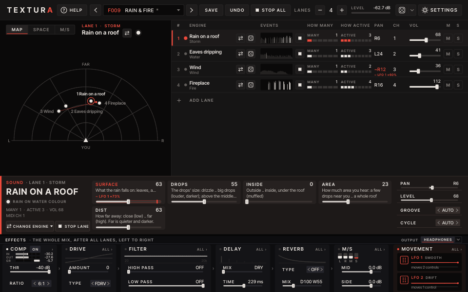

From top to bottom:

- **The top bar**: HELP, the preset, SAVE, UNDO, PLAY ALL, LANES, the output level, the dice (RANDOM),
  SETTINGS.
- **The place** (left) and **the lanes** (right): where each engine stands, and one row for each lane.
- **The drawer**, the **SOUND** zone: the selected lane's engine, all its cards (DIST among them), and its PAN, LEVEL
  and groove, on a warmer, lighter ground with a red rail at its left.
- **The strip**, the **EFFECTS** zone: the whole mix, after all lanes: the effects in signal order (COMP, DRIVE, FILTER,
  DELAY, REVERB, M/S) and the movement (the LFOs), darker and cooler, under a dark gap and its band. Every section
  opens to all its parameters.

Every value in the window works the same way. An amount is a **fader**: its name and value over a track, the part up
to the value filled, a handle at the value (a bipolar one, as PAN or a route's DEPTH, fills from its middle). While an
source moves it, its name turns red, a faint red band on the track shows how far its sources reach, a red tick shows
where they have it now, and small red tags under it name each source ([the movement](#the-movement)). A
choice (a type, a shape, a sync, ON / OFF) shows its value between **<** and **>**: click an arrow for the previous or
the next. Any value: **drag** it (up or right raises it; hold Shift for fine steps), turn the **mouse wheel** over it,
or **double-click** it for its default (a card: the engine's own value). A choice also steps on a **click** (Alt-click
steps back). Each drag is one undo step in your DAW, and is recorded when your DAW records automation.

### The top bar

| Part | What it does |
| --- | --- |
| **TEXTURA** | The name. |
| **HELP** | Starts the tour again; its last step opens the manual in your browser ([HELP and the tour](#help-and-the-tour)). |
| **<** and **>** | The previous / next factory preset, F001 to F110 (after F110 comes F001). |
| **The scene** | The preset's code and name (`F009 RAIN & FIRE`), a user preset (`U01 ...`) or the landscape (`L01 WATER`). A `*` after the name: you changed something since it loaded. Click it for the [presets browser](#the-presets-browser). |
| **SAVE** | Saves what plays as a user preset, U01 to U16 ([SAVE](#save)). |
| **UNDO** | Undoes the last preset load, engine kept or roll of the dice; click again to redo it. As the FM-1's UNDO. Dim when there is nothing to undo. |
| **PLAY ALL / STOP ALL** | STOP ALL stops every lane and remembers each one's HOW MANY and HOW ACTIVE; PLAY ALL brings each lane back with its own (see [a stopped lane](#the-lanes)). The selected lane stays selected. As the FM-1's REC. It turns white when every lane is stopped (a landscape's start). Space bar does the same. |
| **LANES − / +** | How many lanes are in use, 1 to 16 ([lanes](#7-lanes)). |
| **LEVEL** | The output's peak now, in dB. Red near 0 dB. |
| **The dice** | One click rolls ([RANDOM](#random-the-dice)): new engines, sounds, effects and movement, as ticked. Its arrow **▾** opens the ticks: what a roll changes. |
| **SETTINGS** | Opens [SETTINGS](#settings). Click again to close. |

### HELP and the tour

The first time you open the window, **the tour** starts: eight steps, about a minute. Each step lights one part of
the window (the preset, the lanes, the place, the selected lane's controls, the effects, the movement, the dice, HELP)
and dims the rest, with a card saying what that part does. **NEXT** (or Right / Return) goes on, **BACK** (or Left)
goes back, **SKIP** (or Esc) ends it; the last step's button reads **DONE**. After SKIP or DONE it does not start by
itself again. Textura keeps that in its own settings folder, not in your projects: `~/Library/Application
Support/Textura` (macOS), `%APPDATA%\Textura` (Windows), `~/.config/textura` (Linux). Delete the `tour-seen` file
there to see the tour on the next open.

**HELP** after TEXTURA starts the tour again, from its first step, in one click. Its last step has **MANUAL**: this
manual, online, in your default browser.

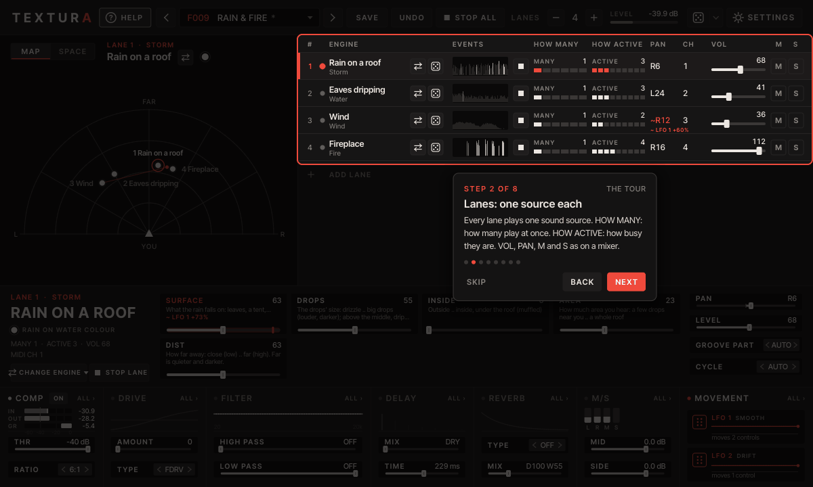

### MAP

The MAP is the place seen from above: a half circle, **YOU** (the triangle) at its centre at the bottom, **L** and
**R** at its sides and **FAR** at its top. Each lane is a dot with its number and its engine's name.

- **Left / right** is the lane's **PAN**.
- **Near / far** is the engine's **DIST** card, its distance, where the engine has one. An engine without a DIST card
  shows a hollow dot: then a drag moves its pan only.
- **Drag a dot** to move the engine: PAN and DIST together.
- A dot **glows** with the lane's last events. The selected lane has a red ring.
- **Lanes on one spot** fan out a little, so each dot shows and can be taken, and share one label: `1 Rain on water ·
  2 · 3 · 4`. A label that would cover another label or a dot moves to the other side, or is left out.
- With more than 8 lanes, a dot shows its number only. The selected lane and the one under the mouse show their names.

**The selected lane** is named at the top of the place: **LANE n · FAMILY**, its engine, the swap-icon button (the
[engine browser](#the-engine-browser)) and its source's colour dot (click it for the [colour](#colours) picker).

### SPACE

**SPACE** shows the same place in perspective. Switch with **MAP | SPACE | M/S** at the top left, or press **v**
(MAP, SPACE, M/S in turn).

- The listener stands at the bottom edge (**YOU**). Far engines are small, near the horizon (**FAR**).
- Each lane's events of the last 6 seconds drift away from it toward the horizon. A busy lane leaves a dense trail;
  a rare one leaves single marks.
- The lanes stand where the MAP puts them. Drag a lane on the ground to move it (pan and distance, as on the MAP).
- The MAP places an engine exactly; SPACE shows the place at a glance. Your DAW's project remembers which view was open.

### The M/S view

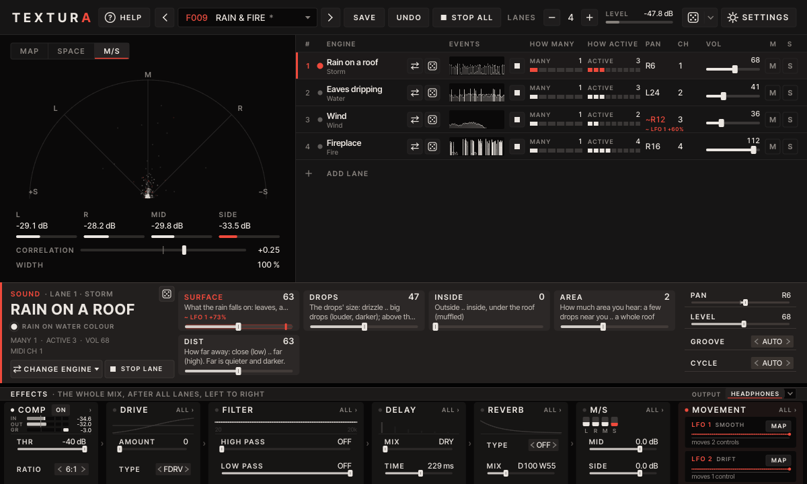

The third tab, **M/S**, shows the whole mix's stereo picture large, as it leaves the [M/S](#ms) (the last effect):

- **The scope**, a half circle: sound in the middle of both speakers rises straight up (**M**); a lane panned hard
  left or right leans toward **L** or **R** at 45 degrees; what differs between the speakers spreads to the sides
  (**+S**, **-S**). A tall, narrow cloud is centred; a wide one is spread. The picture follows the level, so a quiet
  mix still fills it.
- **L, R, MID, SIDE**: the peak of each in dB, with its bar (-48 to 0 dB; the sides' in red).
- **CORRELATION**, from -1 to +1, with the middle marked: near +1 the mix is close to mono; near 0 it is wide; left of
  the middle the sides cancel when the mix is played in mono.
- **WIDTH**: the M/S's WIDTH now (0 % while MONO is on).

The view only shows. MID and SIDE stay in the strip's M/S section and its drawer, WIDTH in the drawer. The place's dots and the
selected lane's name come back with MAP or SPACE; the selected lane is still in the drawer below.

### The lanes

One row for each lane in use, and **ADD LANE** under them (while there are fewer than 16). More rows than fit
scroll: turn the mouse wheel over them. A row shows, left to right:

| Column | What it shows |
| --- | --- |
| **#** | The lane's number and a dot in its engine's colour. The **selected lane**'s dot is solid red, its number red, its row lit with a red edge. Click the number or the dot to select the lane. |
| **ENGINE** | The lane's engine and its family (cut with `...` when long), then two small square buttons, at the same place on every row: the swap icon selects the lane and opens the [engine browser](#the-engine-browser) for it (the same on an empty lane); the **dice** gives the lane a random engine ([RANDOM](#random-the-dice)). On an empty lane the dice is dim. |
| **EVENTS** | The lane's **event line**: the last 6 seconds. A bar for each moment with events, as high as their loudness, over a faint band for the lane's level. A stopped lane reads **STOPPED**. |
| **(STOP / PLAY)** | A square button before HOW MANY, with no header. A playing lane shows a stop square: click it to stop that lane (HOW MANY and HOW ACTIVE go to OFF, as STOP ALL does, and the lane remembers them). A stopped lane shows a red play triangle: click it to play the lane again with the values it remembered, or, if it has none, as PLAY ALL starts a lane (HOW MANY 2, 1 or 1 for lanes 1 to 3, 1 for the others, at the rarest HOW ACTIVE). It selects the lane, as M and S do. On an empty lane it is dim and does nothing. STOP ALL and PLAY ALL work with it: PLAY ALL brings a lane you stopped back as it was. |
| **HOW MANY** | How many event makers the cloud has: six blocks for **1 2 4 10 19 32**; none lit is **OFF**. Click a block for that many (the top lit block again: one less, so the first block again is OFF). Drag along the blocks, or turn the wheel. |
| **HOW ACTIVE** | How busy each event maker is: nine blocks, rare to busy. Click, drag and wheel as HOW MANY. |
| **PAN** | The lane's pan (`L24`, `C`, `R16`). Drag it, wheel, double-click for the centre. Red with a `~` while a source moves it; its tags under it ([the movement](#the-movement)). |
| **CH** | The MIDI channel the lane listens on, OFF or 1 to 16. A click steps it ([MIDI](#6-midi)). |
| **VOL** | The lane's **LEVEL**, 0 to 127. Drag it, turn the wheel over it, or double-click for 100. |
| **M** | Mute. The lane goes silent but keeps playing, so it comes back at once. A preset keeps it, as on the FM-1. |
| **S** | Solo. While any lane is soloed, only the soloed lanes play. Alt-, Cmd- or Ctrl-click solos one lane alone (click it again that way to clear). The project keeps it. |

A click anywhere on a row selects its lane, the engine's name too. The controls in it (HOW MANY, HOW ACTIVE, PAN, CH,
VOL, M, S, STOP / PLAY) work as they did and select the row as well. Only the swap-icon button opens the engine browser;
the dice rolls the lane's engine. The up and down arrow
keys select too. LEVEL is the engine's, as on the FM-1: two lanes playing the same engine
share it.

**A stopped lane** reads **STOPPED** across its event line, with its HOW MANY and HOW ACTIVE at OFF. After **STOP
ALL**, each lane's own values stay beside the OFF, dim, with outlined blocks, and the drawer says `PLAY ALL: MANY 4 ·
ACTIVE 6`: **PLAY ALL** brings each lane back with exactly those. They are kept with the project and in a user
preset, so a project saved stopped plays the same again. A lane that had none (a landscape loads its lanes OFF) stays
stopped on PLAY ALL; if no lane has any, PLAY ALL does what the FM-1's REC does: the landscape's start, its first
three lanes at HOW MANY 2, 1 and 1 at the rarest HOW ACTIVE (the selected lane stays selected here). A landscape starts
with all four lanes stopped, as on the FM-1: the window says **ALL LANES STOPPED** under the rows and PLAY ALL turns
white. Press **PLAY ALL**, or set a lane's HOW MANY or HOW ACTIVE: that starts it.

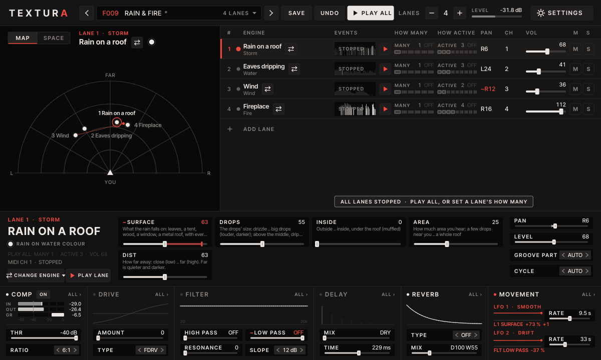

**One lane** stops and plays with its own button, in its row and in the drawer. Below, lane 2 is stopped by its button:
its play triangle is red, the others play on, and PLAY ALL still brings lane 2 back with its own values.

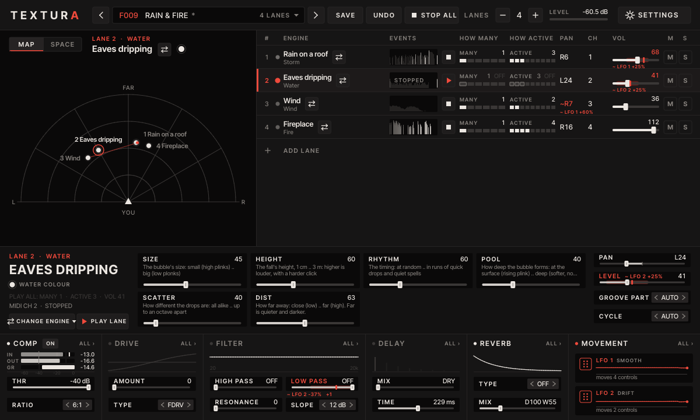

### The drawer

Under the place and the rows, the **drawer** shows the selected lane. It is the **SOUND** zone: a warmer, lighter
ground than the strip under it, a red rail along its left edge, its cards lifted off that ground.

- **At the left**: the tag **SOUND · LANE n · FAMILY**, the engine in large letters (a long name a size smaller, never
  cut), the engine's colour (click it for the picker), a
  line with MANY, ACTIVE, VOL and the lane's MIDI channel, STOPPED or MUTED, **CHANGE ENGINE** (the engine browser) and **STOP LANE** / **PLAY LANE**: the row's STOP / PLAY button again.
- **In the middle**: **every card** of the engine, up to eight, four to a row, each a fader. Each card shows its name,
  its value in its own unit, and what it does (the FM-1 manual's line for it, wrapped to the card; one too long for
  it shows whole when the mouse rests on the card; two lines, light enough to read at a glance). A card a source moves has a red name, its reach and live tick, and a tag for each source. The
  engine's **DIST** card is here too (the MAP's near and far).
- **At the right**: the lane's **PAN**, **LEVEL**, and its groove **PART** (named **GROOVE** there) and **CYCLE**
  ([the groove](MANUAL.md#the-groove)).

### The strip

The strip at the bottom is the **EFFECTS** zone: the whole mix, after all lanes. It is darker and cooler than the drawer,
under a dark gap and a band that says so: **EFFECTS · THE WHOLE MIX, AFTER ALL LANES, LEFT TO RIGHT**. It shows the
mix's effects in the order the sound goes through them, a small **›** between each and the next (COMP › DRIVE › FILTER ›
DELAY › REVERB › M/S), then the movement, on a tinted ground: it moves values and takes no sound. Each section has a
dot (lit while it acts), a small picture and its two main values. At the band's right end, where the mix leaves, is
OUTPUT ([BINAURAL](#binaural)).

| Section | Picture | In the strip | Its drawer (click the header) |
| --- | --- | --- | --- |
| **COMP** | Its meters, live: **IN** (its input level), **OUT** (its output), **GR** (the gain reduction, from the right, 24 dB the width), in dBFS with THR marked | ON / OFF, THR, RATIO | Big meters and its transfer curve, a dot where the input is on it now. LEVEL: THR, MAKEUP · TIME: ATTACK, REL · SHAPE: RATIO, ON |
| **DRIVE** | Its curve | AMOUNT, TYPE | Its curve. AMOUNT: AMOUNT, MIX · COLOUR: TONE, TYPE |
| **FILTER** | Its response, HIGH PASS then LOW PASS (dashed marks; red while an LFO moves one) | HIGH PASS, LOW PASS (in Hz) | Its response from 20 Hz to 20 kHz, each cutoff marked with its Hz. CUTOFF: HIGH PASS, LOW PASS · SHAPE: RESONANCE, SLOPE |
| **DELAY** | Its echoes | MIX, TIME | Its echoes: spaced by TIME, fading by FEEDBACK, each a cloud of GRAINS. TIME: TIME, FEEDBACK, SYNC, FREEZE · GRAINS: GRAINS, SIZE, SPRAY, SPREAD, REVERSE · COLOUR: PITCH, INTERVALS, TONE, GRAIN, MOD, MOD RATE · MIX |
| **REVERB** | Its tail (dim while TYPE is OFF) | TYPE, MIX | Its tail: after PREDELAY, as long as DECAY, as dense as SIZE. SPACE: SIZE, DECAY, PREDELAY · COLOUR: TONE, LOWCUT, SHIMMER, SHIFT, MOD · TYPE, MIX |
| **M/S** | Its meters, live: **L R M S** (the sides' in red) | MID, SIDE | The stereo picture, the correlation and the meters. LEVEL: MID, SIDE · WIDTH: WIDTH, MONO ([M/S](#ms)) |
| **MOVEMENT** | Two source tiles (the connected ones first): each one's grip, name, kind, live trace and how many controls it moves | a click on a tile: its mode | [the movement](#the-movement) |

**Click a section's header** (or **ALL ›**) to open its **drawer**. It rises from the strip in place of the lane's
drawer: a large live picture at the left, every parameter of the effect at the right in small titled groups. The place
and the rows stay above it and work as always (select a lane, drag a dot, set HOW MANY); the rows scroll. The open
section is lit with a red top edge and reads **CLOSE ×** (COMP, whose ON switch takes its head's room: **›** and **×**
alone). Click another section to switch; click CLOSE or press Esc to
close. MOVEMENT opens the same drawer with the tabs **LFO 1** to **LFO 8**, **ENV · FOLLOW** and **MATRIX**. What each
effect parameter does: [the effects](MANUAL.md#7-the-effects) in the FM-1 manual.

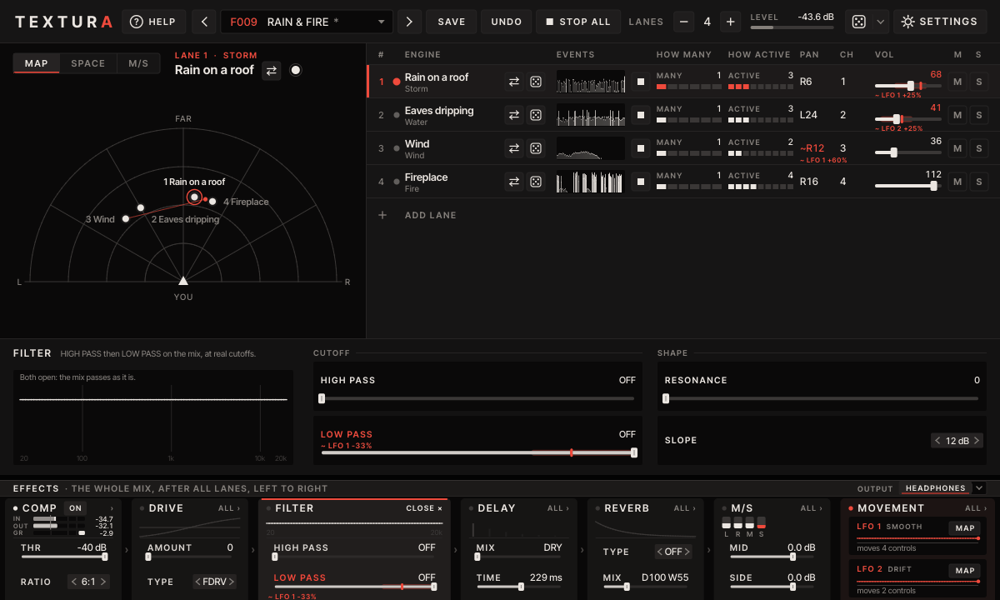

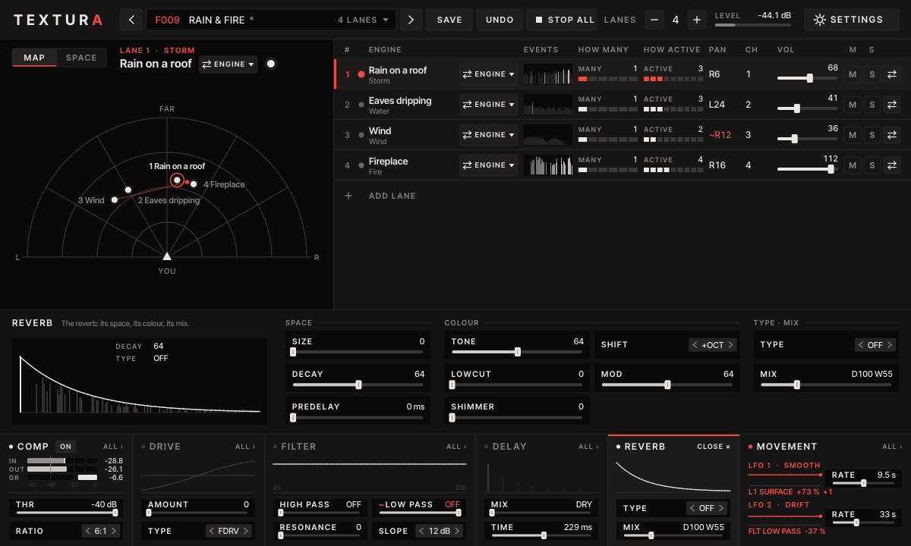

#### M/S

The last effect, after the reverb, on the whole mix: its middle (what both speakers share) and its sides (what differs
left to right), each with its own level, then WIDTH on the sides. At 0 dB, 100 % and MONO off it leaves the sound as
it is. MID, SIDE and WIDTH are separate: moving one never moves another.

- **MID** and **SIDE**: -inf to +6 dB in half-dB steps. On the fader 0 dB sits at three quarters (its mark), the
  last quarter is the boost.
- **WIDTH**: 0 to 200 % on the sides after SIDE: 0 % mono, 100 % as it is (its mark), 200 % twice as wide (the sides
  +6 dB). A project or preset saved before WIDTH was its own loads at 100 %.
- **MONO**: the mix in mono at one click (WIDTH reads 0 %); click again to go back. Moving SIDE or WIDTH turns it
  off, so you hear the change.
- **Double-click** a fader: back to 0 dB or 100 %. An LFO or an envelope can move MID and SIDE (the M/S MID and M/S
  SIDE targets), as any other control in its mode.

The drawer's picture shows the mix as it leaves: each dot a moment of the sound, up the middle and across the sides.
A tall, thin cloud is centred (near mono); a round, wide one is spread. The picture scales itself to the level, so a
quiet mix fills it too. **CORRELATION** under it reads +1 for mono, 0 for wide and below 0 when the sides cancel
(the mix gets thinner in mono). The meters **L R M S** show the left, right, middle and side peaks from -48 dBFS
to 0 dBFS.

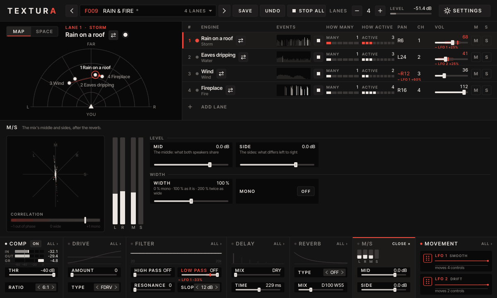

The COMP meters read the app's compressor itself: IN is the level its detector follows, OUT that level through its
gain (the make-up counted), GR its gain reduction. They rise fast and fall about 24 dB a second; IN keeps its peak
for a second. COMP off: they read OFF. Quiet lanes under THR show no gain reduction: lower THR to hear it act.

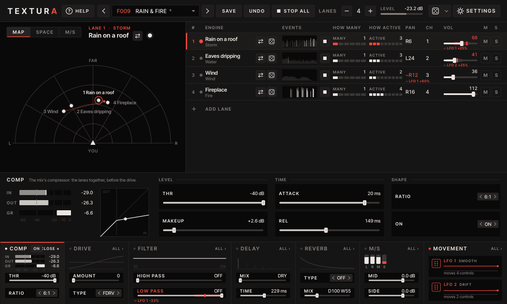

#### BINAURAL

How you listen. On headphones Textura places each lane binaurally, as your ears place a real sound: a lane panned to
one side reaches the far ear a little later and a little darker, the head's shadow, so the lanes stand apart around
your head instead of inside it.

**OUTPUT** sits at the right end of the EFFECTS band. **Click it** to switch between the two:

- **HEADPHONES** (the default in the plugin): each lane placed binaurally. For headphones.
- **SPEAKERS**: each lane placed by its level in the left and right channels alone, as a mixer pans. For speakers,
  and when you mix the plugin further in your DAW.

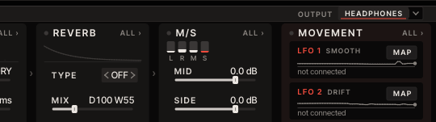

**Click its ▾** for the BINAURAL panel (a click outside closes it): OUTPUT again, and the two binaural settings:

- **AMOUNT**, 0 to 100 % (100 % at first): how much of the binaural placing. Less brings the far ear's delay, its
  shadow and the level difference back toward plain level panning; at 0 % HEADPHONES sounds exactly as SPEAKERS.
  Drag the slider, or turn the wheel over it.
- **HEAD SIZE**: **SMALL**, **MEDIUM** (at first) or **LARGE**, the head the placing is worked out for. A larger head
  delays the far ear more (up to 0.57, 0.66 or 0.75 ms at a hard pan) and shadows it from lower notes. Pick the one
  that sounds most natural to you.

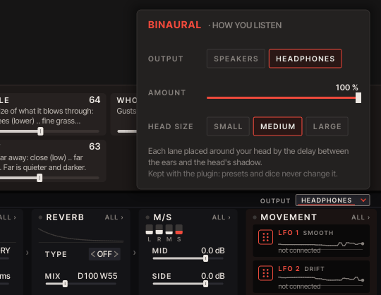

The same three are in [SETTINGS](#settings), BINAURAL. At the centre SPEAKERS and HEADPHONES are the same; only the
placing of panned lanes changes, never the sounds. All three are saved with the project, like the other settings, and
no preset load, undo or roll of the dice changes them. The host parameters are **OUTPUT**, **BINAURAL AMOUNT** and
**HEAD SIZE** (group **Output**).

### The movement

Twelve **sources** can move the window's controls: **LFO 1** to **LFO 8**, **ENV 1**, **ENV 2**, **FOLLOW 1** and
**FOLLOW 2**. A **link** is one source moving one control by an amount, from -100 % to +100 % of the control's range.
The app holds 16 links (its matrix). You connect sources to controls in a **source's mode**.

#### A source's mode

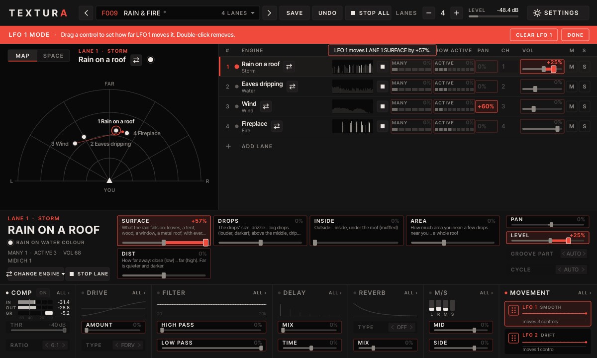

1. **Click a source's tile**: one of the two in the strip's MOVEMENT, the large one in an LFO's tab, or one over each
   envelope and follower in ENV · FOLLOW. The window enters **LFO 1 MODE**: a red bar under the top bar says so,
   with **CLEAR LFO 1** and **DONE**. The rest of the window moves down; the bar never covers a control.
2. Every control LFO 1 can move gets a thin red outline. One it cannot move is dimmed (a choice such as a TYPE or
   ON, the MIDI channel, and the lane values of lanes 5 to 16, which the matrix reaches only as ALL LANES).
3. **Drag a control.** You do not change its value: you set how far LFO 1 moves it. The value's handle turns grey,
   and a red reach runs from the value to a red end handle where the pointer is; the control's number shows the
   amount (`+25%`, or a dim `0%`). Left of the value is a negative amount. The fader is its own depth control, on
   the same scale: nothing larger than the control appears. The mouse wheel sets it in 4 % steps (1 % with Shift).
   HOW MANY and HOW ACTIVE show the reach on their blocks; a choice shows it under its value.
4. The link is made on the first drag, in the first free slot of the matrix. Drag back to the value (or near it),
   or **double-click** the control, and the link is removed. When all 16 slots are in use, a line says so and
   nothing changes.
5. **CLEAR LFO 1** removes all of LFO 1's links. **DONE**, **Esc**, or a click on the tile again leaves the mode.

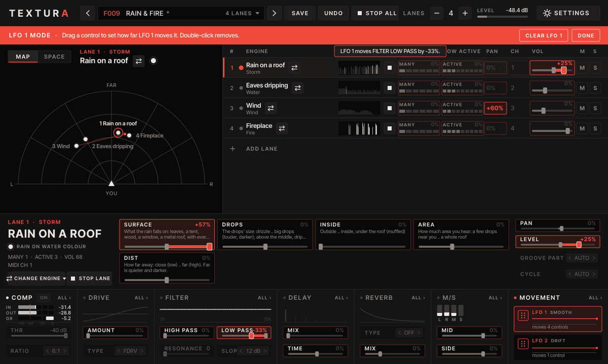

A short line over the rows says what each change did (`LFO 1 moves LANE 1 LEVEL by +25%.`), or why a control
cannot be moved.

#### Outside the mode

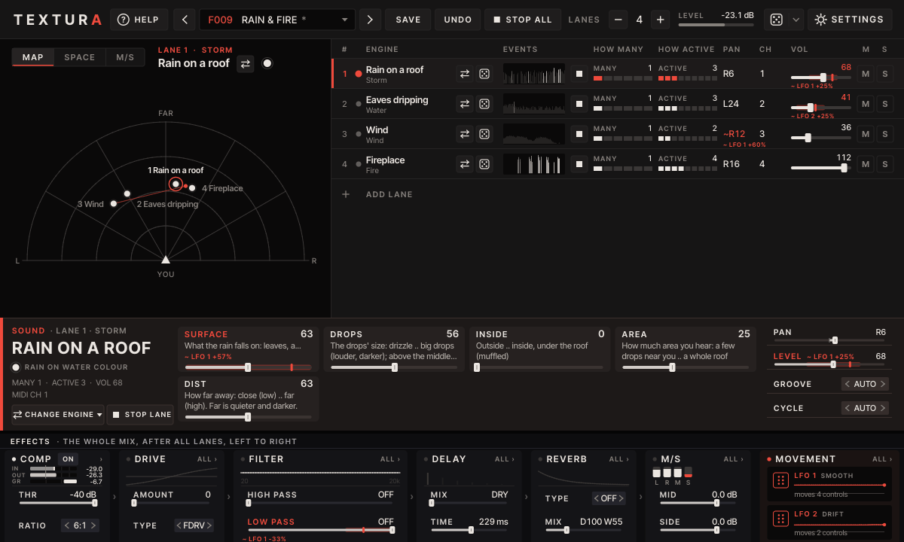

- **A control a source moves** has a red name, a faint red band on its fader (how far all its links reach) and a red
  tick that moves with the sources. A row's VOL and PAN, HOW MANY and HOW ACTIVE, a drawer card, an effect's value:
  all the same.
- **Small red tags** under it (`~ LFO 1 +25%`; `ALL` for a link on ALL LANES) say which sources move it.
  **Click a tag** to enter that source's mode. A source without a tile (velocity, a CC, ...) opens the MATRIX tab.
- **Each tile** says **moves 3 controls** or **not connected**, and traces its source live.
- **Shortcut: drag a tile's grip** (the red box of six dots) onto a control. The link is made at +25 % (one it had
  is kept) and the source's mode opens, ready to set the amount.
- **Right-click a control** (Control-click on a Mac): **Move with LFO 1** ... **Move with FOLLOW 2** enters that
  source's mode (a new link starts at +25 %; the menu shows the amounts it has), **Remove movement** removes the
  control's links. A control no source can move says so.
- **CLEAR ALL MOVEMENT**, at the right of the MOVEMENT drawer's tabs, asks once (**Remove all 5 links? CLEAR /
  KEEP**).
- **UNDO** in the top bar undoes the window's link changes first, one at a time (CLEAR ALL included), then the app's
  own undo. Every link is three host parameters (a matrix slot's SOURCE, TARGET and DEPTH): your DAW records them,
  its own undo sees them, and the project keeps them.

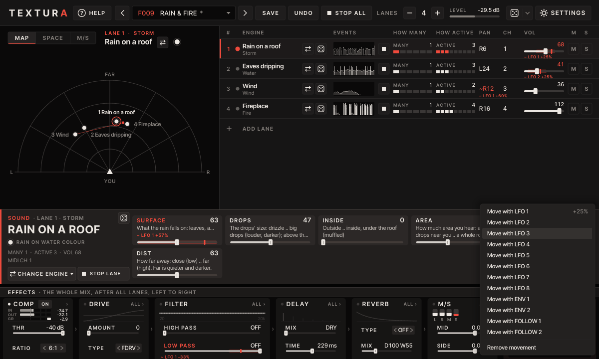

#### The MOVEMENT drawer

- **LFO 1** to **LFO 8**: the LFO's tile (its grip, the trace of the last seconds, red when it moves something; a
  click: its mode), how many controls it moves, its value **NOW**, what it moves (each target with its amount), and
  all ten parameters: SHAPE (SINE, TRI, SAW UP, SAW DN, SQUARE, PULSE, S&H, SMOOTH, DRIFT, GUSTS, CHAOS, STEPS), RATE,
  SYNC, MODE, PHASE, WIDTH, JITTER, FADE, RESTART, LEVEL. A tab is red while its LFO is routed.
- **ENV · FOLLOW**: a tile for each source over its parameters: **ENV 1** and **ENV 2** (TRIGGER, ATTACK, DECAY,
  RELEASE, SUSTAIN, CURVE, VARY, LOOP) and **FOLLOW 1** and **FOLLOW 2** (INPUT, ATTACK, RELEASE, GAIN).
- **MATRIX**: the 16 slots, **MOD 1** to **MOD 16**, each with SOURCE, TARGET, DEPTH and SPREAD (a slot in use is
  red), and **MOD CC** (the CC the matrix's CC source reads). Everything a source's mode does is here as plain
  slots, editable, with the sources the tiles do not have (velocity, mod wheel, aftertouch, CC, ACTIVE, RANDOM,
  CONSTANT), ALL LANES targets and SPREAD.

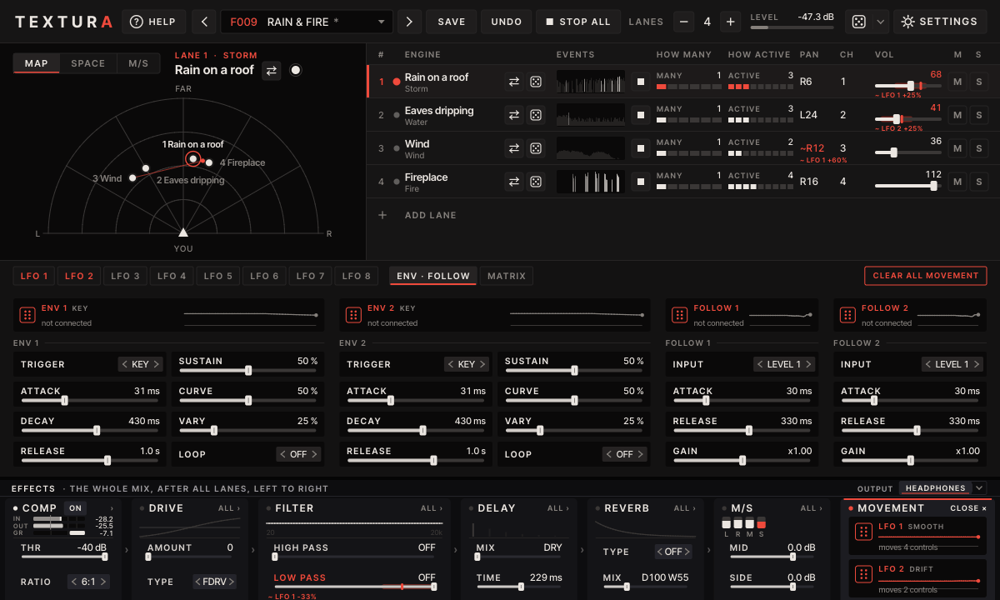

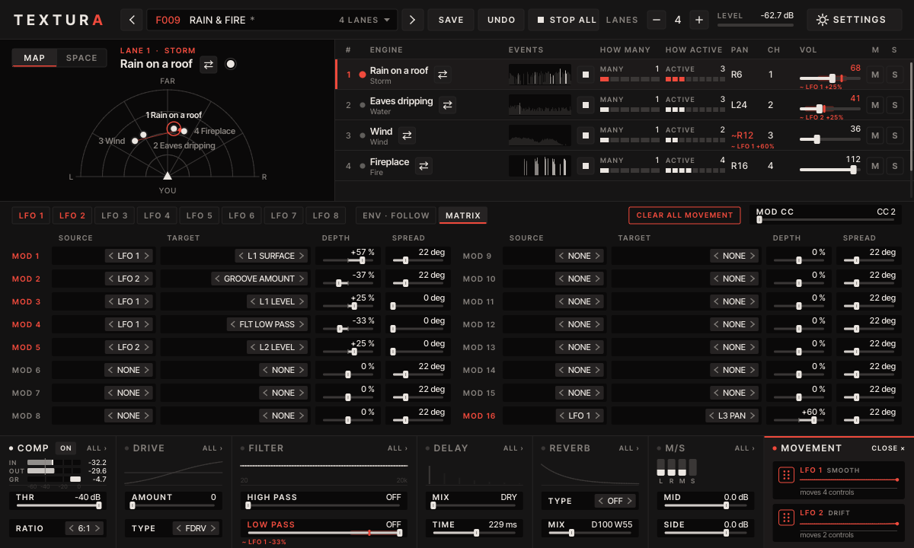

How the modulation works: [movement](MANUAL.md#8-movement-lfos-envelopes-followers-and-the-matrix) in the FM-1 manual.

### SAVE

**SAVE** in the top bar opens a small panel: the 16 user presets **U01** to **U16** with their names, a name field,
the dice and **SAVE**.

- It opens on the **first empty** user preset, with a new name of two words, such as **SALT FIELD** or **MOSSY
  DUSK**. A new name is never the name of one of your presets, so SAVE makes a new preset and changes none of the
  others.
- **The dice** right of the name: another name, a new one each click.
- **Type** the name: up to 11 letters, A to Z, 0 to 9, space and `- & ' .`. The first key replaces the new name (it
  is shown selected); Backspace deletes. Left empty, the preset takes the landscape's name.
- To **replace** a preset, click it: the name becomes its own, and the line under it says, in red, that SAVE
  replaces it. Click an empty one again and the new name is back.

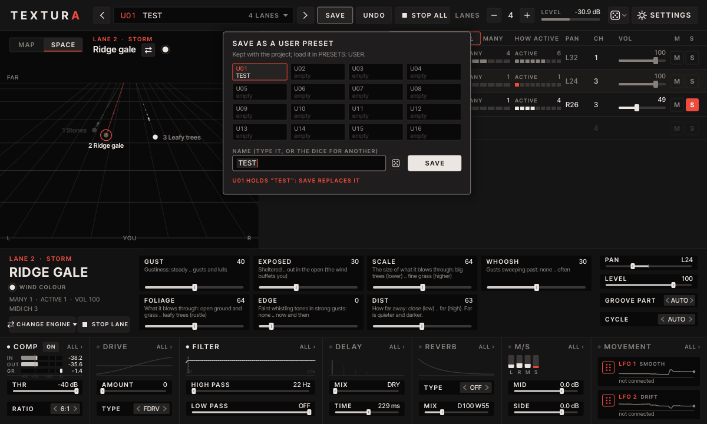

- When all 16 are used, the panel opens on the user preset loaded (else U01) and says that all 16 are used and SAVE
  replaces it.
- **SAVE** (or Return; a double-click on a slot) saves what plays into it, as the FM-1's SAVE does. The factory
  presets are never written over.
- The user presets are **kept with the project**. Load them in the presets browser, **MINE: User**, or by program
  change 100 to 115.

### RANDOM: the dice

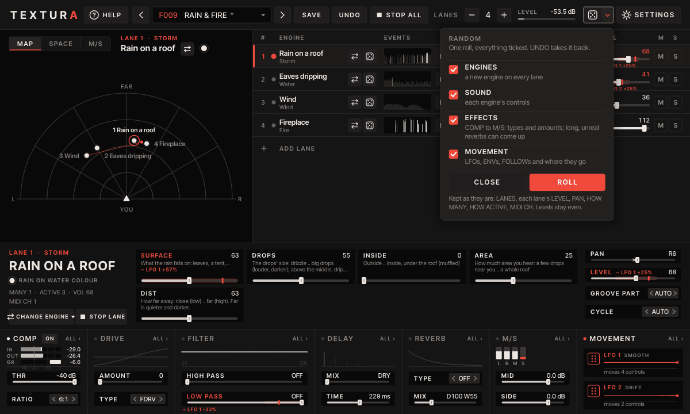

Two kinds of dice roll new sounds, as the FM-1's OCT- and OCT+ pressed together do.

- **A row's dice** (after the swap icon) gives that lane a random engine, from any family and never the one it had.
  Its cards start at the new engine's own values. The lane keeps its LEVEL, PAN, HOW MANY, HOW ACTIVE and MIDI CH.
- **The dice in the top bar** rolls in one click. Its arrow **▾** opens **RANDOM**, a small list with four ticks: what
  a roll changes. The ticks are kept; **ROLL** in the list rolls too. A roll changes everything ticked, on every lane
  in use. With **ENGINES** an empty lane gets a sound too and starts playing, sparse, somewhere on the map; a stopped
  lane stays stopped:

| Tick | What a roll changes |
| --- | --- |
| **ENGINES** | A new engine on every lane, each a different one where it can be |
| **SOUND** | Each engine's cards |
| **EFFECTS** | COMP to M/S: their types and amounts. A long, unreal reverb can come up |
| **MOVEMENT** | The LFOs, the envelopes and the followers, and 2 to 6 routes: what they move, and how far |

- A roll **keeps** LANES and each lane's LEVEL, PAN, HOW MANY, HOW ACTIVE and MIDI CH. Levels stay even (each
  engine's own trim), the limiter stays on, DRIVE and COMP's make-up stay moderate, and the movement's amounts stay
  moderate: a roll never silences the mix or jumps in level.
- The effects **glide** to their new values, as on a preset load. A new engine comes in as a preset's does.
- All four are ticked at first; the ticks are kept with the project. ROLL with nothing ticked does nothing and says so.
  The list stays open, so you can **ROLL** again; **CLOSE**, **Esc** or a click outside closes it.
- The preset name reads **RANDOM \***. **UNDO** takes a whole roll back in one step (a row's dice too). **SAVE** keeps
  a roll you like as a user preset.
- Each roll is a new one: no fixed sequence. Your DAW sees a roll as it sees a preset load: the values change, as
  one step.

### The engine browser

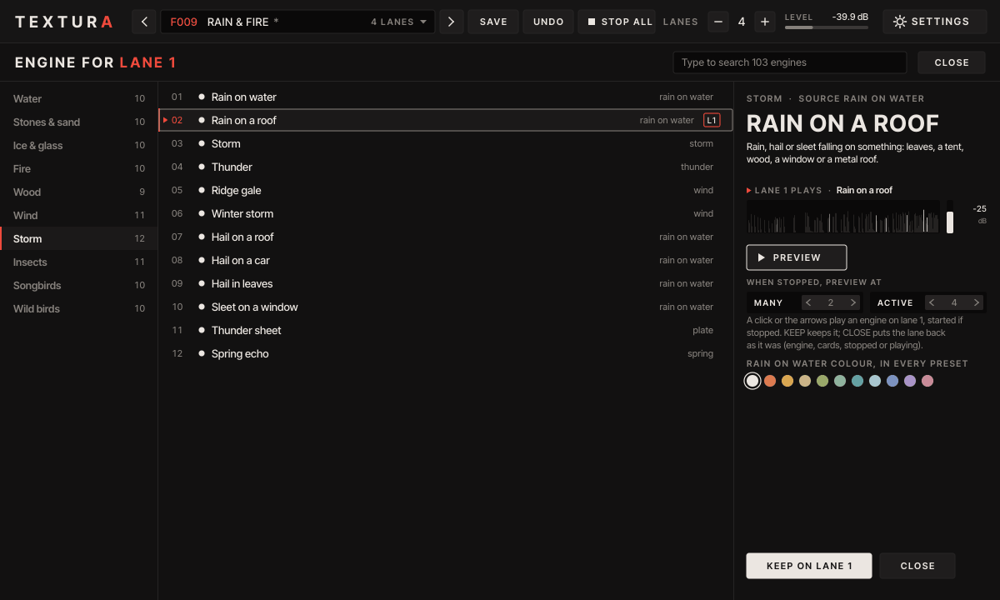

Opens from a lane's swap-icon button (in its row or at the top of the place), **CHANGE ENGINE** in the drawer, or with
**Return** for the selected lane. The header reads **ENGINE FOR LANE n**.

- **Left**: the ten families, with how many engines each has.
- **Middle**: the family's engines, each with its source at the right. **L1** (L2 ...) marks the engines lanes play now;
  **▶** marks the one the lane plays.
- **Right**: the engine under the cursor: its family and source, what it is in one line, the lane's live event line and
  level, **▶ PREVIEW** / **■ STOP**, the preview's **MANY** and **ACTIVE**, and its source's colour row.
- **Type** to search all 103 engines by name, family or source. Backspace deletes.
- **Up / down** move the cursor; **left / right** change the family; the wheel scrolls.

**Every engine you move to plays on the lane**: a click at once, the arrow keys once they rest, or **▶ PREVIEW**. A
stopped lane (or all lanes stopped) plays too: the lane starts at the preview's **MANY** and **ACTIVE** (2 and 4 at
first; the arrows set them, heard at once). A lane that plays keeps its own HOW MANY and HOW ACTIVE. The header says
**PREVIEW ON LANE n** and the engine's name. **■ STOP** stops the preview and puts the lane back.

- **KEEP ON LANE n** (Return, or a double-click) keeps the engine. The lane goes back to its own state: a stopped lane
  stays stopped, unless you set the preview's MANY or ACTIVE, which it then keeps. The scene shows `*`.
- **CLOSE** (Esc) puts the lane back exactly as it was: its engine, its cards, its HOW MANY and HOW ACTIVE, stopped
  or playing.

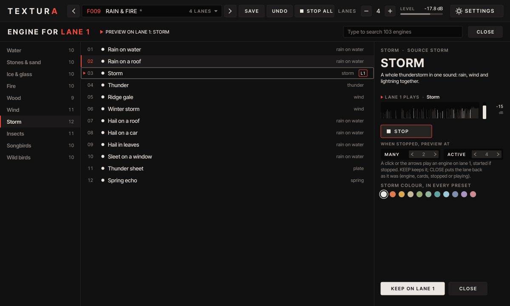

What each engine is and what its cards do: [the engines](MANUAL.md#5-the-sounds) in the FM-1 manual.

### The presets browser

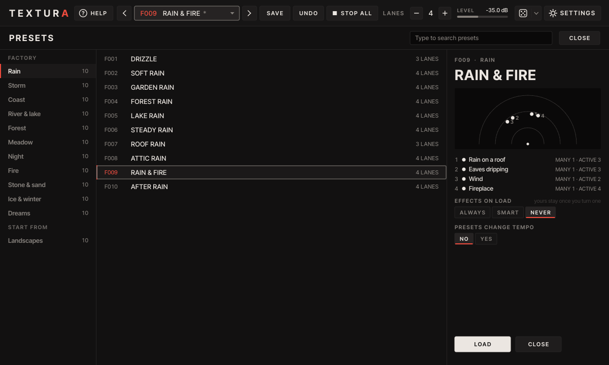

Opens from the scene name in the top bar.

- **Left**: **MINE** (your user presets, when there are any), **FACTORY**, the eleven families of presets (Rain, Storm,
  Coast, River & lake, Forest, Meadow, Night, Fire, Stone & sand, Ice & winter, Dreams), and **START FROM**, the ten
  **Landscapes**.
- **Middle**: the presets, each with its code and how many lanes it uses.
- **Right**: the preview. Where its lanes stand, and each lane's engine with its HOW MANY and HOW ACTIVE.
- **Type** to search; **up / down** move; **left / right** go to the next family.
- **LOAD** (Return, or a double-click) loads it. **CLOSE** (Esc) closes the browser.

A load works as on the FM-1 ([loading](MANUAL.md#loading)): it never cuts the sound, and new engines fade in lane by
lane. A factory preset, a landscape or an FM-1 scene fills lanes 1 to 4 and sets LANES to 4. A landscape starts
stopped, as on the FM-1: press PLAY ALL, or set a lane's HOW MANY.

Under the preview are the two load options, also in SETTINGS:

- **EFFECTS ON LOAD**: **ALWAYS** (the default: the preset brings its effects), **SMART** (it brings them until you change an
  effect yourself; then yours stay), **NEVER** (your effects stay). With SMART, loading the same preset again brings
  its effects back. (The FM-1's default is NEVER, for playing live.) A saved project keeps the choice it was saved
  with.
- **PRESETS CHANGE TEMPO**: **NO** / **YES**. With YES a preset brings its tempo too. Your DAW's tempo still leads
  when it gives one.

The 110 factory presets by family, and their effects: [factory presets](MANUAL.md#factory-presets) in the FM-1 manual.

### SETTINGS

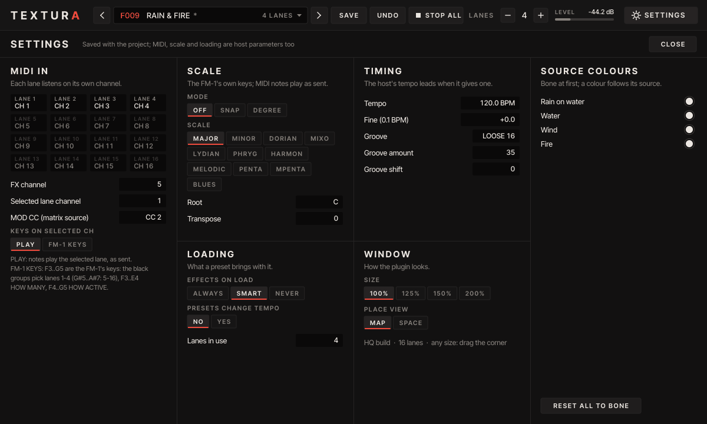

Seven groups, by function. All but SOURCE COLOURS, WINDOW and the tempo are host parameters too, so your DAW can
automate them. A box steps on a click (Shift- or Alt-click steps back), the wheel steps it, a double-click sets the
default. A row of choices takes a click.

| Group | What is in it |
| --- | --- |
| **MIDI IN** | Each lane's channel, **LANE 1** to **LANE 16**: CH 1 to CH 16 or OFF (dim for lanes not in use). **FX channel**: effects, tempo, groove and scale CCs, 5 at first. **Selected lane channel** (SELECTED CH): its notes play the selected lane, 1 at first. **MOD CC**: the CC the matrix's CC source reads, CC 2 at first. **KEYS ON SELECTED CH**: **PLAY** or **FM-1 KEYS** ([keys](#keys-fm-1-keys-or-play)). See [MIDI](#6-midi). |
| **SCALE** | **MODE** (OFF, SNAP, DEGREE), **SCALE** (MAJOR ... BLUES), **Root**, **Transpose**. As on the FM-1 ([SCALE](MANUAL.md#scale)). They act on the FM-1's own keys (and on FM-1 KEYS); MIDI notes in PLAY play as sent. |
| **TIMING** | **Tempo** and **Fine** (0.1 BPM steps): the plugin's own tempo, used when your DAW gives none (your DAW's tempo leads). **Groove**, **Groove amount**, **Groove shift** ([the groove](MANUAL.md#the-groove)). |
| **LOADING** | **EFFECTS ON LOAD**, **PRESETS CHANGE TEMPO** (as in the presets browser), **Lanes in use** (LANES). |
| **WINDOW** | **SIZE**: 100 %, 125 %, 150 %, 200 % (at 5:3; drag the corner for any other size). **PLACE VIEW**: MAP, SPACE or M/S. The last line names the build (HQ build, 16 lanes). |
| **BINAURAL** | **OUTPUT**: **SPEAKERS** or **HEADPHONES (BINAURAL)**; **Amount**, 0 to 100 %; **HEAD SIZE**: SMALL, MEDIUM, LARGE. How you listen, kept with the project, never in presets ([BINAURAL](#binaural)). |
| **SOURCE COLOURS** | The sources the lanes' engines run on now, each with its colour dot: click one to choose its colour. **RESET ALL TO BONE** sets them all back. |

Close SETTINGS with **CLOSE**, Esc or the SETTINGS button.

### Keys: FM-1 KEYS or PLAY

**KEYS ON SELECTED CH** (SETTINGS, MIDI IN; the host parameter `MIDI KEYS`) says what notes on SELECTED CH do:

- **PLAY** (the default): they play the selected lane as sent, like every lane's own channel. Your MIDI tracks play
  as they always did.
- **FM-1 KEYS**: notes **F3 to G5** are the FM-1's 27 keys in its LANDSCAPE mode. The **black keys** pick lanes 1 to
  4 by their groups (F#3 G#3 A#3: lane 1; C#4 D#4: lane 2; F#4 G#4 A#4: lane 3; C#5 D#5: lane 4); held for 0.6 s
  they mute or unmute it. The black keys above G5 pick lanes 5 to 16 (G#5 lane 5, A#5 lane 6, C#6 lane 7 ...). The
  **white keys F3 to E4** set the selected lane's HOW MANY (OFF, 1, 2, 4, 10, 19, 32), **F4 to G5** its HOW ACTIVE.
  Other notes on that channel still play the selected lane.

PLAY is the default because the DAW's notes are music: a track that plays the selected lane keeps playing it, and an
older project sounds as it did. Choose FM-1 KEYS to play the plugin from a keyboard the way you play the FM-1.

The window's selected lane and the app's are one: a lane picked in the window is the one SELECTED CH plays, and a
lane picked by the keys is selected in the window (its row scrolls into view).

### Colours

Every engine runs on a source, the physical model it is built on (the line at the right of its name in the engine
browser: rain on water, wind, fire ...). A colour belongs to a **source**, not to a lane: every engine of that
source, in every preset, takes it, for its dot, its event line and its row.

- Click the colour dot of the selected lane (at the top of the place or in the drawer), a dot in SOURCE COLOURS, or
  a colour in the engine browser.
- Eleven colours: **BONE** (the default), EMBER, AMBER, SAND, MOSS, SAGE, TEAL, ICE, SLATE, LILAC, ROSE. None is red:
  red is kept for the selection and the LFOs.
- Click a colour to set it; click anywhere else (or Esc) to close the picker.
- The project keeps the colours.

### LFOs

What a source moves is red, everywhere in the window:

- **In the strip's MOVEMENT**: two source tiles, the connected ones first, each with its grip, kind, live trace and
  how many controls it moves. `+n` in the header says how many more sources are connected.
- **A value a source moves** has a red name, its reach and live tick on its fader, and a red tag for each source
  ([the movement](#the-movement)); a row's PAN reads `~R12` while it moves.
- **On the MAP and in SPACE** a small red point and line show where the LFO has the lane right now; the white dot is
  where you put it.

### Keys and mouse

With the window focused and no panel open:

| Key | What it does |
| --- | --- |
| **Up / down** | Select the previous / next lane |
| **Return** | Open the selected lane's engine browser |
| **m** | Mute / unmute the selected lane |
| **s** | Solo / unsolo the selected lane |
| **v** | Switch MAP / SPACE / M/S, in turn |
| **Space** | PLAY ALL / STOP ALL |
| **Esc** | Close the right-click menu; leave a source's mode |

In the tour: **Right** or **Return** for the next step, **Left** for the one before, **Esc** to skip it.

In a browser: type to search, **up / down** (Page Up / Page Down: 10 at a time), **left / right** for the family,
**Return** to keep or load, **Esc** to close. In SAVE: type the name, **Return** saves, **Esc** closes. In RANDOM:
**Esc** closes. Some DAWs
keep the keys for themselves; the mouse does everything too.

## 5. Everything else: host parameters

Every host parameter is also in the window: the lanes in their rows and the drawer, the effects and the movement
in the strip, the MIDI, scale, timing and loading settings in SETTINGS. Your DAW lists the same parameters (its
generic view of the plugin) for automation, and MIDI CCs and NRPNs reach them too.

| Group (as the DAW lists it) | Parameters |
| --- | --- |
| **Scenes** | **PRESET**, F001 to F110 (loads a whole scene; not automatable) |
| **MIDI** | **MIDI KEYS**: PLAY or FM-1 KEYS (not automatable) |
| **Lane 1** ... **Lane 16** | `L1 ENGINE`, `L1 HOW MANY`, `L1 HOW ACTIVE`, `L1 LEVEL`, `L1 PAN`, `L1 CARD 1` to `L1 CARD 8`, `L1 GROOVE PART`, `L1 GROOVE CYCLE` |
| **Grain delay**, **Reverb**, **Compressor**, **Drive**, **Filter**, **M/S** | The effects, as on their FM-1 pages ([the effects](MANUAL.md#7-the-effects)) |
| **Groove**, **Keys**, **MIDI** | The groove, the scale, the MIDI channels, EFFECTS ON LOAD, LANES |
| **LFO**, envelopes, followers, matrix | LFO 1 to 8, ENV 1 and 2, FOLLOW 1 and 2, MOD 1 to 16, MOD CC |
| **Output** | **OUTPUT**: SPEAKERS or HEADPHONES; **BINAURAL AMOUNT** 0 to 100 %; **HEAD SIZE** ([BINAURAL](#binaural)) |

486 parameters in all. Their ids never change between versions, so automation stays put.

- **A lane's cards** (CARD 1 to 8) mean what the lane's engine says: a rain engine's cards are not a bird's. The FM-1
  manual lists every engine's cards ([the engines](MANUAL.md#5-the-sounds)). A card's value is 0 to 127 over the card's
  own range, as its CC.
- **An empty lane** shows neutral values: LEVEL 100, PAN centre, the rest 0.
- **Change ENGINE and a card in separate steps.** A new engine starts from its own cards, so a card value sent in the
  same instant as the ENGINE change is replaced by the new engine's default (as on the FM-1).
- **A change the plugin makes itself** (a MIDI CC, a program change, a preset load, a roll of the dice) goes back to
  your DAW as a parameter change.
- A modulation target names lane 1 to 4 or **ALL LANES**, as on the FM-1. ALL LANES reaches lanes 5 to 16 too.

## 6. MIDI

The plugin listens as the FM-1 does over USB MIDI ([MIDI](MANUAL.md#12-midi) in the FM-1 manual), with 16 lanes.

| MIDI | What it reaches |
| --- | --- |
| Notes, CCs, NRPNs on channel n (1 to 16) | Lane n (each lane's channel is set in SETTINGS, MIDI IN) |
| Notes on channel 1 | The selected lane (SELECTED CH) |
| CCs and NRPNs on channel 5 | The effects, the tempo, the groove and the scale (FX CHANNEL) |
| Program change on channel 1 | 0 to 99 load F001 to F100; 100 to 115 load U01 to U16; 116 to 125 load F101 to F110 |

- **Lane n on channel n.** By default each lane listens on its own channel: notes play it, CCs shape it. Put each
  lane on its own MIDI track, or play them all from one track with several channels.
- **Notes** play a lane as the FM-1's keys do in PLAY mode ([PLAY mode](MANUAL.md#10-play-mode-and-scales)): a note
  sets the size or pitch of the lane's events. The lane's cloud plays by itself, without notes, while it runs.
- **Layering.** Set two or more lanes to one channel: its notes and CCs reach all of them. **OFF**: the lane listens
  to nothing.
- **The selected lane.** Notes on SELECTED CH (channel 1 at first) play the selected lane, as on the FM-1: the lane
  selected in the window. With **KEYS ON SELECTED CH** at **FM-1 KEYS**, F3 to G5 on that channel are the FM-1's
  keys instead: they pick lanes and set HOW MANY and HOW ACTIVE ([keys](#keys-fm-1-keys-or-play)). Set SELECTED CH
  to OFF if channel 1 should reach lane 1 only.
- **SCALE** acts on the FM-1's keys, as on the FM-1: MIDI notes played on a lane (and on SELECTED CH in PLAY) play
  as sent.
- **Channel 5 is shared.** Lane 5 listens on channel 5 and so do the effects (FX CHANNEL 5, as on the FM-1). Both
  work there: the effects' CCs and the lanes' CCs use different numbers. Move FX CHANNEL if you want them apart.
- **Lane CCs**: 7 LEVEL, 10 PAN, 20 ENGINE, 21 HOW MANY, 22 HOW ACTIVE, 14 to 17 and 18, 19, 23, 24 the cards 1 to 8.
  The effect CCs on the FX CHANNEL: the [FM-1 table](MANUAL.md#effect-and-global-ccs-channel-5).
- **NRPN**: every parameter, as on the FM-1 ([NRPN](MANUAL.md#nrpn-every-parameter)): CC 99 the scope, CC 98 the
  index, CC 6 the value. Lanes 1 to 4 are scopes 0 to 3, as on the FM-1; **lanes 5 to 16 are scopes 16 to 27**. The
  globals (scope 4) add 68 to 79 LANE 5 to 16 CHANNEL, 80 FX CHANNEL, 81 LANES.
- **Velocity, mod wheel, aftertouch and the MOD CC** are matrix sources, as on the FM-1.
- **Tempo**: your DAW's tempo leads when it gives one; otherwise the plugin's own. The plugin does not take or send
  MIDI clock: the DAW's tempo replaces it.

## 7. Lanes

**LANES** (1 to 16) is how many lanes are in use. Set it with **LANES − / +** in the top bar, **ADD LANE** under the
rows, Lanes in use in SETTINGS, or the LANES parameter.

- **A lane past LANES is empty**: no engine, no CPU.
- **Raising LANES** adds empty lanes. Give each one an engine with its engine browser.
- **A new lane starts stopped.** Set its HOW MANY or HOW ACTIVE (`L5 HOW MANY` ..., or CC 21 / CC 22 on its channel)
  to start it. HOW MANY at OFF stops it again; its last events ring out.
- **An engine set on lane n** (from the DAW, or by CC 20 on its channel) raises LANES to n.
- **Lowering LANES** empties the lanes past it. Each one stops and its sound rings out naturally; nothing is cut.
- **Factory presets, landscapes and FM-1 scenes** fill lanes 1 to 4, exactly as on the FM-1, and set LANES to 4.
  A plugin scene keeps all its lanes.

## 8. Saving

Your DAW saves the plugin with the project, and its own preset function saves it too. The plugin keeps:

- what a user preset keeps on the FM-1: the landscape, each lane's engine, HOW MANY, HOW ACTIVE, level, pan, mute and
  cards, the effects, the modulation, the groove and the tempo;
- the preset loaded last, the scale, the MIDI channels, EFFECTS ON LOAD, PRESETS CHANGE TEMPO, OUTPUT, BINAURAL
  AMOUNT and HEAD SIZE;
- your user presets, U01 to U16 ([SAVE](#save));
- KEYS ON SELECTED CH, the selected lane;
- the window's own: the solo, the size, MAP, SPACE or M/S, the sources' colours and RANDOM's ticks.

Opening the project brings it all back, its effects included.

The plugin writes nothing to disk itself: the user presets live in the project. To use them in another project, save
your DAW's preset of the plugin, or load the project's state there. A project saved by an earlier, 4-lane plugin still
opens: lanes 1 to 4 as saved, LANES 4.

## 9. Sound, CPU and latency

- **Sample rates.** Textura computes at 44.1 kHz in blocks of 256 samples, as on the FM-1. At 44.1 kHz you hear
  exactly that. At 48 kHz and its multiples (88.2, 96, 176.4, 192 kHz and up) a high-quality resampler converts it;
  any other rate works too.
- **Latency.** Constant: 258 samples at 44.1 kHz, 325 at 48 kHz (one block and the resampler). The plugin tells your
  DAW, which compensates. Notes act from the start of the block that holds them, as on the FM-1.
- **CPU.** Light. On an Apple M-series Mac at 48 kHz, four heavy lanes take about 1 % of one core, sixteen heavy lanes
  about 3 %. Empty lanes cost nothing.
- **Instances.** Up to 16 Textura instances play in one DAW process. A 17th stays silent and says so in the DAW's log.
- **Levels.** As on the FM-1, the default start is quiet, every engine is about equally loud, and a limiter at the end
  keeps the output from clipping ([sound and volume tips](MANUAL.md#11-sound-and-volume-tips)).

## 10. Known limits

- **The window on Windows and Linux** is drawn by the same code as on macOS, and its pictures match macOS's, but it
  has not been tried on a real Windows or Linux desktop yet. If it does not open, use your DAW's generic parameter view.
- **User presets belong to their project.** A new project starts with none; use your DAW's presets to carry them.
- **The map's distance** is the DIST card's value (0 to 127), not metres: the app has no metres to show.
- **Setting a preset and modulated cards in the same instant** can leave a card the matrix holds at the engine's
  default instead of the scene's value. Set them a moment apart.
- **Audio Unit**: `auval` gives one warning ("Preset name is not retained in retrieved class data"). It is harmless.
- **The files are not signed** (macOS, Windows): clear the download flag as in [install](#2-install).
- **More than 16 instances** in one DAW process: the 17th plays silence.

## 11. Differences from the FM-1

| | FM-1 | Plugin |
| --- | --- | --- |
| **Lanes** | 4 | 1 to 16 (LANES) |
| **Thinning** | The CPU governor may thin a busy lane | Never (HQ build) |
| **OUTPUT** (binaural) | SPEAKERS at first (the OUTPUT page) | HEADPHONES at first (the EFFECTS band's right end, SETTINGS) |
| **Playing** | Keys: lanes, HOW MANY, HOW ACTIVE, mute; PLAY mode | MIDI notes on each lane's channel play it as in PLAY mode; FM-1 KEYS on SELECTED CH plays the keys' way; the window's HOW MANY and HOW ACTIVE blocks |
| **Starting** | REC starts and stops the lanes | PLAY ALL / STOP ALL (REC); a factory preset's lanes start when it loads, a landscape's start stopped; HOW MANY or HOW ACTIVE starts a lane |
| **Editing** | Pages and knobs | The window: every parameter, in the rows, the drawer, the strip and SETTINGS |
| **Solo** | No | **S** on each row |
| **Lane channels** | LANE 1 to 4 CHANNEL | LANE 1 to 16 CHANNEL, FX CHANNEL |
| **Tempo** | Its own, tap, MIDI clock in and out | The DAW's tempo leads; no MIDI clock |
| **Saving** | U01 to U16 in flash, settings kept by themselves | SAVE: U01 to U16 in the project; the DAW's project or presets |
| **Undo** | Hold SAVE | UNDO (a load, an engine kept, a roll); your DAW's undo for window edits (host parameter changes) |
| **Random** | OCT- and OCT+ together: everything at once (with the sound browser open: that lane's engine) | The dice: one on each row, RANDOM in the top bar (all four ticked at first) |
| **Sample rate** | 44.1 kHz | Any; 44.1 kHz inside |
| **Screen colour, clock, status line** | DISPLAY, MIDI CLOCK pages | Not in the plugin |
| **Look** | One accent colour | Dark, red for selection and LFOs, a colour per engine |

The engines, the presets, the landscapes, the effects, the modulation and the groove are the same. A 4-lane scene
plays in the plugin as on the FM-1, with nothing thinned.

## 12. If something goes wrong

- **The DAW does not list Textura**: check the folder ([install](#2-install)), clear the download flag (macOS) or
  Unblock the files (Windows), and rescan. For the Audio Unit run `killall -9 AudioComponentRegistrar`.
- **No sound**: load a preset (its lanes start at once). A landscape starts stopped (the rows read STOPPED):
  press PLAY ALL. A lane you added starts stopped: set its HOW MANY or HOW ACTIVE. Check the row's VOL and M, a solo on another lane (**S**), and the effects: a filter turned far down, a
  MIX at WET with the effect off.
- **A lane does not answer its track**: compare the track's MIDI channel with the lane's CH. Channel 1 notes go to
  the selected lane (SELECTED CH).
- **The effects change when I play lane 5**: lane 5 and the effects share channel 5, but not their CC numbers. Move
  FX CHANNEL in SETTINGS if your controller sends effect CCs on channel 5.
- **A preset changed my effects / did not change them**: EFFECTS ON LOAD (the presets browser or SETTINGS).
- **Everything moves on its own**: an LFO, envelope or follower is routed. Red values show what moves; open the
  strip's MOVEMENT, MATRIX, and set the slot's SOURCE to NONE.
- **The keys change HOW MANY instead of playing**: KEYS ON SELECTED CH is at FM-1 KEYS (SETTINGS, MIDI IN).
- **The events fall into a rhythm**: that is the groove. Turn Groove amount down (SETTINGS, TIMING).
- **A 17th instance is silent**: 16 per DAW process is the limit.
